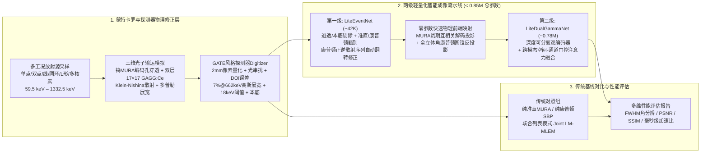
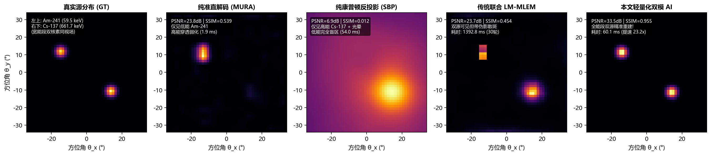
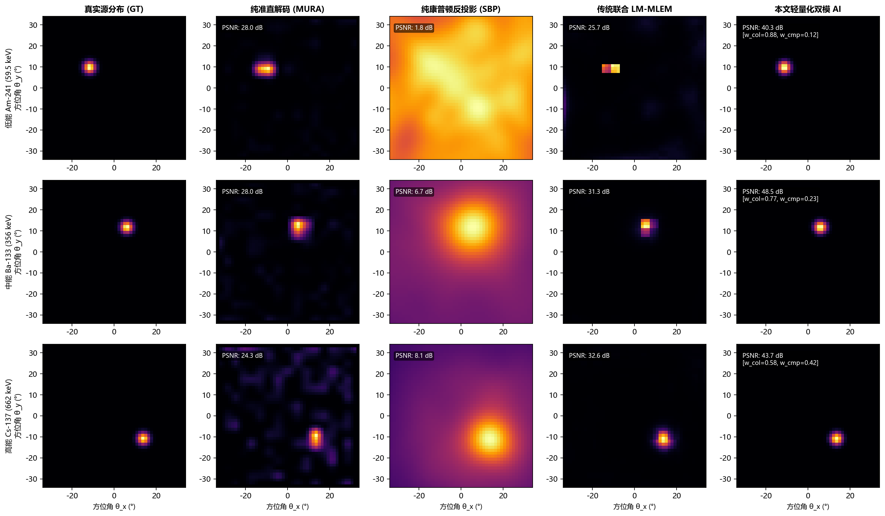
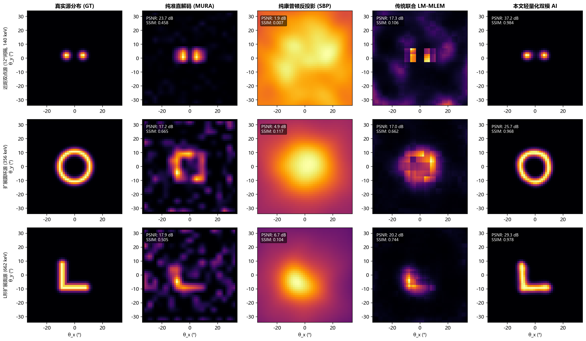
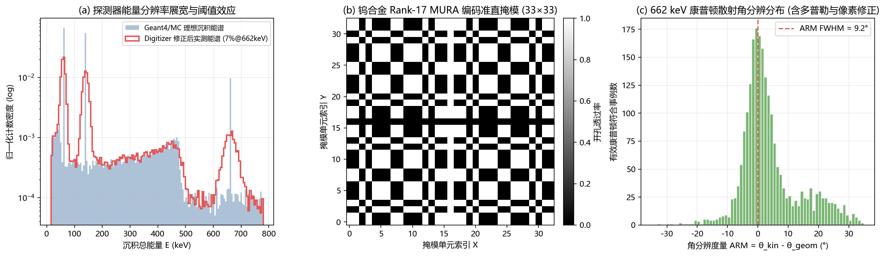
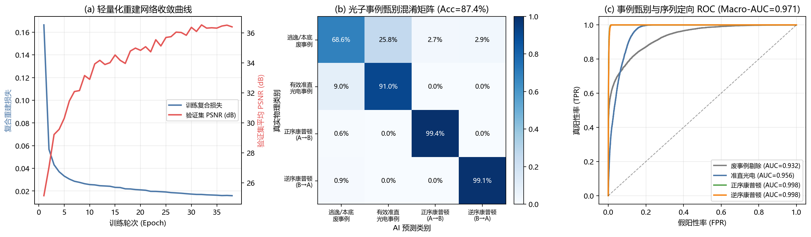
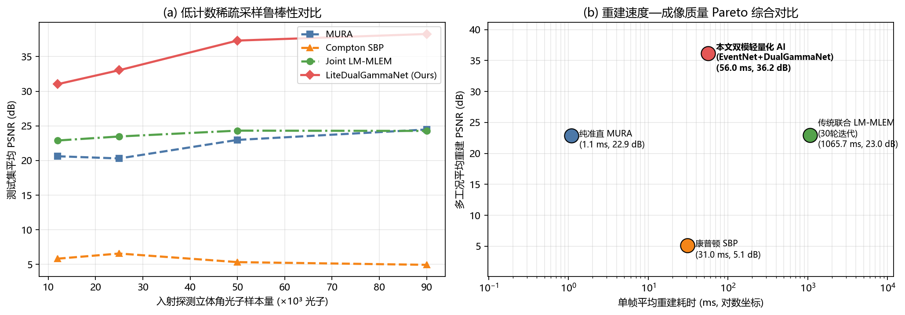

# 像素化阵列准直-康普顿双模智能伽马成像原型系统 (`demo` 分支)

> **课题名称**：基于像素化阵列探测器的准直孔和康普顿散射智能伽马成像算法研究  
> **指导教师**：韩纪锋 研究员（四川大学原子核科学技术研究所 / 720所）  
> **系统定位**：覆盖 **“三维蒙特卡罗物理输运 $\to$ 真实探测器物理退化修正 (Digitizer) $\to$ 光子作用事例智能甄别解析 (`LiteEventNet`) $\to$ 物理引导双分支跨模态轻量化重建 (`LiteDualGammaNet`) $\to$ 传统迭代算法对比与实时交互演示”** 全链路的完整算法原型系统。

---

## 1. 一键运行指南

### 1.1 启动交互式实时仿真与重建可视化平台（推荐演示使用）
双击 `demo/run_demo.bat`，或在仓库根目录运行：
```bash
streamlit run demo/app.py
```
在浏览器界面中可自由切换 **低能 $^{241}\text{Am}$、中能 $^{133}\text{Ba}$、高能 $^{137}\text{Cs}$、近距双点源、扩展圆环/L形面源、宽能段多核素同场** 等工况，实时调节探测器能量分辨率 FWHM、DOI 误差、触发阈值与本底比例，直观对比传统反投影、联合 LM-MLEM 与轻量化双模 AI 的重建效果及毫秒级耗时。

### 1.2 重新运行全流程数据生成、模型训练与基准评测
```bash
# 1. 多工况数据生成 + 两级轻量化神经网络从头训练
python -m demo.train_pipeline

# 2. 运行 80 组多工况定量基准测试并自动生成 6 张论文级对比图与评估报告
python -m demo.evaluate_benchmark
```

---

## 2. 系统总体架构



---

## 3. 核心评测图集预览

> 详细定量指标表与物理分析见自动生成的完整评估报告：[`results/performance_report.md`](./results/performance_report.md)

### (1) 宽能段多核素同视场混合重建（Am-241 59.5 keV + Cs-137 662 keV + Co-60 1.33 MeV 线源）


### (2) 低能 / 中能 / 高能全谱段单源适应性与跨模态门控权重自适应切换


### (3) 近距双点源角分辨与复杂扩展源（圆环、L形面源）形态恢复


### (4) 探测器物理退化修正与第一级光子作用事例甄别性能



### (5) 低计数稀疏采样鲁棒性与推理速度—精度 Pareto 对比


---

## 4. 代码工程目录结构

```text
demo/
├── configs/system_config.yaml         # 探测器几何、钨MURA准直孔、Digitizer退化与训练配置
├── src/
│   ├── physics/
│   │   ├── cross_sections.py          # NIST XCOM标定GAGG:Ce与W截面、Klein-Nishina与多普勒抽样
│   │   ├── geometry_and_sources.py    # Gottesman-Fenimore Rank-17 MURA掩模与多形状源生成器
│   │   ├── mc_simulator.py            # 矢量化三维光子输运模拟引擎
│   │   └── digitizer.py               # 真实像素阵列物理退化修正器与16维运动学特征构造
│   ├── baselines/
│   │   └── traditional_recon.py       # MURA解码、全立体角归一化康普顿SBP、联合LM-MLEM迭代算法
│   ├── models/
│   │   ├── event_net.py               # 第一级光子作用事例四分类甄别与散射序列解析网络
│   │   └── dual_gammanet.py           # 第二级双分支跨模态门控注意力轻量化重建网络
│   └── dataset.py                     # 双模特征映射与各向同性旋转增强数据集封装
├── geant4_interface/                  # 标准 C++ Geant4 宏文件模板与 CSV Hit 流无缝转换脚本
├── train_pipeline.py                  # 一键多工况数据集构建与两级网络训练流水线
├── evaluate_benchmark.py              # 80场景定量评测、6张高清对比图与评估报告生成脚本
├── app.py                             # Streamlit 交互式实时伽马成像工作台
├── run_demo.bat                       # Windows 双击一键启动演示脚本
├── checkpoints/                       # 预训练轻量化模型权重 (~3.2 MB)
└── results/                           # 定量指标 JSON、Markdown 性能评估报告与 PNG 图集
```
