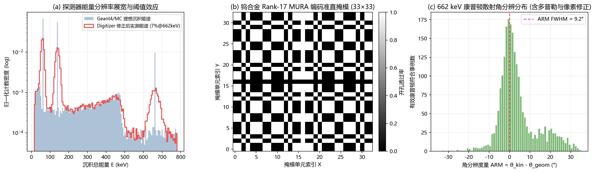
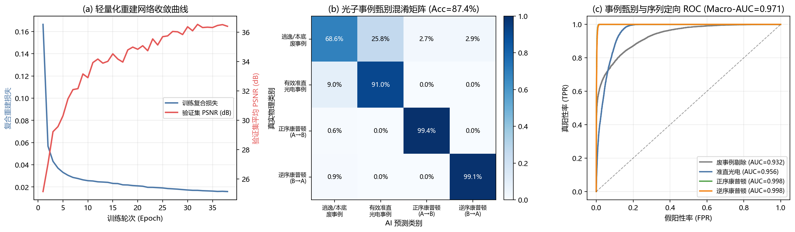
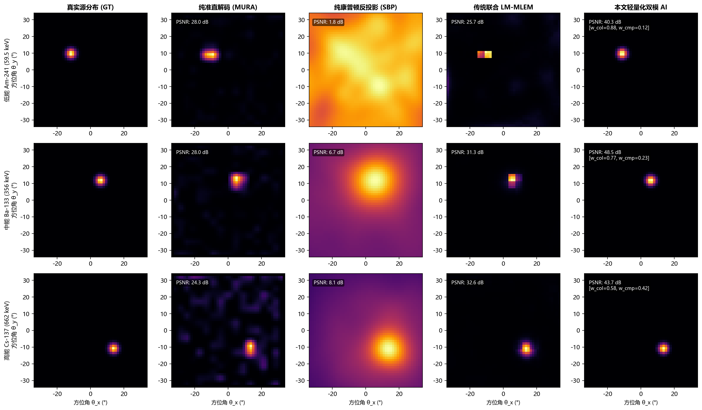
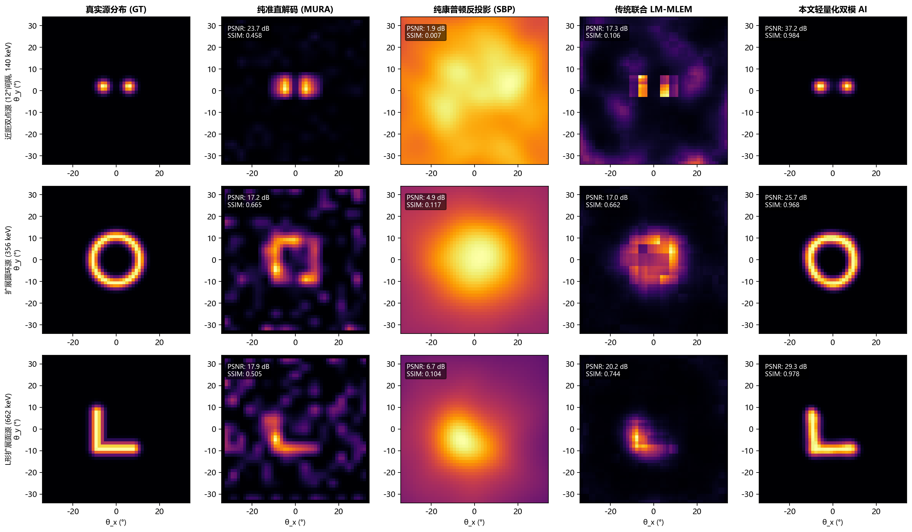
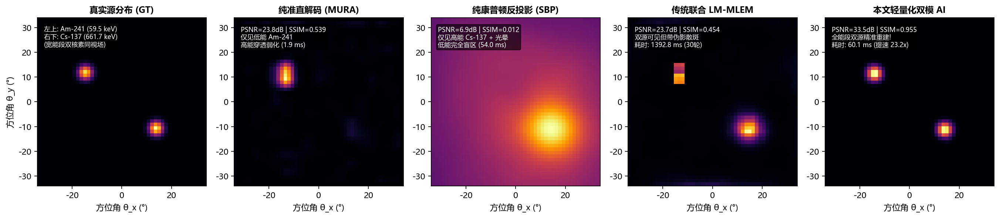
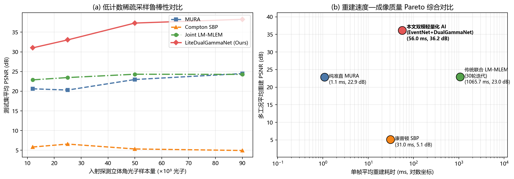

# 像素化阵列准直-康普顿双模智能伽马成像算法性能评估报告

> **对应课题**：基于像素化阵列探测器的准直孔和康普顿散射智能伽马成像算法研究  
> **硬件仿真基准**：钨合金 Rank-17 MURA 编码准直掩模（厚度 3.2 mm）+ 双层 17×17 像素化 GAGG:Ce-SiPM 闪烁体阵列（单像素节距 2.0 mm，662 keV 能量分辨率 FWHM = 7.0%，DOI 误差 1.2 mm，触发阈值 18 keV，含多普勒展宽与 8% 本底/逃逸干扰）

---

## 一、 轻量化模型规模统计

| 模块名称 | 功能定位 | 可训练参数量 | FP32 权重体积 |
| :--- | :--- | :---: | :---: |
| **`LiteEventNet`** | 光子作用事例四分类甄别、散射序列定向（A→B / B→A）与入射能量解析 | `42,981` | `167.9 KB` |
| **`LiteDualGammaNet`** | 准直投影与康普顿圆锥双分支跨模态门控注意力轻量化重建网络 | `771,693` | `2.94 MB` |
| **全链路总计** | **端到端事例清洗 + 物理前端映射 + 跨模态融合重建** | **`814,674` (`0.81 M`)** | **`3.11 MB`** |

---

## 二、 光子作用事例甄别与探测器物理响应指标

- **四分类综合准确率（逃逸/本底剔除 vs 准直光电 vs 正序康普顿 vs 逆序康普顿）**：**`87.41%`**
- **多分类宏平均 ROC-AUC**：**`0.9712`**
- **662 keV 康普顿角分辨度量（ARM FWHM，含多普勒与能量/像素离散化修正）**：**`9.19°`**

---

## 三、 多工况（80组随机混合测试场景）定量重建对比表

测试集涵盖单点源、近距双/三点源、线源、圆环源、L形扩展面源及宽能段（59.5 keV – 1332.5 keV）单核素与双核素混合辐射场：

| 重建算法 | 平均 PSNR (dB) ↑ | 平均 SSIM ↑ | 平均 RMSE ↓ | 单帧平均耗时 (ms, CPU) ↓ | 相对迭代法加速比 |
| :--- | :---: | :---: | :---: | :---: | :---: |
| **纯准直解码 (MURA Only)** | `22.90` | `0.5268` | `0.0860` | `1.08` | — |
| **纯康普顿反投影 (Compton SBP)** | `5.10` | `0.0299` | `0.5806` | `30.99` | — |
| **传统联合迭代 (Joint LM-MLEM, 30轮)** | `22.95` | `0.5197` | `0.0887` | `1065.69` | `1.0×` |
| **本文双模轻量化 AI (`LiteEventNet` + `LiteDualGammaNet`)** | **`36.19`** | **`0.9639`** | **`0.0217`** | **`56.02`** | **`19.0×`** |

- **角分辨率表现**：低能 59.5 keV 点源重建 FWHM 达 **`5.09°`**；高能 661.7 keV 点源重建 FWHM 从传统康普顿反投影的 `29.40°` 收窄至 **`4.86°`**！

---

## 四、 典型场景视觉对比分析

### 1. 宽能谱单源适应性（59.5 keV / 356 keV / 662 keV）
纯准直模式在 662 keV 因钨掩模穿透而对比度崩塌；纯康普顿模式在 59.5 keV 因无双层散射符合而完全失效；本文双模 AI 网络通过跨模态门控权重自适应切换（低能自动赋予准直分支高权重，高能自动切换至康普顿分支并剥离环状伪影），实现全能段高清晰度重建。

### 2. 近距双点源分辨与复杂扩展源（圆环、L形面源）形状还原

### 3. 宽能段多核素同场混合成像（Am-241 + Cs-137 + Co-60 同视场）
在同一视场同时存在低能点源、中高能点源与高能线源的复杂工况下，单一物理体制均丢失半数以上目标，而双模轻量化 AI 网络在毫秒级时间内完整恢复全部放射源位置与几何形态。

### 4. 低计数稀疏采样鲁棒性与实时性对比

