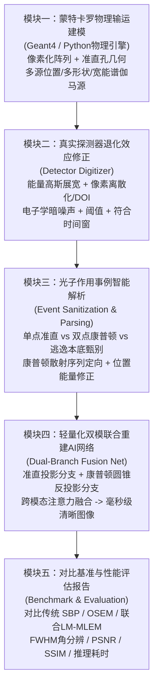

# 项目白话通俗拆解与核物理 + AI 全链路深度解读

> **阅读目标**：看完这篇文档，无论你之前对“核探测器、准直孔、康普顿散射、蒙特卡罗、MLEM迭代重建”熟不熟悉，都能**从第一性原理彻底搞懂韩纪锋老师这个项目到底在干什么、为什么要这么做、难在哪里、以及我们的代码和网络具体处理什么数据**。

---

## 一、 先用三分钟大白话讲透：这到底是个什么东西？

想象一下你在核电站巡检、海关安检、医院核医学科或者核应急现场，房间里藏着看不见、摸不着的**伽马射线放射源**（比如泄漏的放射性管道、丢失的放射源 $^{137}\text{Cs}$ / $^{241}\text{Am}$，或者注入病人体内的肿瘤靶向核药）。
普通的光学相机靠玻璃透镜把可见光折射聚焦到 CMOS 传感器上拍出照片；**但伽马射线能量比可见光高几万到几百万倍，任何光学透镜它都像穿空气一样直接射穿，根本没法折射聚焦！**

那怎么给伽马射线“拍照片”（即**伽马成像 Gamma Imaging**，找出放射源在哪、长什么形状、有多强）？人类发明了两种完全不同的办法：

### 办法 A：准直孔成像（机械准直 —— 相当于“小孔成像 / 带铅百叶窗看世界”）
- **怎么干**：在探测器前面挡一块很厚的重金属钨板或铅板，上面钻一个小孔（**针孔 Pinhole**）或者按特定数学规律打一排孔（**编码孔径 Coded Aperture**）。斜着飞来的伽马光子全被钨板吸收挡死，只有正对着孔飞来的光子能穿过孔打在后面的探测器像素上，直接投出放射源的“影子”。
- **优点**：**拍低能量伽马射线特别清楚！**（分辨率高，源是点、是线还是圆环一眼看清）。
- **致命缺点**：
  1. **太浪费光子（灵敏度极低）**：99% 以上的光子都被铅/钨板挡在门外，放射源稍微弱一点就要拍几十分钟；
  2. **视野窄**：只能拍正前方一小块区域；
  3. **怕高能射线**：一旦遇到高能伽马射线（比如 $^{137}\text{Cs}$ 的 $662\text{ keV}$ 或 $^{60}\text{Co}$ 的 $1.33\text{ MeV}$），光子像穿纸一样把钨板直接射穿，影子糊成一片白茫茫的伪影，彻底失灵！

### 办法 B：康普顿散射成像（电子准直 —— 相当于“通过台球碰撞轨迹反推母球从哪打来”）
- **怎么干**：扔掉笨重的铅板，摆**前后两层（或三维多层）像素化探测器阵列**。一个伽马光子飞进来，先在第一层某个像素点 $\mathbf{r}_1$ 撞击一个电子（**康普顿散射**），留下一部分能量 $E_1$ 后改变方向飞向第二层，在像素点 $\mathbf{r}_2$ 被完全吸收并留下剩余能量 $E_2$。根据初高中动量守恒与相对论能量守恒公式，只要测出 $E_1$ 和 $E_2$，就能精确算出光子拐弯的角度 $\theta$！把 $\mathbf{r}_2 \to \mathbf{r}_1$ 连成轴线，张开 $\theta$ 角画一个**圆锥面**——放射源必定在这个圆锥面上！收集几百上千个光子，所有圆锥面交汇最密集的焦点，就是放射源的位置！
- **优点**：**不用挡光子，效率高几十倍！视野超大（甚至 $360^\circ$ 全景）！而且越是中高能伽马射线越好用！**
- **致命缺点**：
  1. **拍不了低能射线**：低能光子刚进第一层就直接被吞掉了，根本飞不到第二层，凑不齐两次撞击；
  2. **画质天生偏糊**：每个光子画出来的是一个大圆圈（圆锥交线），稍微有一点能量测量误差，圆圈就变粗，图像周围全是环状残影，分辨率不如准直孔清晰。

### 韩老师这个课题的绝妙之处：把 A 和 B 合二为一 + 用轻量化 AI 秒级出图！
1. **硬件物理融合（准直孔 + 康普顿散射 + 像素化阵列探测器）**：  
   在像素化阵列探测器前端设计准直孔结构——**低能光子穿过准直孔成清晰投影（办法 A），中高能光子在双层像素阵列间发生康普顿散射画圆锥（办法 B），中能段光子甚至两者兼有！** 一台设备通吃从几十 keV 到几 MeV 的全能谱放射源，既有广角高灵敏度，又有高空间分辨率！
2. **为什么非上 AI 不可？（替代传统迭代算法）**：  
   拿到了混合的“准直影子”和“康普顿圆锥”，传统数学怎么把它还原成清晰图像？靠 **MLEM（极大似然期望最大化迭代算法）**——把空间切成几万个体素格子，对成千上万个光子一轮一轮反复算概率积分，算一幅图往往要**几秒到几十分钟**，而且光子少的时候全是麻点噪声；同时原始探测器里还混着大量“撞了一半跑掉的废光子”和“先后顺序搞反的光子”。  
   **我们的任务**：
   - 第一步：用 **Geant4 蒙特卡罗程序** 在电脑里1:1搭出这套探测器，模拟各种位置、各种形状（点、双点、线、面、环）的放射源发光，并且**故意加上真实探测器的电子学噪声、能量测量误差、像素网格误差**，造出几万组带标准答案（Ground Truth）的逼真数据集；
   - 第二步：设计一个**前端小 AI 模块**，先把乱七八糟的光子信号筛干净（挑出哪些是有效准直事例、哪些是有效康普顿事例、排对撞击先后顺序）；
   - 第三步：设计一个**后端轻量化双分支融合 AI 重建网络**，左边吃“准直投影图”，右边吃“康普顿快速反投影圆锥图”，网络自动把两路信息取长补短融合去伪影，**几毫秒（$<15\text{ ms}$）直接输出超清晰放射源分布图像**，彻底替代慢吞吞的传统迭代算法！

---

## 二、 命题说明逐句精读拆解（把 220 字拆成四大工程模块）

让我们把系统截图里韩纪锋老师的原始《命题说明》逐句拆开，看看每一句话对应什么核物理概念与代码模块：

| 命题原句 | 专业术语翻译（大白话 + 工程落地含义） | 核心交付产物 |
| :--- | :--- | :--- |
| **“基于像素化阵列探测器，开展基于准直孔和康普顿散射的智能伽马成像算法研究。”** | 探测器不是整块大晶体，而是像棋盘一样切分成 $N\times N$ 个独立小晶体条（如 $16\times16$ 或 $32\times32$ 阵列，常用材料为 **GAGG:Ce 闪烁体阵列耦合 SiPM** 或 **3D-CZT 半导体像素阵列**），前端带钨准直孔（针孔或 MURA 编码孔），前后双层构成准直-康普顿双模相机。注意：**本课题聚焦软件仿真与智能算法支撑，不需要本科生自己去买几万块钱晶体焊电路板**！ | 系统几何构型参数表与双模物理成像数学模型 |
| **“通过蒙特卡罗程序构建成像系统，模拟伽马射线的输运以及与探测器的相互作用过程。”** | 用核物理工业标准程序 **Geant4**（或结合 GATE/Python MC）构建三维钨准直器 + 双层像素探测器模型，开启光电效应、康普顿散射（含多普勒展宽）、电子对效应，追踪每个伽马光子从放射源飞出直到在晶体内沉积能量的全过程。 | 蒙特卡罗仿真代码与原始 Hit 级事件流 |
| **“设置不同源位置、形状，生成多工况标注数据集，结合实际探测器噪声、能量分辨率、位置分辨等进行修正，贴近真实探测场景。”** | 批量自动化改变放射源的：(1) 空间方位/距离；(2) 几何形状（单点源、双点源、线源、十字/圆环扩展面源）；(3) 射线能量（如 $60\text{ keV}$、$140\text{ keV}$、$356\text{ keV}$、$662\text{ keV}$、$1.33\text{ MeV}$ 及混合源）；(4) 计数水平（低计数百事例级到万事例级）。再经过**探测器数字化退化脚本**加入真实物理误差，形成 `(退化观测数据, 真实源分布图 Ground Truth)` 配对标注数据集。 | 多工况标准仿真数据集（HDF5 / NPZ 格式）与探测器修正模块 |
| **“基于数据集设计轻量化 AI 重建网络，对光子作用事例进行甄别、能量与位置信息解析，融合准直投影信息和康普顿散射角信息联合重建，替代传统迭代算法。”** | 包含两级轻量化网络：① **事例级轻量分类/解析器**（筛除逃逸/偶然符合废事例，区分准直事件与康普顿事件并排定散射先后顺序）；② **图像级双分支轻量融合网络**（参数量控制在 $<1\text{M}$，融合准直清晰局部特征与康普顿广域圆锥特征），直接一步推理出图，取代慢速 MLEM 迭代。 | 事例甄别模型 + 双模轻量化重建网络 PyTorch/ONNX 代码 |
| **“形成完整算法代码、仿真数据集与性能评估报告，为像素化阵列探测器快速伽马成像提供算法支撑。”** | 跑通传统算法（SBP、LM-MLEM）做对照组，在多源分辨、扩展源形状还原、低计数鲁棒性、抗噪能力、单帧耗时五个维度用严谨指标证明我们的轻量化 AI 算法又快又准！ | 全套开源代码库 + 仿真数据集 + 定量性能评估报告 |

---

## 三、 核心物理与数学原理完全手册（写申请书 & 写代码直接查这里）

为了让你在和韩纪锋老师沟通、写申请书技术路线以及后续写 Demo 时显得**极其专业、物理功底扎实**，下面把本课题涉及的 **5 个核心物理数学公式** 彻底讲明白：

### 1. 伽马光子与探测器物质相互作用的三大截面规律
伽马光子进入晶体（如密度 $6.63\text{ g/cm}^3$、有效原子序数 $Z_{\text{eff}} \approx 54$ 的 $\text{GAGG:Ce}$）后，主要发生三种过程：
1. **光电效应（Photoelectric Absorption）**：截面 $\sigma_{\text{pe}} \propto Z^{4\sim5} E_\gamma^{-3.5}$。在**低能段（$<150\text{ keV}$）占绝对主导**，光子一次性把全部能量交给原子内层电子，只产生 **1 个作用点（Single-site event）** —— 这是**准直孔投影成像**的物理基础。
2. **康普顿散射（Compton Scattering）**：截面由 Klein-Nishina 公式决定，在**中能至高能段（$200\text{ keV}\text{–}3\text{ MeV}$）占绝对主导**。入射光子撞击外层电子产生反冲电子并散射出次级光子，形成 **2 个及以上空间分离的作用点（Multi-site event）** —— 这是**康普顿散射成像**的物理基础。
3. **电子对效应（Pair Production）**：仅在 $E_\gamma > 1.022\text{ MeV}$ 阈值以上发生，伴随两个 $511\text{ keV}$ 湮灭光子逃逸或被俘获（会形成单逃逸峰/双逃逸峰干扰事例，需由 AI 事例甄别模块识别剔除）。

---

### 2. 准直孔投影成像正向模型（Collimator Branch）
设空间放射源活度分布为向量 $\mathbf{f} \in \mathbb{R}^{M}_+$（将视场划分为 $M = H \times W$ 个像素网格）。对于准直孔模式（单针孔或编码孔径掩模 $M_{\text{mask}}$），前层像素阵列记录到的单作用点光电计数分布 $\mathbf{y}_{\text{coll}} \in \mathbb{R}^{N_{\text{pix}}}$ 服从泊松分布：

$$
\mathbf{y}_{\text{coll}} \sim \text{Poisson}\left( \mathbf{A}_{\text{coll}} \mathbf{f} + \mathbf{b}_{\text{coll}} \right)
$$

其中：
- $\mathbf{A}_{\text{coll}} \in \mathbb{R}^{N_{\text{pix}} \times M}$ 为准直几何投影矩阵（包含立体角衰减、掩模开孔透过率以及高能光子穿透孔壁的泄漏项 $\exp(-\mu(E_\gamma) d(\theta))$）；
- 若采用均匀冗余阵列（MURA）编码孔，可用周期互相关算子 $\mathbf{G}$ 快速获得初始解码投影图 $\hat{\mathbf{I}}_{\text{coll}} = \mathbf{y}_{\text{coll}} \circledast \mathbf{G}$；若采用针孔准直，经坐标倒置缩放即可直接得到初始准直投影特征图 $\hat{\mathbf{I}}_{\text{coll}} \in \mathbb{R}^{H \times W}$。

---

### 3. 康普顿散射圆锥运动学与角分辨展宽（Compton Branch）
当能量为 $E_0$ 的入射伽马光子在散射层像素 $\mathbf{r}_1 = (x_1, y_1, z_1)$ 发生康普顿散射沉积反冲电子能量 $E_1$，散射光子飞至吸收层像素 $\mathbf{r}_2 = (x_2, y_2, z_2)$ 被完全光电吸收沉积能量 $E_2$（此时 $E_0 = E_1 + E_2$），由相对论能量-动量守恒可得**康普顿散射角 $\theta$**：

$$
\cos\theta = 1 - m_e c^2 \left( \frac{1}{E_2} - \frac{1}{E_1 + E_2} \right)
$$

其中电子静止能量 $m_e c^2 = 511.0\text{ keV}$。
- **物理合法性判据（运动学滤波）**：因为散射角满足 $\theta \in [0, \pi]$，所以合法的真康普顿全吸收事例必须满足 $-1 \le \cos\theta \le 1$，即 $1 - m_e c^2 \left(\frac{1}{E_2} - \frac{1}{E_1+E_2}\right) \ge -1$。若算出的 $|\cos\theta| > 1$，说明光子未完全沉积能量（发生逃逸）或两次作用顺序反了！
- **角分辨度量（ARM, Angular Resolution Measure）**：定义为几何真实散射角 $\theta_{\text{geom}}$ 与能量反推散射角 $\theta_{\text{kin}}$ 之差：

$$
\text{ARM} = \theta_{\text{kin}}(E_1, E_2) - \arccos\left( \frac{(\mathbf{r}_1 - \mathbf{r}_s)\cdot(\mathbf{r}_2 - \mathbf{r}_1)}{\|\mathbf{r}_1 - \mathbf{r}_s\|\,\|\mathbf{r}_2 - \mathbf{r}_1\|} \right)
$$

总角不确定度由能量展宽项 $\sigma_{\theta, E}$、像素位置几何项 $\sigma_{\theta, \text{pos}}$ 和束缚电子多普勒展宽项 $\sigma_{\theta, \text{Doppler}}$ 正交合成：

$$
\sigma_{\theta,\text{total}} = \sqrt{\sigma_{\theta,E}^2 + \sigma_{\theta,\text{pos}}^2 + \sigma_{\theta,\text{Doppler}}^2}
$$

---

### 4. 真实探测器物理退化修正模型（Digitizer 数学表达）
为了将蒙特卡罗理想仿真数据转化为贴近真实实验的训练数据，对每次晶体内相互作用施加四步修正：
1. **像素体素聚合与位置量化**：落入第 $(i,j)$ 根像素晶条（设像素节距为 $p_x \times p_y$，如 $2\text{ mm} \times 2\text{ mm}$）内的微步能量求和 $E_{ij} = \sum_{k \in \text{pixel}(i,j)} \Delta E_k$，横向坐标量化为像素中心 $(x_i, y_j)$（或叠加光串扰重心解析误差 $\epsilon_{xy} \sim \mathcal{N}(0, \sigma_{xy}^2)$），深度坐标叠加 DOI 误差 $\tilde{z} = z_{\text{true}} + \epsilon_z$。
2. **能量分辨率高斯展宽**：

$$
\tilde{E} = E + \epsilon_E, \quad \epsilon_E \sim \mathcal{N}(0, \sigma_E^2(E)), \quad \frac{\text{FWHM}(E)}{E} = \frac{2.355\,\sigma_E(E)}{E} = \sqrt{\frac{a^2}{E} + b^2 + \frac{c^2}{E^2}}
$$

   其中 $a$ 表征闪烁光子统计涨落项，$b$ 表征晶体非均匀性与通道校准残差项，$c$ 表征 SiPM 暗电流与前置放大器电子学白噪声项。
3. **触发能量阈值截断**：仅保留 $\tilde{E} \ge E_{\text{th}}$（典型值 $15\text{–}25\text{ keV}$）的触发通道。
4. **时间符合窗编组**：在符合时间窗 $\Delta \tau$（典型值 $10\text{–}20\text{ ns}$）内聚合单层单像素触发（归入候选准直池）与跨层/跨像素多点触发（归入候选康普顿池）。

---

### 5. 传统联合迭代算法（Joint LM-MLEM）为什么慢？AI 怎么替代它？
在传统统计迭代法中，若同时利用 $N_1$ 个准直事件与 $N_2$ 个列表模式康普顿事件联合重建图像第 $j$ 个网格的活度 $f_j^{(k+1)}$，联合 MLEM 迭代公式为：

$$
f_j^{(k+1)} = \frac{f_j^{(k)}}{s_j^{\text{coll}} + s_j^{\text{comp}}} \left( \sum_{m=1}^{N_{\text{pix}}} \frac{y_m^{\text{coll}} \, a_{mj}^{\text{coll}}}{\sum_{j'=1}^{M} a_{mj'}^{\text{coll}} f_{j'}^{(k)}} + \sum_{i=1}^{N_2} \frac{t_{ij}^{\text{comp}}}{\sum_{j'=1}^{M} t_{ij'}^{\text{comp}} f_{j'}^{(k)}} \right)
$$

**看懂这个公式，你就看懂了传统算法的死穴**：
- 每迭代 1 轮，对每一个康普顿事件 $i \in \{1,\dots,N_2\}$ 都要遍历全图 $M$ 个网格计算概率系统矩阵元 $t_{ij}^{\text{comp}}$，单轮复杂度高达 $O(N_2 \times M)$，迭代 $30\text{–}50$ 轮动辄耗时数秒至数分钟；
- 当低计数（$N_2 < 500$）时，MLEM 越迭代越把泊松涨落放大成碎裂噪点；
- 灵敏度平衡系数 $s_j^{\text{coll}}$ 与 $s_j^{\text{comp}}$ 在不同能量下极难手工配平。

**而我们的轻量化双模融合 AI 重建网络（Physics-Guided Dual-Branch Lightweight Network）怎么做？**
1. **零迭代物理前端映射（耗时 $<5\text{ ms}$）**：
   - 将 AI 甄别后的有效准直事例直接映射为二维准直投影特征图 $\mathbf{X}_{\text{coll}} \in \mathbb{R}^{C_1 \times H \times W}$（可按能窗分通道，保留能谱信息！）；
   - 将 AI 甄别并排好序的有效康普顿事例通过向量化高斯核圆锥反投影（Gaussian-blurred Cone Back-Projection，将每个圆锥按 $\sigma_\theta$ 展宽投影到视场平面并累加）快速生成二维康普顿反投影特征图 $\mathbf{X}_{\text{comp}} \in \mathbb{R}^{C_2 \times H \times W}$。
2. **轻量化跨模态融合网络一次前向推理（耗时 $<10\text{ ms}$）**：

$$
\hat{\mathbf{f}} = \mathcal{F}_{\Theta}\left( \mathbf{X}_{\text{coll}}, \, \mathbf{X}_{\text{comp}} \right)
$$

   网络内部采用**双路深度可分离卷积编码器（Depthwise Separable Conv Encoder）+ 跨模态通道空间门控注意力（Cross-Modal Gated Attention）+ 多尺度残差解码器**。
   - 当输入是低能 $^{241}\text{Am}$ 时，$\mathbf{X}_{\text{comp}}$ 近乎全零，门控注意力自动将权重赋给准直分支 $\mathbf{X}_{\text{coll}}$，精细去噪恢复源形状；
   - 当输入是高能 $^{137}\text{Cs}$ / $^{60}\text{Co}$ 时，门控注意力自动抑制准直分支的穿透星芒伪影，重点提取康普顿分支 $\mathbf{X}_{\text{comp}}$ 的圆锥交汇中心并剥离环状伪影；
   - 当输入是中能或双核素混合场时，两路特征空间协同约束，一步输出无伪影高分辨放射源分布图！

---

## 四、 一张表总结：接下这个项目你需要掌握的知识地图

| 知识板块 | 角色占比 | 难度评估 | 我们的应对策略 |
| :--- | :---: | :---: | :--- |
| **核辐射探测物理基础** | 25% | ★★☆☆☆（概念清晰即可） | 本文档第三节已把光电效应、康普顿散射、能量/位置分辨与多普勒展宽核心公式全部梳理完毕，直接够用。 |
| **蒙特卡罗仿真建模（Geant4）** | 25% | ★★★☆☆（C++环境配置较繁琐） | **两步走策略**：初版 Demo 先用纯 Python 混合蒙特卡罗快速仿真引擎秒级生成验证集跑通全链路；立项后在 Linux/WSL 下部署标准 Geant4 多工况模拟，无缝替换数据源。 |
| **探测器物理退化修正与事例甄别** | 20% | ★★☆☆☆（逻辑清晰、极易出彩） | 编写模块化的 `DetectorDigitizer` 类和轻量级 `EventClassifierNet`（MLP/Res-FCNN），这是韩纪锋老师最看重的“贴近真实探测场景”加分项！ |
| **轻量化双模 AI 重建与对比评估** | 30% | ★★★☆☆（PyTorch主流技术栈） | 构建参数量 $<1\text{M}$ 的物理引导双分支融合网络，同步实现传统 SBP 和 LM-MLEM 作为对比靶子，图表对比极具视觉冲击力！ |
