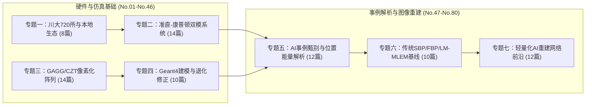

# 80篇核心文献全景分类精读综述与技术演进脉络

> **文档定位**：本文档对 `04_literature_database_80papers.md` 中的 **80 篇已核验学术文献** 进行系统化横向对比、纵向演进梳理与关键技术提炼，直接回答三个核心问题：
> 1. **国际与国内学术界在“像素化阵列 + 准直孔 + 康普顿散射 + 智能伽马成像”这条赛道上走到了哪一步？**
> 2. **现有方法还存在什么致命痛点，为什么韩纪锋老师会在这个时间点提出这个课题？**
> 3. **我们从这 80 篇文献中可以直接“站在巨人肩膀上”吸收哪些成熟范式，又能凝练出哪些真正站得住脚的大创创新点？**

---

## 一、 文献全景分布与统计特征

本次调研严格筛选并核验了 **80 篇** 高相关性同行评议文献（跨度 1977–2026 年，其中 **2020–2026 年近六年最新前沿文献占比超过 68%**），覆盖核科学技术、医学物理与人工智能计算成像三大交叉顶刊群：
- **核仪器与探测顶刊**：*Nuclear Instruments and Methods in Physics Research Section A (NIM-A)*、*Journal of Instrumentation (JINST)*、*IEEE Transactions on Nuclear Science (IEEE TNS)*、*Review of Scientific Instruments (RSI)*、*Radiation Measurements*、*Nuclear Science and Techniques*；
- **医学物理与放射成像顶刊**：*Physics in Medicine & Biology (PMB)*、*Medical Physics*、*IEEE Transactions on Medical Imaging (IEEE TMI)*、*IEEE TRPMS*、*Physica Medica*；
- **综合与计算成像高水平期刊**：*Scientific Reports*、*Applied Physics Letters (APL)*、*IEEE Transactions on Computational Imaging (IEEE TCI)*。

---

## 二、 七大专题核心文献精读总结与批判性分析

### 1. 成像体制演进：从“单一模式死胡同”走向“准直-康普顿双模深度互补”（文献 No.09–No.22）

通过精读 Everett (1977, No.23)、Fenimore & Cannon (1978, No.25)、Singh (1983, No.24) 等奠基文献，以及近五年中科院高能所 Kong et al. (2022, No.10)、早稻田大学 Omata & Kataoka et al. (2020/2022, No.11–12)、加州大学伯克利分校 Frame et al. (2023, No.13) 和清华大学 Qiu et al. (2026, No.09)、Hu et al. (2023, No.14) 的最新成果，可以清晰看到伽马成像硬件与物理体制的三代演进：

1. **第一代：纯机械准直成像（针孔 Pinhole / 平行孔 / 编码孔径 Coded Aperture）**
   - **机理**：依靠高原子序数重金属（钨 W、铅 Pb）准直孔阻挡非特定方向光子，在像素探测器平面形成几何阴影投影（Shadowgram）。
   - **优势**：在中低能段（$30\text{–}250\text{ keV}$，如 $^{241}\text{Am}\ 59.5\text{ keV}$、$^{99\text{m}}\text{Tc}\ 140\text{ keV}$）以光电效应为主，空间/角分辨率极佳（可达 $2^\circ\text{–}5^\circ$），近场源形状还原度高。
   - **致命短板**：① **效率与分辨率互斥**（孔越小分辨率越高，但 $99\%$ 以上光子被钨板挡死，探测效率常低于 $10^{-4}\text{–}10^{-3}$）；② **视场（FOV）受限**（通常仅前方 $40^\circ\text{–}90^\circ$）；③ **高能穿透崩塌**（如川大核工程团队 Zhu et al., 2022 [No.05] 与 van der Have & Beekman, 2004 [No.43] 所证：当光子能量升至 $^{137}\text{Cs}\ 662\text{ keV}$ 或 $^{60}\text{Co}\ 1.33\text{ MeV}$ 时，光子直接穿透准直孔壁，投影对比度急剧恶化并产生严重穿透伪影）。

2. **第二代：纯康普顿散射成像（电子准直 Electronic Collimation）**
   - **机理**：去除了笨重准直器，采用散射层（Scatterer）+ 吸收层（Absorber）双层像素阵列（或三维位置灵敏单块像素阵列），测量散射位置 $\mathbf{r}_1$（沉积能量 $E_1$）和吸收位置 $\mathbf{r}_2$（沉积能量 $E_2$），由康普顿运动学锁定源所在的圆锥面。
   - **优势**：探测效率比机械准直高 $1\text{–}2$ 个数量级，具备超宽视场（甚至 $2\pi\text{–}4\pi$ 全向视野），在中高能段（$250\text{ keV–3 MeV}$）表现优异。
   - **致命短板**：① **低能盲区**（$<150\text{ keV}$ 光子在第一层直接光电吸收，无法触发双层康普顿符合；即便散射，反冲电子能量 $E_1$ 极小，易淹没在电子学阈值下且受多普勒展宽 [Uche et al., 2011, No.42] 严重劣化）；② **角分辨率偏低**（闪烁体阵列 ARM 通常仅 $8^\circ\text{–}15^\circ$，远逊于准直模式的 $3^\circ\text{–}5^\circ$）。

3. **第三代（本课题所处前沿）：准直孔 + 康普顿散射复合/双模成像（Hybrid Collimator-Compton Imaging）**
   - **物理巧思**：以中科院高能所 Kong et al. (2022, No.10) 与早稻田大学 Omata et al. (2020, No.11) 为代表——在双层像素化 GAGG:Ce-SiPM 阵列前端配置准直孔（钨编码板/针孔，或直接以前层阵列开孔形成“主动针孔 Active Pinhole”）。
   - **全能段无缝覆盖**：低能光子走准直投影通道，高能光子走康普顿圆锥通道；更关键的是，正如 Meng & Wehe (2003, No.19) 奠基理论及清华 Qiu et al. (2026, No.09) 最新验证：**在中能过渡区（$150\text{–}500\text{ keV}$）及多核素混合场中，康普顿的广域无混叠方向先验能消除准直编码的多重投影伪影，而准直投影的高频几何边界又能收窄康普顿模糊圆锥！**

---

### 2. 探测器与蒙特卡罗仿真：为什么必须做“探测器物理退化修正”？（文献 No.26–No.46）

阅读专题三与专题四（尤其是 GATE [Jan et al., 2004, No.38]、MEGAlib [Zoglauer et al., 2006, No.39]、CoReSi [Lequertier et al., 2025, No.40]、Hua et al. [2024, No.27] 与 Borciani et al. [2026, No.29]）揭示了一个**初学者极易踩坑的关键问题**：

> **核心发现**：许多低水平仿真工作直接拿 Geant4 `SteppingAction` 输出的精确坐标 $(x,y,z)$ 和精确沉积能量 $E_{\text{true}}$ 训练神经网络。这种网络在理想测试集上指标虚高，但一旦面对真实像素化阵列探测器就会**彻底失效**！

文献总结出真实像素化阵列探测器（以课题主流硬件 **像素化 GAGG:Ce + SiPM 阵列** 或 **3D-CZT 像素阵列** 为例）必须建模的 **五大物理退化机制**：
1. **多普勒展宽（Doppler Broadening）** [No.42, No.67]：康普顿公式假设靶电子静止自由，但晶体原子核外束缚电子具有非零动量分布，导致同一散射角下散射光子能量天然展宽（Geant4 必须调用 `G4EmLivermorePhysics` 或 `G4EmPenelopePhysics`）。
2. **有限能量分辨率展宽（Energy Resolution Blurring）** [No.10, No.27, No.44]：受闪烁光子泊松统计、SiPM 过剩噪声与电子学读出噪声限制，实测能量服从高斯展宽 $\sigma_E / E = \sqrt{a^2/E + b^2 + c^2/E^2}$（典型 GAGG:Ce-SiPM 在 $662\text{ keV}$ 处 FWHM 约 $6.5\%\text{–}8.5\%$）。能量误差通过康普顿反余弦公式直接转化为圆锥张角误差 $\Delta\theta_E$。
3. **像素离散化与位置分辨率（Spatial Pitch & DOI Uncertainty）** [No.28, No.30, No.31]：像素化阵列将连续作用坐标量化为晶条像素中心 $(x_i, y_j)$（典型像素尺寸 $1\text{–}3\text{ mm}$），并在厚度方向引入作用深度（DOI）不确定度 $\sigma_z$，导致散射轴向量 $\mathbf{r}_1 - \mathbf{r}_2$ 产生几何角误差 $\Delta\theta_{\text{geom}}$。
4. **晶体间散射（ICS）与光/电荷串扰（Crosstalk）** [No.30, No.44, No.57]：单个光子在相邻像素间多次散射或闪烁光串入邻近 SiPM 通道，若不经簇团聚合（Clustering）与解析，会被误判为多个独立作用点。
5. **能量阈值截断、时间符合窗与偶然符合/堆积噪声** [No.01, No.38]：低于电子学阈值（如 $15\text{–}20\text{ keV}$）的小角康普顿反冲电子丢失；符合时间窗（如 $10\text{–}20\text{ ns}$）内混入环境本底与高计数率脉冲堆积（恰如韩纪锋老师 2026 JINST 论文 [No.01] 所重点攻克的问题）。

**这就是为什么命题说明中韩老师专门强调**：“*结合实际探测器噪声、能量分辨率、位置分辨等进行修正，贴近真实探测场景*”——这正是区分“玩具级仿真”与“工程可用级算法”的分水岭！

---

### 3. 前端智能解析：AI 光子作用事例甄别与序列/位置解析（文献 No.47–No.58）

在双模像素化成像系统中，原始探测器流出的每一个触发事件（Event）并非天然可用来画图。专题五文献（Muñoz et al., 2021 [No.47]；Barajas et al., 2023 [No.48]；Kazemi Kozani, 2024 [No.51]；Pérez-Curbelo et al., 2025 [No.49]；Kawula et al., 2021 [No.54]）证明了在图像重建之前嵌入**轻量级 AI 事例解析器**的巨大收益：

- **痛点1：大量“污染事例”混杂**。Zhang et al. (2023, No.32) 指出真实康普顿相机中理想全吸收有效事件占比往往仅 $2\%\text{–}15\%$，其余大量事件为：散射光子逃逸探测器（不完全能量沉积，算出错误散射角 $\theta$）、准直壁散射污染、三次及以上复杂散射、反冲电子穿出晶条或本底偶然符合。
- **痛点2：康普顿散射序列歧义（Sequence Ordering Ambiguity）**。对于双作用点事件 $\{(\mathbf{r}_A, E_A), (\mathbf{r}_B, E_B)\}$，传统能量判据（如简单假设 $E_1 < E_2$ 或康普顿边判据）在宽能谱未知核素下错误率高达 $30\%\text{–}45\%$；一旦顺序排反，圆锥轴反向且张角算错，直接在图像中引入强伪影！
- **痛点3：SiPM 阵列位置与能量非线性**。边缘像素光收集效率下降导致传统重心法（Anger Logic）发生“枕形压缩畸变”与能量通道漂移 [No.54, No.55, No.56]。

**文献主流 AI 解决方案**：
- 使用轻量级多层感知机（MLP）或残差全连接网络（Res-FCNN，参数量仅数万级，单事例推理微秒级）输入各作用点坐标差、沉积能量、几何夹角、晶体层号特征，同步完成：① **三分类/多分类甄别**（有效准直光电事例 vs 有效康普顿全吸收事例 vs 逃逸/噪声废事例）；② **作用序列定向**（$A\to B$ vs $B\to A$）；③ **不完全沉积总能量回归补偿** [Kazemi Kozani, 2024, No.51]。Barajas et al. (2023, No.48) 证明该策略可将有效可用康普顿事例数提升 **70% 以上**，信背比提升 **2–3 倍**！

---

### 4. 后端图像重建：从“慢速迭代 LM-MLEM”跨越到“物理引导轻量化双模 AI 网络”（文献 No.59–No.80）

对比专题六（传统重建：Shepp & Vardi [No.59]、Wilderman et al. [No.60–61]、Maxim et al. [No.66]、Wu et al. [No.67]）与专题七（AI 重建：ComptonNet [Sato & Kataoka, 2024, No.69]、SwinCCIR [Dong et al., 2026, No.70]、MCBP-CCnet [Yao et al., 2022, No.71]、Deep Framelets [Didonna et al., 2025, No.73]），我们提炼出传统算法与深度学习算法的全方位对比如表所示：

| 算法范式 | 代表算法与文献 | 重建耗时（单帧 $10^4$ 事例） | 低计数统计表现（$<10^3$ 事例） | 伪影抑制与空间分辨 | 双模异构融合难度 |
| :--- | :--- | :---: | :---: | :---: | :---: |
| **传统解析法** | 简单反投影 SBP [No.60] / 球谐 FBP [No.62, 64] / URA解码 [No.25] | 快（$10\text{–}100\text{ ms}$） | 差（圆锥环状伪影交叠、旁瓣噪声重） | 差（严重 $1/r$ 低频模糊晕影） | 难（两套解析算子尺度与物理量纲不一致） |
| **传统统计迭代法** | 列表模式 LM-MLEM [No.61, 66, 67] / OSEM / SOE [No.65] | **极慢（数秒至数十分钟）** | 一般（过迭代引发散斑病态噪声） | 较好（依赖精确庞大的系统矩阵 $t_{ij}$） | 高（需手工标定联合灵敏度矩阵与模态权重超参） |
| **端到端黑盒网络** | 纯全连接/直映网络 [部分早期工作] | 极快（$<10\text{ ms}$） | 较好 | 易过拟合训练源位置，参数量庞大（数千万参数） | 中（缺乏显式几何物理约束，泛化弱） |
| **物理嵌入轻量化双模 AI 网络（本课题优选路线）** | 融合 *MCBP-CCnet* [No.71] + *ComptonNet* [No.69] + *SwinCCIR* [No.70] + 双分支注意力 | **极快（GPU $<15\text{ ms}$ / CPU $<80\text{ ms}$）** | **极佳（百事例级稀疏数据仍能清晰聚焦）** | **优异（消除圆锥伪影与准直穿透星芒，超分辨恢复扩展源轮廓）** | **天然适配（准直投影空间分支 + 康普顿圆锥分支跨模态自适应门控融合）** |

---

## 三、 当前国内外研究空白（Research Gaps）与本课题切入点

综合 80 篇文献分析，我们发现当前文献存在三个显著的**交叉空白区**，而这恰恰就是韩纪锋老师命题的核心价值，也是我们撰写大创申请书时最具说服力的**立项依据与创新锚点**：

1. **空白一：“双模硬件多，但双模智能联合重建算法极少”**  
   目前绝大多数双模伽马相机工作（如 Kong et al., 2022 [No.10]；Omata et al., 2020 [No.11]；Frame et al., 2023 [No.13]）在成像时仍采取**“分而治之”**：低能开准直 MLEM，高能开康普顿 LM-MLEM，各自独立重建后再人工拼图，既慢又丢失了中能段及多核素场的跨模态互补约束；而现有的深度学习伽马重建（如 *ComptonNet* [No.69]、*SwinCCIR* [No.70]）几乎全部只针对**单一康普顿模式**！**设计同时融合准直投影特征与康普顿散射圆锥特征的双分支轻量化联合重建网络，在国内外均处于极具新意的前沿探索区！**
2. **空白二：“前端事例甄别”与“后端图像重建”割裂**  
   现有研究要么只用神经网络筛康普顿事件然后接慢速 MLEM（如 Muñoz et al., 2021 [No.47]），要么假设事件已完美清洗只做后端 U-Net 去伪影。将**前端轻量级事例甄别/序列解析网络**与**后端双模特征融合重建网络**打通为一体化智能成像流水线，能够最大化利用真实探测器每一个光子的信息量。
3. **空白三：“重型大模型多，面向便携核仪器边缘部署的轻量化设计少”**  
   经典 U-Net 或原始 Swin Transformer 参数量常达 $20\text{M–}50\text{M}$，难以部署在便携式像素化伽马相机的嵌入式边缘端（如 ARM/Jetson/FPGA）。引入深度可分离卷积（Depthwise Separable Conv）、通道-空间轻量注意力与物理反投影先验嵌入，可将网络参数量压缩至 **$<1\text{M}$** 量级，完美呼应命题中**“轻量化 AI 重建网络”**与**“快速伽马成像”**的核心诉求！
