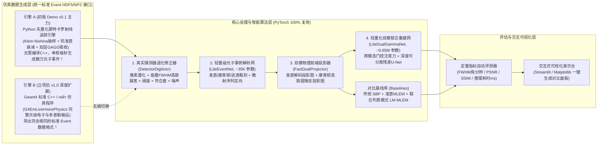

# 初版 Demo 系统架构设计与分步开发路线（第三阶段 `demo` 分支蓝图）

> **说明**：当前第一阶段仅做架构设计与路线规划，暂不编写业务代码。本文档专门解决一个最现实的工程问题：**如何在正式立项前，用最短时间、最稳妥的技术栈做出一套“物理上严谨、韩老师一看就懂且眼前一亮、能真刀真枪跑出数据与漂亮对比图”的初版原型 Demo（Demo v0.1），同时为立项后的完整版 Geant4 大规模仿真（Demo v1.0）留好无缝接口？**

---

## 一、 核心战略决策：为什么采用“双引擎解耦架构”开发初版 Demo？

很多同学一上来就想先在 Windows 上从零编译几百 MB 的 C++ Geant4 源码、配 Qt OpenGL 可视化、写十几个 `DetectorConstruction` / `SteppingAction` 类——结果光装环境和调 C++ 内存报错就卡了两周，连一张图都没跑出来，耽误了申请书提交时机！

借鉴 2025 年发表于 *Physics in Medicine & Biology* 的开源框架 **CoReSi**（Lequertier et al., 2025, 文献 No.40）的设计哲学，我们为本项目制定**“统一事件数据协议 + 双物理仿真后端解耦”**路线：



### 这一架构的三大巨大优势：
1. **极速可跑、零环境死锁**：初版 Demo v0.1 使用纯 Python（NumPy + SciPy + PyTorch）实现真实的伽马射线三维蒙特卡罗追踪（含真实 NIST 质量衰减系数表：光电吸收截面、Klein-Nishina 康普顿微分散射角抽样、钨准直板指数衰减穿透、多普勒角度微扰），几分钟就能生成数千组多工况训练数据！
2. **物理真实性完全受控**：`DetectorDigitizer` 严格实现能量分辨率 $\text{FWHM}(E) = E\sqrt{a^2/E + b^2 + c^2/E^2}$、像素节距量化、DOI 误差与偶然符合本底，绝非简单的“高斯模糊假图片”。
3. **代码 100% 向前兼容**：定义好统一的事件级数据结构（`event_id, n_hits, layer_id[], x[], y[], z[], energy_keV[], timestamp_ns[], event_true_type`），立项后跑出的 Geant4 `.root/.csv` 数据只需一行转换脚本即可直接喂给同一套 `DetectorDigitizer`、`LiteEventNet` 和 `LiteDualGammaNet`！

---

## 二、 初版 Demo 具体物理与网络参数设计表

### 1. 默认参考探测器几何构型（对标中科院高能所 Kong et al. 2022 [No.10] 与早稻田 Omata et al. 2020 [No.11]）
- **前端准直层**：钨合金（W，密度 $19.3\text{ g/cm}^3$）针孔/MURA 编码准直板，厚度 $3.0\text{ mm}\text{–}5.0\text{ mm}$，中心针孔孔径 $2.0\text{ mm}$（或 $11\times11$ 阶 MURA 编码孔，可配置切换），距散射层间距 $20\text{ mm}$；
- **第一层（准直投影接收层 / 康普顿散射层）**：$16 \times 16$ 像素化 $\text{GAGG:Ce}$ 闪烁体阵列，单像素尺寸 $2.0 \times 2.0 \times 4.0\text{ mm}^3$，耦合 SiPM 阵列；
- **第二层（康普顿吸收层）**：$16 \times 16$（或 $24 \times 24$）像素化 $\text{GAGG:Ce}$ 闪烁体阵列，单像素尺寸 $2.0 \times 2.0 \times 10.0\text{ mm}^3$，两层中心间距 $30\text{ mm}$；
- **探测器退化修正默认标定参数**：
  - 能量分辨率：$662\text{ keV}$ 处 $\text{FWHM} = 7.0\%$（可滑动调节 $3\%\text{–}12\%$ 观察性能变化）；
  - 横向位置量化：$2.0\text{ mm}$ 像素中心离散化 + 亚像素串扰噪声；纵向 DOI 分辨率 $\sigma_z = 1.5\text{ mm}$；
  - 电子学触发阈值：$E_{\text{th}} = 20\text{ keV}$，电子学噪声基线 $\sigma_{\text{elec}} = 3.5\text{ keV}$；
  - 成像视场（FOV）：极角 $[-45^\circ, +45^\circ] \times [-45^\circ, +45^\circ]$，离散化为 $64 \times 64$ 角度网格。

### 2. 多工况仿真数据集设计（Demo v0.1 初版规模建议：3,000–5,000 组样本，单机 15 分钟内即可生成训练完毕）
- **工况 1（单点源不同能段测试）**：低能 $^{241}\text{Am}$ ($59.5\text{ keV}$)、中低能 $^{99\text{m}}\text{Tc}$ ($140\text{ keV}$)、中能 $^{133}\text{Ba}$ ($356\text{ keV}$)、中高能 $^{137}\text{Cs}$ ($662\text{ keV}$)、高能 $^{60}\text{Co}$ ($1173/1332\text{ keV}$)；
- **工况 2（双点源角分辨极限测试）**：角间距 $6^\circ, 10^\circ, 15^\circ, 20^\circ$ 双源混合；
- **工况 3（扩展源不同形状测试）**：线状管道源（Line）、圆环源（Ring）、L形/十字形面源（Extended Plane）；
- **工况 4（双核素混合场测试——最能体现双模融合威力！）**：视野左上角放一个低能 $^{241}\text{Am}$ ($60\text{ keV}$)，右下角放一个高能 $^{137}\text{Cs}$ ($662\text{ keV}$) —— 单纯准直相机看不清 $^{137}\text{Cs}$（穿透糊成一片），单纯康普顿相机完全看不见 $^{241}\text{Am}$（零符合），而我们的**双模联合 AI 网络在一张图上同时清晰重建两个源**！

### 3. 两级轻量化神经网络具体结构

#### (1) 前端事例甄别与序列定向网络：`LiteEventNet`（参数量 $\approx 32\text{ K}$）
- **输入特征向量（14维物理构造特征）**：$[x_1, y_1, z_1, \tilde{E}_1, x_2, y_2, z_2, \tilde{E}_2, \Delta r, \Delta z, \tilde{E}_1+\tilde{E}_2, \cos\theta_{1\to2}, \cos\theta_{2\to1}, \text{hit\_multiplicity}]$；
- **网络骨干**：3 层带 LayerNorm 与残差跳连的轻量 MLP（`14 -> 128 -> 128 -> 64`）；
- **双输出头**：
  - `Head 1 (事例有效性分类)`：4分类（0: 逃逸/本底废事例；1: 有效准直光电事例；2: 正序有效康普顿 $1\to2$；3: 逆序有效康普顿 $2\to1$）；
  - `Head 2 (修正能量估计)`：回归总入射光子能量 $\hat{E}_0$。

#### (2) 后端双模跨模态轻量化重建网络：`LiteDualGammaNet`（总参数量 $\approx 0.62\text{ M} < 1\text{ M}$）
- **输入张量**：
  - 分支 1（准直特征张量）：$\mathbf{X}_{\text{coll}} \in \mathbb{R}^{2 \times 64 \times 64}$（低能窗 + 全能窗准直投影解码图）；
  - 分支 2（康普顿特征张量）：$\mathbf{X}_{\text{comp}} \in \mathbb{R}^{2 \times 64 \times 64}$（经 `LiteEventNet` 筛选后的高斯核圆锥反投影图 + 散射角不确定度权重图）；
- **轻量化编码器**：两路独立的 **Depthwise Separable ConvNeXt-Lite / MobileBlock** 三尺度下采样（$64\times64 \to 32\times32 \to 16\times16$，通道数 `24 -> 48 -> 96`）；
- **跨模态门控注意力融合模块（CMGA, Cross-Modal Gated Attention）**：在多尺度特征层自适应计算模态置信门控系数 $\alpha = \sigma(\text{MLP}(\text{GAP}(\mathbf{F}_{\text{coll}}) \oplus \text{GAP}(\mathbf{F}_{\text{comp}})))$，实现 $\mathbf{F}_{\text{fused}} = \alpha \odot \mathbf{F}_{\text{coll}} + (1-\alpha) \odot \mathbf{F}_{\text{comp}} + \text{SpatialAttn}(\mathbf{F}_{\text{coll}}, \mathbf{F}_{\text{comp}})$；
- **轻量化多尺度解码器 + 复合损失函数**：
  - 针对放射源在视场中占比较小（稀疏峰值）的特性（借鉴文献 No.74 Jiang et al. 2023），采用 **MSE + SSIM 结构相似性损失 + 焦点加权峰值损失（Focal Peak Loss）**：

$$
\mathcal{L}_{\text{total}} = \lambda_1 \|\hat{\mathbf{f}} - \mathbf{f}\|_2^2 + \lambda_2 \left(1 - \text{SSIM}(\hat{\mathbf{f}}, \mathbf{f})\right) + \lambda_3 \| (1 + \gamma \mathbf{f}) \odot (\hat{\mathbf{f}} - \mathbf{f}) \|_1
$$

---

## 三、 `demo` 分支计划目录结构与 5 步开发里程碑（待启动）

当我们进入第三阶段切入 `demo` 分支开发时，代码工程结构如下：

```text
demo/
├── configs/
│   └── default_system.yaml       # 像素化GAGG阵列、钨准直孔几何与噪声修正参数配置
├── src/
│   ├── physics/
│   │   ├── cross_sections.py     # 光电/康普顿Klein-Nishina截面与钨衰减物理模型
│   │   ├── mc_simulator.py       # 多工况(点/双点/线/环/混合源)快速蒙特卡罗输运仿真器
│   │   └── digitizer.py          # 真实探测器噪声、能量分辨率FWHM、像素量化与符合修正器
│   ├── baselines/
│   │   ├── sbp_ura.py            # 传统简单圆锥反投影(SBP)与准直解码算法
│   │   └── joint_lmmlem.py       # 传统联合列表模式极大似然迭代算法(Joint LM-MLEM)
│   ├── models/
│   │   ├── lite_event_net.py     # 前端轻量化光子事例甄别与散射序列解析网络
│   │   └── lite_dual_gammanet.py # 后端轻量化双分支跨模态联合重建网络(<0.7M参数)
│   ├── dataset.py                # 多工况数据集批量生成与PyTorch DataLoader
│   ├── train.py                  # 两级网络训练与ONNX轻量化导出脚本
│   └── evaluate.py               # 自动生成FWHM/PSNR/SSIM/耗时对比表与评估报告图
├── app_viewer.py                 # 交互式可视化演示面板(给导师现场演示用！)
└── geant4_interface/             # 预留标准Geant4 C++宏文件模板与ROOT/CSV数据转换接口
```

### 分步开发里程碑（预计切入 `demo` 分支后可快速闭环）：
- **Milestone D1**：实现物理输运仿真器 `mc_simulator.py` + 探测器退化修正器 `digitizer.py`，可视化验证能谱（光电峰、康普顿边、高斯能量展宽）和准直阴影/康普顿散射圆锥几何完全符合物理定律；
- **Milestone D2**：实现传统基线 `SBP` 与 `Joint LM-MLEM`，跑出传统算法的耗时基准与伪影表现；
- **Milestone D3**：生成多工况标注数据集，训练前端 `LiteEventNet` 与后端 `LiteDualGammaNet`；
- **Milestone D4**：运行完整定量评测脚本 `evaluate.py`，产出全套学术级对比图（特别包括“$^{241}\text{Am} + {}^{137}\text{Cs}$ 宽能段双核素同场联合重建对比图”与“耗时-PSNR 散点图”）；
- **Milestone D5**：封装一键交互演示界面 `app_viewer.py` 并生成初版《算法性能评估简报》。
