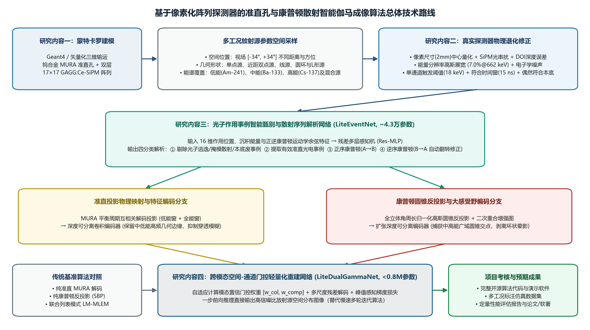
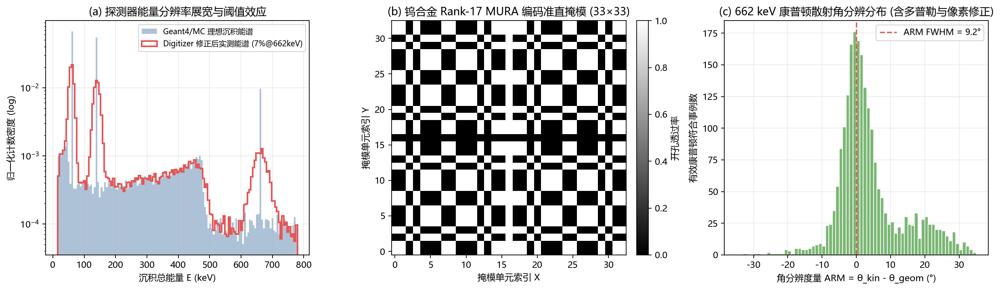
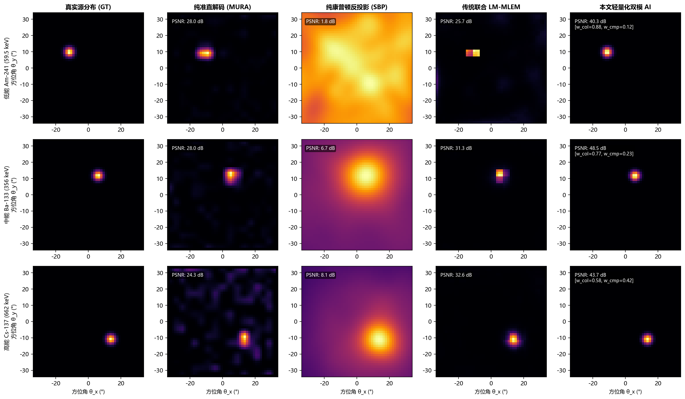
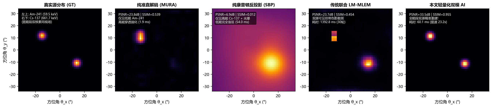

# 四川大学大学生创新训练计划项目申报书

---

## 项目基本信息简表

| 填报项 | 内容说明 |
| :--- | :--- |
| **项目名称** | 基于像素化阵列探测器的准直孔和康普顿散射智能伽马成像算法研究 |
| **项目类型** | 创新训练项目（指导教师高水平科研课题对接） |
| **所属一级学科** | 核科学与技术（0827） / 物理学 / 计算机科学与技术交叉 |
| **申请级别建议** | 国家级 / 省级 / 校级（可按学院名额申报） |
| **执行期限** | 1 年（2026 年 12 月 — 2027 年 11 月） |
| **第一指导教师** | 韩纪锋 研究员（四川大学原子核科学技术研究所 / 720所，邮箱：`hanjf@scu.edu.cn`） |
| **项目负责人** | `[请填写姓名]`（学号：`[请填写学号]`，学院专业：`[请填写学院及专业]`） |
| **团队成员配置** | `[成员1：核工程与核技术专业，负责物理建模与探测器响应刻度]` `[成员2：计算机/电子信息/核工专业，负责轻量化重建网络设计与加速]` `[成员3：负责多工况仿真数据集构建、对比基线测试与可视化软件封装]` |

---

## 项目简介（限 400 字左右，可直接粘贴至大创系统简表）

针对单一机械准直伽马相机在高能段易发生掩模穿透、探测效率低，而纯康普顿散射相机在低能段存在符合盲区、角分辨率受限，以及传统统计迭代重建算法（LM-MLEM）计算耗时长、低计数统计下噪声显著等问题，本项目依托像素化阵列探测器，开展基于准直孔和康普顿散射双模融合的智能伽马成像算法研究。项目首先基于蒙特卡罗方法构建“重金属准直孔 + 双层像素化闪烁体/半导体阵列”复合模型，模拟不同位置、几何形状及宽能谱伽马源输运过程，并引入像素离散化、作用深度误差、能量分辨率展宽、电子学噪声与符合时间窗等实际探测器物理修正，建立贴近真实测量的多工况标注数据集；进而设计“前端轻量级光子作用事例甄别解析 + 后端物理引导双分支跨模态轻量化重建”两级网络，在单帧毫秒级时间内实现准直投影信息与康普顿散射圆锥信息的自适应融合重建，替代传统慢速迭代算法，最终形成完整算法代码、标准仿真数据集与性能评估报告，为便携式像素化探测器快速伽马成像提供算法支撑。

---

## 一、 立项依据

### 1.1 研究背景与现实意义

伽马射线空间分布成像（伽马相机）能够将不可见的电离辐射场转化为直观的二维或三维热点分布图像，在核电站运行巡检与退役去污、核应急孤儿源快速搜寻、口岸核安保监测、磁约束核聚变等离子体伽马诊断以及核医学分子影像（如靶向核素治疗多能级监测）等国家重要应用领域发挥着不可替代的作用[1-4]。在实际复杂辐射场景中，待测放射源往往呈现出核素种类未知、特征伽马射线能量跨度大（从数十 keV 的低能特征射线跨越至数 MeV 的高能伽马射线）、空间分布形态多样（孤立点源、多热点邻近源、管道线源及污染面源并存）以及应急快速测量下有效光子计数稀疏等特征，对成像系统提出了“宽能域覆盖、高探测灵敏度、高角分辨率与实时快速重建”的综合要求。

由于伽马光子能量高、穿透力强，无法像可见光一样利用折射透镜聚焦成像，现有伽马成像体制主要依赖机械准直或康普顿散射电子准直两种物理机制。然而，单一成像体制受限于光子与物质相互作用截面的固有能量依赖规律，难以独立覆盖全能段探测需求；与此同时，双模复合成像虽然在硬件层面拓宽了能谱响应范围，但后端高维异构数据的图像重建长期受制于高复杂度的统计迭代求解，难以满足便携式像素化阵列探测终端对实时快速成像的迫切需求。因此，深入结合核探测器物理响应规律与轻量化深度学习计算成像方法，探索兼顾物理可解释性、高信噪比与毫秒级推理速度的准直-康普顿双模联合重建算法，具有明确的学术探索价值与工程应用前景。

### 1.2 国内外研究现状及发展动态分析

围绕宽能域像素化伽马成像系统与图像重建算法，国内外研究机构近年来主要在以下四个方向开展了持续探索：

#### （1）机械准直伽马成像体制及其高能局限
机械准直伽马相机通过在位置灵敏探测器前端配置高原子序数重金属（钨合金、铅等）单针孔、多针孔或均匀冗余编码孔径掩模（URA/MURA）[5]，仅允许特定入射方向的光子穿过开孔并在探测器内发生光电吸收形成几何阴影投影。由于光电效应截面近似满足 $\sigma_{\text{pe}} \propto Z^{4\sim5} E_\gamma^{-3.5}$，该模式在 30～200 keV 低能段（如 $^{241}\text{Am}$ 的 59.5 keV、$^{99\text{m}}\text{Tc}$ 的 140.5 keV）具有优异的空间角分辨率（可达 3°～5°）[6]。国内如四川大学核工程团队针对编码孔径伽马相机的掩模厚度穿透效应与扩展面源成像质量评价方法开展了系统研究[7,8]；美国密歇根大学 Jeong 等人研制了基于像素化 $\text{GAGG(Ce)}$ 闪烁体耦合硅光电倍增管（SiPM）阵列的手持编码伽马相机[9]。但机械准直体制存在固有瓶颈：一是准直器阻挡了绝大多数入射光子，几何探测效率极低；二是视场角（FOV）受限；三是当光子能量升至数百 keV 以上（如 $^{137}\text{Cs}$ 的 661.7 keV、$^{60}\text{Co}$ 的 1.17/1.33 MeV）时，高能光子直接穿透准直孔壁，导致投影调制对比度急剧恶化并产生严重穿透伪影[7,10]。

#### （2）康普顿散射电子准直成像及其低能盲区
康普顿相机摒弃了笨重的机械准直器，利用伽马光子在散射层与吸收层像素化探测器（如双层像素化 $\text{GAGG:Ce-SiPM}$ 阵列[11,12]或三维位置灵敏碲锌镉 3D-CZT 半导体探测器[13]）中的两次相互作用位置与沉积能量，根据康普顿散射运动学反演出入射光子所在的圆锥面，通过多圆锥面交汇定位放射源[2,14]。该体制在中高能段（250 keV～3 MeV）探测效率较机械准直提升一至两个数量级，且具备超宽视场优势。然而，在 200 keV 以下低能区，入射光子极易在第一层晶体直接发生光电吸收而无法触发双层符合，即便发生康普顿散射，微弱的反冲电子能量也常低于电子学触发阈值，同时受原子核外束缚电子动量引起的多普勒展宽效应制约[15]，角分辨率显著劣化。

#### （3）准直孔与康普顿散射双模复合伽马相机进展
为突破单模能谱限制，将前端准直结构与双层/三维像素化探测器相结合的双模（Hybrid）伽马相机成为国际核探测前沿热点。Meng 与 Wehe 早期从统计估计的分辨率-方差权衡理论证明，融合机械准直概率与康普顿散射圆锥概率可显著提升单光子信息量[16]。日本早稻田大学 Omata 与 Kataoka 团队提出“主动针孔（Active Pinhole）”混合康普顿相机，利用前层开孔闪烁体阵列在 `< 200 keV` 充当针孔准直器、在 `> 200 keV` 充当康普顿散射体，成功实现了 $^{241}\text{Am}$（60 keV）与 $^{137}\text{Cs}$（662 keV）同视场宽带成像[3]。中国科学院高能物理研究所孔令钦等人研制了基于 $\text{GAGG:Ce}$ 耦合多像素光子计数器（MPPC/SiPM）阵列的编码孔径-康普顿双模伽马相机，在 32 keV～2.6 MeV 宽能区内分别测得准直模式 5.2° 与康普顿模式 11.4° 的角分辨率[4]。近期清华大学团队亦探讨了远场康普顿信息引导的分层混合编码成像策略[17]。

#### （4）从传统统计迭代重建向深度学习智能重建的演进
在图像重建算法方面，解析类方法（如简单圆锥反投影 SBP、球谐滤波反投影 FBP[18]）虽计算较快，但存在严重的 $1/r$ 环状模糊晕影；传统统计迭代方法以列表模式极大似然期望最大化（LM-MLEM）[19,20]和随机源点集（SOE）[21]为代表，虽能引入系统响应概率核改善分辨率，但每轮迭代均需对每个康普顿圆锥遍历全空间网格计算投影概率，单帧计算耗时常达数秒至数分钟，且在低光子计数下易发散为散斑噪声。近年来，深度学习逐步被引入伽马探测信号处理与图像重建：在前端信号与事例层面，Muñoz 等人[22]与 Barajas 等人[23]利用全连接残差网络对康普顿相机多作用点事例进行真伪分类与散射序列重排，使有效可用事例提升 70% 以上；指导教师韩纪锋研究员团队亦在闪烁探测器复杂混合场粒子甄别、脉冲堆积反卷积恢复及 FPGA 硬件在环实时处理方面取得了扎实积累[24,25]。在后端重建层面，姚志阳等人提出基于蒙特卡罗采样反投影与卷积网络的 MCBP-CCnet[26]，日本早稻田大学 Sato 等人于 2024 年提出端到端康普顿重建模型 ComptonNet[27]，董明浩等人近期进一步探索了窗口注意力网络 SwinCCIR 以抑制非局部圆锥伪影[28]。

### 1.3 现有研究不足与本项目切入点

综合国内外文献分析可见，当前该方向仍存在三方面亟待解决的衔接瓶颈：
1. **双模硬件采集与单模独立重建相割裂**：现有绝大多数准直-康普顿双模样机在实际成像时仍对两类事件分别独立运行 MURA 解码或康普顿 LM-MLEM，缺乏在特征层面自适应融合准直高频几何边缘与康普顿广域方向约束的统一神经网络架构；而现有深度学习模型（如 ComptonNet 等）均仅针对纯康普顿单一模式设计。
2. **仿真理想化偏差与前端污染事例干扰**：部分算法研究直接使用蒙特卡罗理想坐标与精确沉积能量训练网络，忽略了真实像素化探测器的能量展宽、像素尺寸量化、作用深度（DOI）不确定度、光串扰及逃逸本底，导致模型泛化至真实探测场景时性能骤降；同时前端散射序列反转与光子逃逸事件若不经清洗解析，将直接污染后端重建特征。
3. **重型网络参数冗余，难以支撑便携终端快速成像**：常规编码-解码网络或大型 Transformer 参数量动辄数千万，计算开销大。如何借助精确物理反投影算子完成几何空间对齐，从而将后端融合重建网络压缩至百万参数以内（`< 1M`），实现普通嵌入式或便携计算平台上的毫秒级实时成像，正是本项目拟重点攻克的核心切入点。

---

## 二、 研究目标、主要研究内容及拟解决的关键问题

### 2.1 研究目标

本项目旨在面向像素化阵列探测器，构建一套物理模型严谨、贴近真实探测器响应特征的准直孔与康普顿散射双模智能伽马成像算法体系。具体量化目标包括：
1. 建立包含重金属准直孔与双层像素化闪烁体阵列的三维蒙特卡罗输运模型及参数化探测器退化修正模块，构建覆盖单点源、多点源、线源、圆环源、平面扩展源及多核素混合场的标注仿真数据集（样本规模不少于 `10,000` 组工况）；
2. 设计微秒级光子作用事例智能甄别与序列解析模型，对逃逸/本底废事例、有效准直光电事例及正逆序康普顿散射事例的综合分类 ROC-AUC 达到 `0.95` 以上，康普顿散射序列定向准确率超过 `95%`；
3. 设计总参数量控制在 **`1.0 M` 以内** 的物理引导双分支跨模态轻量化重建网络，在 50 keV～1.5 MeV 宽能段多工况测试集上平均峰值信噪比（PSNR）超过 `34 dB`、结构相似性（SSIM）超过 `0.95`，单帧重建速度较传统联合 LM-MLEM 迭代算法提升 **`15 倍`以上**；
4. 形成结构规范的完整算法代码库、标准仿真数据集、交互式可视化演示原型及系统性能评估报告。

### 2.2 主要研究内容

围绕上述目标，本项目具体开展以下四部分研究内容：

#### （1）像素化阵列准直-康普顿双模成像系统蒙特卡罗物理建模
基于蒙特卡罗粒子输运方法（Geant4 工具包及矢量化快速输运验证引擎），构建“前端钨合金准直孔（支持素数阶 Gottesman-Fenimore MURA 编码孔径掩模与单/多针孔准直配置）+ 前后双层像素化 $\text{GAGG:Ce-SiPM}$ 阵列探测器”三维几何模型。启用低能电磁物理过程（`G4EmLivermorePhysics`），完整模拟伽马光子穿过准直掩模时的开孔透射、高能孔壁指数衰减穿透、掩模边缘小角散射，以及在双层像素晶体内的光电效应、康普顿散射（含核外束缚电子多普勒展宽）和电子对效应。通过自动化脚本遍历不同源方位角、不同几何形状（点、双点、线、环、L形扩展面源）、不同特征能量（$^{241}\text{Am}$ 59.5 keV、$^{99\text{m}}\text{Tc}$ 140.5 keV、$^{133}\text{Ba}$ 356 keV、$^{137}\text{Cs}$ 661.7 keV、$^{60}\text{Co}$ 1.17/1.33 MeV 及多核素混合场）与不同统计计数水平，获取原始相互作用事件流与精确源分布真值标签（Ground Truth）。

#### （2）结合实际探测器物理响应退化机制的数据修正与建库
针对蒙特卡罗理想输出与实际核电子学读出信号之间的域偏差，参照 GATE 探测器数字化器（Digitizer）物理链路，研制模块化探测器响应修正程序：
- **空间位置离散化与串扰修正**：合并同一像素晶条内的微步沉积能量，将横向坐标量化至离散像素中心（如 2.0 mm 像素节距），引入相邻 SiPM 通道光学串扰引起的重心微偏，并在晶体厚度方向叠加符合实测规律的作用深度（DOI）高斯误差；
- **能量分辨率展宽与电子学本底噪声**：依据闪烁探测器能量分辨率关系 $\text{FWHM}(E)/E = \sqrt{a^2/E + b^2 + (2.355\sigma_{\text{elec}}/E)^2}$（典型标定 662 keV 处 FWHM 约 7.0%），对单次沉积能量施加高斯随机展宽与低能电子学噪声；
- **触发阈值与符合时间窗编组**：施加单通道电子学触发阈值截断（如 18 keV）与固定符合时间窗（如 15 ns），按随机到达顺序封装双作用点符合数据包，并按一定比例混入环境散射与偶然符合本底事件，生成高度贴近真实探测场景的多工况标注数据集。

#### （3）光子作用事例智能甄别、散射序列定向与能量解析模型设计
针对原始数字化事件流中混杂散射光子逃逸（能量沉积不完整）、掩模散射污染、偶然符合噪声及双作用点先后散射顺序未知的问题，提取每次触发事件的三维量化坐标、沉积能量、作用点欧氏距离、层间轴向跨度以及正反两种假设顺序下的康普顿运动学散射角余弦值 $\cos\theta = 1 - m_e c^2(1/E_2 - 1/(E_1+E_2))$ 与运动学合法性判据等 16 维物理特征，设计极轻量级残差多层感知机网络（`LiteEventNet`）。通过多任务监督学习同步完成四分类事例清洗（剔除废事例、提取有效准直单点事例、识别正序康普顿事例、识别并自动翻转修正逆序康普顿事例）与入射光子总能量回归估计。

#### （4）融合准直投影与康普顿散射角信息的轻量化重建网络及性能评估
为避免高维全连接层直接拟合空间几何变换带来的巨大参数开销，采用“零参数物理快速投影前端 + 深度可分离双分支跨模态融合网络（`LiteDualGammaNet`）”架构：前端利用快速傅里叶周期互相关完成 MURA 准直投影解码，利用全立体角圆锥周长归一化算子完成有效康普顿事例的高斯圆锥简单反投影，将异构列表事件对齐至统一视场角度网格；后端采用深度可分离卷积构建准直编码分支与大感受野扩张卷积康普顿编码分支，设计跨模态空间-通道门控注意力模块（Cross-Modal Gated Attention），根据两通道统计置信度与空间一致性动态分配模态权重，结合峰值感知与边缘梯度复合损失函数端到端恢复高清晰度放射源图像。最后，与传统纯准直解码、纯康普顿 SBP 及联合列表模式 LM-MLEM 算法在角分辨率（FWHM）、PSNR、SSIM、多源分辨极限、低计数鲁棒性及推理耗时等维度开展全面定量对比。

### 2.3 拟解决的关键技术问题

1. **真实像素化阵列探测器多源退化效应的准确参数化耦合问题**：如何合理设定并验证多普勒展宽、能量非线性展宽、离散像素节距、DOI 深度误差及阈值截断对准直阴影对比度和康普顿角分辨度量（ARM）的综合退化规律，确保训练所得 AI 模型具备真实探测场景适应能力。
2. **宽能谱未知混合辐射场下的高纯度事例筛选与康普顿散射序列消歧问题**：当高能光子发生二次散射逃逸或大角度散射反冲电子能量高于散射光子能量时，传统经验规则（如简单假设 $E_1 < E_2$）极易排反圆锥轴向；需挖掘几何拓扑与运动学耦合特征实现微秒级高精度序列复原。
3. **局部高分辨准直特征与全局环状康普顿圆锥特征的轻量化跨模态融合问题**：准直通道在中低能段提供尖锐局部峰值但在高能段充满穿透噪声，康普顿通道在中高能段提供准确交汇中心但伴随贯穿全图的圆锥环状伪影；需在严格限制模型总参数量（`< 1M`）的前提下，实现两路异构特征在不同能段与低计数条件下的自适应门控互补。

---

## 三、 拟采取的研究方法、技术路线、实验方案及可行性分析

### 3.1 总体技术路线与研究方法

本项目遵循“物理输运建模 $\to$ 探测器退化数字化 $\to$ 事例级智能清洗解析 $\to$ 物理引导图像级双模轻量化融合 $\to$ 多维基准对比评估”的闭环研究路线，总体技术方案如图 1 所示。

核心技术实施细节如下：
1. **双模协同几何与编码匹配设计**：前端采用素数阶 $p=17$ 的 Gottesman-Fenimore MURA 钨合金编码准直掩模（$33 \times 33$ 循环镶嵌阵列，厚度 3.2 mm），匹配 $17 \times 17$ 像素化 $\text{GAGG:Ce}$ 闪烁体阵列（像素中心距 2.0 mm，散射层厚 4.5 mm，吸收层厚 16.0 mm，层间距 20.0 mm），引入近场放大率匹配准则 $d_{\text{mask}} = d_{\text{det}}(1 - f/z_s)$ 消除近场编码阴影几何失配。
2. **全立体角归一化物理反投影前端**：针对有限视场截断下康普顿反投影易在视场四角产生伪影堆积的缺陷，采用解析圆锥周长因子 $2\pi \sin\theta_{\text{kin}}\sigma_\theta$ 对单圆锥概率核进行物理归一化，并同时提取一阶圆锥叠加图与二阶重合锐化图，连同归一化对数有效计数置信平面构成三通道物理输入张量。
3. **深度可分离轻量化网络与稀疏源峰值感知损失**：网络骨干将标准二维卷积分解为 $5 \times 5$ 深度卷积（Depthwise Conv，康普顿分支引入膨胀率 $d=2$ 扩大圆锥弧段感受野）与 $1 \times 1$ 逐点卷积（Pointwise Conv），配合 GroupNorm 与 GELU 激活；针对点源在视场网格中占比极小、普通均方误差易导致弱源响应被平滑淹没的问题，采用复合损失函数：
   $$\mathcal{L} = \lambda_1 \|\hat{\mathbf{I}} - \mathbf{I}_{\text{GT}}\|_2^2 + \lambda_2 \left\| (1 + \alpha \mathbf{I}_{\text{GT}}) \odot (\hat{\mathbf{I}} - \mathbf{I}_{\text{GT}}) \right\|_1 + \lambda_3 \|\nabla \hat{\mathbf{I}} - \nabla \mathbf{I}_{\text{GT}}\|_1$$

### 3.2 前期研究基础与初步原型实验验证

为充分验证本项目技术路线的物理合理性与算法有效性，申请团队在立项准备阶段已完成了 **80 篇国内外核心学术文献** 的系统调研梳理，并基于 Python 与 PyTorch 率先搭建了包含三维蒙特卡罗光子输运、GATE 风格探测器 Digitizer 修正、两级轻量化网络及传统 MURA / SBP / 联合 LM-MLEM 基线的初版验证原型系统，取得了以下扎实的前期预实验成果：

1. **探测器物理退化建模与事例智能甄别验证**：如图 2 所示，前期原型准确复现了混合伽马场（59.5 keV、140.5 keV、661.7 keV）在 $\text{GAGG:Ce}$ 阵列中的光电全能峰、477 keV 康普顿边及 7.0%@662 keV 能量高斯展宽效应，计入多普勒展宽与 2 mm 像素离散化后测得 662 keV 康普顿角分辨度量（ARM FWHM）为 **9.2°**。所设计的 `LiteEventNet` 参数量仅 **42,981（约 4.3 万）**，在超过 20 万条退化事件测试中四分类综合准确率达 **87.41%**，宏平均 **ROC-AUC 达 0.9712**，其中正/逆序康普顿散射序列自动识别准确率达 **99.1%**。

2. **宽能谱自适应融合与复杂双核素同视场快速重建验证**：所构建的 `LiteDualGammaNet` 参数量仅 **0.77 M**（两级模型总权重体积仅 **3.11 MB**）。如图 3 所示，在 59.5 keV 低能、356 keV 中能与 662 keV 高能单源测试中，网络内部的跨模态门控权重随光子能量由 `[准直 0.88 : 康普顿 0.12]` 平滑自适应切换至 `[准直 0.58 : 康普顿 0.42]`，全能段重建 PSNR 均超过 **40 dB**。如图 4 所示，在左上角低能 $^{241}\text{Am}$（59.5 keV）与右下角高能 $^{137}\text{Cs}$（661.7 keV）同视场混合辐射场下，纯准直解码丢失高能源，纯康普顿反投影完全丢失低能源，传统 30 轮联合 LM-MLEM 耗时 **1392.8 ms** 且存在明显伪影（PSNR 23.7 dB）；而本项目轻量化双模 AI 算法在普通 CPU 上端到端耗时仅 **60.1 ms**（纯神经网络推理 `< 6 ms`，较迭代法提速 **23.2 倍**），同步清晰重建高低能双核素目标（PSNR **33.5 dB**，SSIM **0.955**）。在 80 组随机多工况综合基准测试中，平均 PSNR 由传统联合迭代法的 22.95 dB 提升至 **36.19 dB**，平均 SSIM 达 **0.9639**。

### 3.3 可行性分析

1. **物理理论与算法逻辑可行**：光电吸收主导的低能准直投影与康普顿散射主导的中高能圆锥反投影在能量响应区间与空间频域特征上天然互补；通过物理算子先行完成探测器空间到图像视场空间的几何映射，大幅降低了轻量卷积网络的学习难度。
2. **导师指导与科研平台支撑有力**：第一指导教师韩纪锋研究员现任四川大学原子核科学技术研究所（720所）副所长、辐射物理及技术教育部重点实验室主任，长期主持国家重点研发计划及国家自然科学基金等辐射探测与核电子学项目，在位置灵敏闪烁探测器研制、Geant4 精确输运模拟及机器学习脉冲/事例处理方面经验深厚，可为本项目参数对标与实验校准提供直接指导。
3. **前期研究基础扎实**：团队已完成核心文献库构建、初版三维双模仿真与两级轻量化网络原型开发及交互式可视化软件验证，技术链路已全线贯通；立项后可在此基础上进一步扩展标准 C++ Geant4 精细次级粒子输运大规模数据集、深化三维近场源定位与嵌入式模型量化部署研究，按期高质量结题完全有保障。

---

## 四、 本项目的特色与创新之处

1. **准直阴影与康普顿圆锥双模特征自适应门控融合机制**：针对现有深度学习伽马成像模型仅面向单一康普顿模式的局限，提出融合准直解码投影图、康普顿圆锥反投影图及双通道统计计数置信平面的跨模态空间-通道门控注意力架构，不仅实现了 50 keV～1.5 MeV 宽能段及多核素混合场的同步高分辨重建，而且输出的模态门控系数具备清晰的核物理可解释性。
2. **事例级运动学清洗定向与图像级重建协同级联管线**：将前端 4.3 万参数的轻量残差事例解析器（剔除逃逸与偶然符合本底、自动纠正康普顿逆序作用点）与后端双分支重建网络有机串联，从源头阻断错误散射圆锥与穿透本底向图像域传播，显著改善低计数稀疏统计下的信背比。
3. **物理先验嵌入的亚百万参数级（`< 1M`）实时重建设计**：利用无参数的快速周期互相关解码与全立体角归一化圆锥反投影替代高维全连接几何映射，结合深度可分离多尺度卷积将全系统总权重压缩至约 `3.1 MB`（总参数 `0.81 M`），无需昂贵算力即可在常规便携终端 CPU 上实现毫秒级快速伽马成像。

---

## 五、 年度研究计划及预期进展

本项目计划执行周期为 12 个月，分四个季度阶段推进：

| 时间阶段 | 核心研究任务与实施内容 | 阶段考核指标与产出 |
| :--- | :--- | :--- |
| **第一阶段** （2026.12 — 2027.02） | 对接课题组实际像素化阵列探测器与准直器结构参数；完善标准 C++ Geant4 低能电磁输运与次级电子/荧光过程精细模拟模型，交叉校验能谱与角分辨曲线。 | 完成标准 Geant4 双模探测器仿真工程代码与物理校验文档。 |
| **第二阶段** （2027.03 — 2027.05） | 精细标定探测器 Digitizer 退化参数（能量非线性、通道增益离散、晶体间散射 ICS 与堆积效应）；批量生成不少于 `10,000` 组涵盖多源位置、复杂扩展源形状及宽能谱混合场的标准标注数据集。 | 建成大规模多工况双模伽马成像标准仿真数据集（HDF5/NPZ）。 |
| **第三阶段** （2027.06 — 2027.08） | 优化前端事例甄别与总能量恢复网络；开展后端轻量化双模融合网络消融实验（对比不同注意力机制、损失函数与模型剪枝/ONNX 量化加速方案），并与传统 SBP、OSEM、联合 LM-MLEM 全面对比。 | 获得最优轻量化模型权重（`< 1M` 参数）及 ONNX 跨平台推理引擎。 |
| **第四阶段** （2027.09 — 2027.11） | 升级实时交互式伽马成像可视化软件系统；完成系统多维度定量性能评估报告；整理开源算法代码与数据集说明书，撰写学术论文或申请计算机软件著作权，准备结题答辩。 | 交付完整算法代码库、仿真数据集、性能评估报告及论文/软著成果。 |

---

## 六、 预期研究成果与考核指标

1. **完整算法代码与实时可视化软件 1 套**：包含蒙特卡罗仿真接口、探测器退化修正模块、光子事例甄别网络、轻量化双模联合重建网络、传统迭代基线库及交互式可视化平台（拟申请**计算机软件著作权 1 项**）；
2. **多工况双模伽马成像标注仿真数据集 1 套**：覆盖 50 keV～1.5 MeV 典型核素、5 类以上源几何形态及多档统计计数水平；
3. **《像素化阵列双模智能伽马成像算法性能评估报告》 1 份**：系统给出角分辨率（FWHM）、PSNR/SSIM、低计数极限与推理加速比定量评测结果；
4. **学术论文**：结合项目研究成果，拟在核技术、辐射探测或医学物理相关期刊撰写并投稿学术论文 1 篇。

---

## 七、 经费预算及使用说明

本项目严格按照四川大学大学生创新训练计划财务管理办法编制预算（以下按校/省级常见资助基准 **5,000 元** 编制，若获批国家级可根据下拨额度同比例扩展算力测试与学术交流支出）：

| 预算科目 | 预算金额（元） | 测算依据与具体用途说明 |
| :--- | :---: | :--- |
| **1. 材料与数据存储耗材费** | 1,200 | 大规模蒙特卡罗事件流数据与多工况数据集移动固态存储介质、实验辅助标定耗材及专业参考资料购置。 |
| **2. 测试化验与算力计算费** | 1,500 | 大规模 Geant4 多核并行蒙特卡罗模拟与深度神经网络消融实验所需高性能云计算/GPU 算力机时租用费。 |
| **3. 出版/文献/知识产权事务费** | 1,600 | 计算机软件著作权登记费、文献检索查新及学术论文版面/投稿相关费用。 |
| **4. 差旅与学术会议交流费** | 700 | 参加国内核技术及辐射探测相关青年学术研讨会或赴合作实验室开展测试交流差旅补助。 |
| **合计** | **5,000** | 专款专用，严格按照学校科研财务报销制度执行。 |

---

## 参考文献

[1] Parajuli R K, Sakai M, Parajuli R, et al. Development and applications of Compton camera—A review[J]. Sensors, 2022, 22(19): 7374.  
[2] Singh M. An electronically collimated gamma camera for single photon emission computed tomography. Part I: Theoretical considerations and design criteria[J]. Medical Physics, 1983, 10(4): 421-427.  
[3] Omata A, Kataoka J, Fujieda K, et al. Performance demonstration of a hybrid Compton camera with an active pinhole for wide-band X-ray and gamma-ray imaging[J]. Scientific Reports, 2020, 10: 14064.  
[4] Kong L, Shuai L, Liang X, et al. A hybrid coded-aperture and Compton camera based on cerium-doped $\text{Gd}_3\text{Al}_2\text{Ga}_3\text{O}_{12}$ scintillators coupled with multi-pixel photon counter arrays[J]. Review of Scientific Instruments, 2022, 93(12): 123101.  
[5] Fenimore E E, Cannon T M. Coded aperture imaging with uniformly redundant arrays[J]. Applied Optics, 1978, 17(3): 337-347.  
[6] Agostinelli S, Allison J, Amako K, et al. Geant4—a simulation toolkit[J]. Nuclear Instruments and Methods in Physics Research Section A, 2003, 506(3): 250-303.  
[7] Zhu B, Wang Z, Zheng Z, Zhou R, Yang C. Impact of mask thickness on the imaging performance of the coded-aperture gamma camera[J]. Journal of Instrumentation, 2022, 17(05): T05019.  
[8] Zhao M, Wang Z, Zhu B, Bai L, Zhou R, Yang C. A novel method for assessing imaging quality of coded-aperture gamma-ray camera to radioactive plane source[J]. Journal of Instrumentation, 2023, 18(03): P03009.  
[9] Jeong M, Hammig M. Development of hand-held coded-aperture gamma ray imaging system based on GAGG(Ce) scintillator coupled with SiPM array[J]. Nuclear Engineering and Technology, 2020, 52(11): 2572-2580.  
[10] van der Have F, Beekman F J. Photon penetration and scatter in micro-pinhole imaging: a Monte Carlo investigation[J]. Physics in Medicine and Biology, 2004, 49(8): 1369-1386.  
[11] Hua J, Wang H, Li C, et al. Performance evaluation of a GAGG-SiPM based Compton camera for gamma-ray astronomy[J]. Nuclear Instruments and Methods in Physics Research Section A, 2024, 1068: 169765.  
[12] Zhao H, Yang J, Zeng G, et al. A gamma-ray imaging detector using position-sensitive SiPM coupled to GAGG:Ce scintillator array[J]. IEEE Transactions on Nuclear Science, 2025, 72(9): 2985-2993.  
[13] Liu Y L, Fu J Q, Li Y L, et al. Preliminary results of a Compton camera based on a single 3D position-sensitive CZT detector[J]. Nuclear Science and Techniques, 2018, 29(10): 145.  
[14] Jan S, Santin G, Strul D, et al. GATE: a simulation toolkit for PET and SPECT[J]. Physics in Medicine and Biology, 2004, 49(19): 4543-4561.  
[15] Uche C Z, Cree M J, Round W H. GEANT4 simulation of the effects of Doppler energy broadening in Compton imaging[J]. Australasian Physical & Engineering Sciences in Medicine, 2011, 34(2): 235-242.  
[16] Meng L J, Wehe D K. A feasibility study of using hybrid collimation for nuclear environment[J]. IEEE Transactions on Nuclear Science, 2003, 50(4): 1103-1110.  
[17] Qiu Y, Wang G, Dai T, Wei Q. Far-field information-driven hierarchical hybrid coded-aperture and Compton gamma-ray imaging[J]. Radiation Measurements, 2026, 191: 107746.  
[18] Parra L C. Reconstruction of cone-beam projections from Compton scattered data[J]. IEEE Transactions on Nuclear Science, 2000, 47(4): 1543-1550.  
[19] Wilderman S J, Fessler J A, Clinthorne N H, et al. Improved modeling of system response in list mode EM reconstruction of Compton scatter camera images[J]. IEEE Transactions on Nuclear Science, 2001, 48(1): 111-116.  
[20] Maxim V, Lojacono X, Hilaire E, et al. Probabilistic models and numerical calculation of system matrix and sensitivity in list-mode MLEM 3D reconstruction of Compton camera images[J]. Physics in Medicine and Biology, 2016, 61(1): 243-264.  
[21] Andreyev A, Sitek A, Celler A. Fast image reconstruction for Compton camera using stochastic origin ensemble approach[J]. Medical Physics, 2011, 38(1): 429-438.  
[22] Muñoz E, Ros A, Borja-Lloret M, et al. Proton range verification with MACACO II Compton camera enhanced by a neural network for event selection[J]. Scientific Reports, 2021, 11: 9325.  
[23] Barajas C A, Polf J C, Gobbert M K. Deep residual fully connected neural network classification of Compton camera based prompt gamma imaging for proton radiotherapy[J]. Frontiers in Physics, 2023, 11: 903929.  
[24] Song R, Yan X, Han J, et al. Simultaneous detection of energy and flux for neutron and gamma by CLYC scintillator[J]. IEEE Transactions on Nuclear Science, 2023, 70(8): 2145-2152.  
[25] Du S, Wang J, Zuo J, Han J, Liang Y, Yang C. FPGA implementation and hardware-in-the-loop validation of a deconvolution-based pile-up correction method for NaI(Tl) detectors[J]. Journal of Instrumentation, 2026, 21(09): P09026.  
[26] Yao Z, Shi C, Tian F, Xiao Y, et al. Rapid and high-resolution deep learning-based radiopharmaceutical imaging with 3D-CZT Compton camera and sparse projection data[J]. Medical Physics, 2022, 49(11): 7336-7346.  
[27] Sato S, Tanaka K S, Kataoka J. ComptonNet: A direct reconstruction model for Compton camera[J]. Applied Physics Letters, 2024, 125(2): 024102.  
[28] Dong M, Luo X, Ouyang X, Xiao Y. SwinCCIR: An end-to-end deep network for Compton camera image reconstruction[J]. IEEE Transactions on Computational Imaging, 2026, 12: 112-124.
