# 项目摘要与关键词

**中文摘要**：面向核设施退役巡检、核应急孤儿源快速搜寻与先进核医学多核素显像对“宽能段、高空间分辨、高探测效率及毫秒级实时成像”的迫切需求，针对单一机械准直孔伽马相机在高能段穿透伪影严重、单一电子准直康普顿相机在低能段符合效率近零且传统极大似然统计迭代重建（LM-MLEM）单帧耗时漫长、稀疏计数噪点剧烈的瓶颈问题，本项目依托像素化阵列探测器（双层 $17 \times 17$ $\text{GAGG:Ce-SiPM}$ 阵列耦合近场放大率匹配素数阶 Rank-17 MURA 钨合金准直掩模），系统开展基于准直孔与康普顿散射双模融合的轻量化智能伽马成像算法研究。项目首先构建高保真蒙特卡罗三维连续能量光子输运模型（涵盖光电吸收、含束缚电子多普勒展宽的康普顿散射及钨掩模特征荧光过程），并设计五级探测器数字化物理退化管线（`DetectorDigitizer`），定量引入平方根能量高斯展宽、相邻像素光学串扰、毫米级网格量化、轴向作用深度（DOI）模糊及电子学符合窗阈值截断，构建涵盖点源、多点源、线源、圆环源、复杂面源与异能混合核素的 `SCU-DualGamma-15K` 大规模多工况标准标注数据集。在此基础上，创新提出“前端微秒级事例清洗定向 + 后端跨模态门控融合重建”的两级亚百万参数轻量化神经网络架构：第一级 `LiteEventNet`（`4.3 万` 参数）耦合 16 维康普顿运动学边界判据，同步完成光电准直事件识别、逃逸本底剔除与前后层正逆散射序列消歧；第二级 `LiteDualGammaNet`（`77.2 万` 参数）利用无参数精确物理算子嵌入几何先验，通过非对称感受野双编码分支（常规局部卷积 + 大膨胀率空洞卷积）与跨模态空间—通道门控注意力模块（CMGA），自适应融合准直高频空间边缘与康普顿广域圆锥方向约束。项目组已完成初版全链路原型系统开发与本地/云端交互实验台部署，在 80 组独立多工况盲测集上实测表明：所提两级网络总参数量仅 `0.815 M`（`3.11 MB`），四分类事例甄别宏平均 ROC-AUC 达 `0.9712`（正逆散射定向精度 `>99.1%`）；全局平均重建峰值信噪比达 `36.19 dB`、结构相似性达 `0.9639`（较传统 30 轮 Joint LM-MLEM 分别提升 `+13.24 dB` 与 `+0.4442`），点源角分辨率达 `4.86°–5.09°`，桌面 CPU 单帧推理仅需 `56.02 ms`（综合提速 `19.0–23.2` 倍）。立项后将进一步推进 C++ Geant4 全物理扩库、三作用点能量回归补偿及 INT8 边缘量化部署，形成完整开源算法代码、万组级仿真数据集与系统性能评估报告，为像素化阵列探测器快速伽马成像提供扎实算法支撑。

**关键词**：伽马射线成像；像素化阵列探测器；编码孔径准直；康普顿相机；蒙特卡罗模拟；探测器响应退化修正；轻量化神经网络；跨模态特征融合

**Abstract**: Addressing the urgent demand for wide-energy-band, high-angular-resolution, high-efficiency, and millisecond-level real-time gamma-ray imaging in nuclear decommissioning, emergency orphan-source search, and multi-isotope medical imaging, this project investigates lightweight intelligent gamma-ray reconstruction algorithms fusing mechanical collimation and Compton scattering based on a dual-layer pixelated detector array ($17 \times 17$ $\text{GAGG:Ce-SiPM}$ coupled with a near-field magnification-matched Rank-17 tungsten MURA mask). First, a high-fidelity 3D Monte Carlo photon transport framework incorporating Doppler broadening and tungsten fluorescence is established alongside a five-stage `DetectorDigitizer` modeling nonlinear energy Gaussian blurring, inter-pixel optical crosstalk, pixel-pitch discretization, depth-of-interaction (DOI) uncertainty, and electronic thresholds to construct a 15,000-scene multi-condition benchmark dataset (`SCU-DualGamma-15K`). Second, a two-stage sub-million-parameter neural architecture (`0.815 M` total parameters, `3.11 MB`) is proposed: Stage-1 `LiteEventNet` (`42,981` parameters) leverages a 16-dimensional kinematic feature vector to filter escape backgrounds and resolve Compton scattering sequence ambiguity ($A \to B$ vs. $B \to A$) with a macro ROC-AUC of `0.9712` and `>99.1%` sequence ordering accuracy; Stage-2 `LiteDualGammaNet` (`771,693` parameters) bridges parameter-free physical projection operators with asymmetric-receptive-field dual encoders and Cross-Modal Gated Attention (CMGA) to adaptively fuse collimated spatial edges and Compton cone constraints without manual energy windowing. Extensive validation on an 80-scene independent test benchmark demonstrates an average PSNR of `36.19 dB` and SSIM of `0.9639`—outperforming 30-iteration Joint List-Mode MLEM by `+13.24 dB` while accelerating single-frame CPU inference by `19.0×–23.2×` (`56.02 ms` per frame) and achieving `4.86°–5.09°` FWHM angular resolution across `59.5–661.7 keV`.

**Keywords**: Gamma-ray imaging; Pixelated detector array; Coded-aperture collimation; Compton camera; Monte Carlo simulation; Detector response degradation; Lightweight neural network; Cross-modal fusion

---

# 第一章 立项依据与研究背景

## 1.1 复杂核辐射场空间成像的现实需求与应用价值

电离辐射空间分布可视化技术（通常称为伽马射线成像或伽马相机技术）能够将肉眼不可见、常规传感器仅能给出单一剂量率读数的放射性辐射场，实时还原为直观反映放射源方位、几何轮廓及相对活度强度的二维角度分布图或三维空间分布图像。相比于传统的单点便携式剂量率仪或无向伽马能谱仪，伽马成像设备允许作业人员在远离高剂量热点区域的安全距离外完成远距离非接触式“隔空定位”，因而在核工业全生命周期安全运维、国家核安保监测、大科学装置聚变等离子体诊断以及现代核医学精准诊疗等诸多战略领域具有不可替代的工程价值[1-4]。

具体而言，当前四类典型核工程与核技术应用场景对新一代便携式像素化伽马相机提出了紧迫的“宽能域、高分辨、高效率与实时成像”综合需求：

第一，在核设施退役去污与核电站日常巡检场景中，反应堆一回路管道、蒸发器隔间及高放废液贮槽内部往往同时残存多种裂变产物与活化腐蚀产物。其中既包含发射中低能特征伽马射线或伴生 X 射线的核素（如 $^{241}\text{Am}$ 发射的 59.5 keV 伽马射线、部分超铀核素低能特征线），也大量存在发射中高能强穿透伽马射线的关键核素（如 $^{137}\text{Cs}$ 的 661.7 keV 射线、$^{60}\text{Co}$ 的 1173.2 keV 与 1332.5 keV 双能射线）[4,5]。现场污染源的几何形态亦十分复杂，可能表现为阀门缝隙处的孤立点状热点、沿冷却剂管道延伸的线状沉积源、容器法兰周向的环状源，或地面积液形成的扩展面源[6]。如何在一次测量中同时实现从数十 keV 到数 MeV 宽能段核素的高对比度空间轮廓还原，直接决定了去污机器人路径规划与辐射防护屏蔽设计的效率。

第二，在公共安全反恐核安保与核应急“孤儿源”快速搜寻任务中，遗失工业探伤源或非法携行核材料往往处于未知屏蔽状态和强环境本底干扰之下，现场留给巡检设备驻留采集的时间窗口极短（通常要求数秒至十余秒内给出预警定位图像）[7,8]。在如此短暂的采集时间内，探测器接收到的有效光子通量极度稀疏（往往仅有数百至数千个有效光子事件）。传统依赖海量计数收敛的统计迭代重建算法在低计数条件下不仅计算耗时漫长，更易因泊松统计涨落被反复放大而产生严重的散斑伪影，导致虚警或漏检。

第三，在磁约束核聚变实验装置（如托卡马克高能逃逸电子与快离子伽马射线相机诊断）及加速器束流监测领域，强中子-伽马混合辐射场对像素化闪烁体探测器阵列的时间响应、能量解析以及快速在线重建能力提出了极高要求[9,10]。与此同时，在先进核医学分子影像与靶向 α/β 核素内照射治疗（如 $^{225}\text{Ac}$ 子体 $^{221}\text{Fr}$ 的 218 keV 与 $^{213}\text{Bi}$ 的 440 keV 同步示踪、$^{211}\text{At}$ 的 79 keV X 射线与 570 keV 伽马射线双能监测）以及质子/硼中子俘获放疗（BNCT）瞬发伽马射程在线验证中，同样迫切需要在同一紧凑型像素化阵列探头上融合低能高分辨准直成像与中高能高灵敏度康普顿散射成像[3,11-14]。

然而，受限于高能伽马光子波长极短（皮米量级）、折射率无限趋近于 1 的物理本质，任何光学透镜或反射镜均无法对几十 keV 以上的伽马射线实现折射聚焦。现有伽马成像设备必须在硬件物理机制与后端反问题求解算法两个层面上寻求突破。本项目紧扣指导教师课题组在位置灵敏与像素化阵列探测器、蒙特卡罗精细输运建模及核探测智能信号处理方面的长期科研积累[10,15,16]，针对像素化阵列探测器开展准直孔与康普顿散射双模融合的轻量化智能伽马成像算法研究，力求打通从多工况物理仿真、真实探测器响应修正到毫秒级双模联合图像重建的完整技术链路。

## 1.2 伽马光子与探测物质相互作用物理机理及能段互补规律

要理解单一成像体制的固有局限以及“准直孔 + 康普顿散射”双模融合的物理必然性，需要从伽马光子在重金属准直材料（如钨合金 $\text{W}$，原子序数 $Z=74$，密度 $\rho = 19.3\text{ g/cm}^3$）与新型无机闪烁晶体（如掺铈钆铝镓石榴石 $\text{Gd}_3\text{Al}_2\text{Ga}_3\text{O}_{12}\text{:Ce}$，简称 $\text{GAGG:Ce}$，有效原子序数 $Z_{\text{eff}} \approx 54$，密度 $\rho = 6.63\text{ g/cm}^3$）中的微观相互作用截面规律出发进行定量分析。

伽马光子进入探测器介质后，主要通过光电吸收（Photoelectric Absorption）、康普顿非弹性散射（Compton Scattering）和电子对生成（Pair Production）三种竞争机制沉积能量，总线性衰减系数可表示为 $\mu_{\text{tot}}(E_\gamma) = \mu_{\text{pe}}(E_\gamma) + \mu_{\text{comp}}(E_\gamma) + \mu_{\text{pair}}(E_\gamma)$：

1. **低能区（30 keV ～ 180 keV）：光电吸收绝对主导**  
   原子内壳层束缚电子光电吸收微观截面近似服从 $\sigma_{\text{pe}} \propto Z^{4\sim5} E_\gamma^{-3.5}$ 的急剧衰减幂律（在钆元素的 K 吸收限 50.2 keV 与钨元素的 K 吸收限 69.5 keV 处存在特征跃变）。在 59.5 keV（$^{241}\text{Am}$）处，3.2 mm 厚的钨合金准直掩模线性衰减系数高达 $7.05\text{ mm}^{-1}$，对非开孔方向光子的阻挡率超过 $99.9999\%$，几乎不存在掩模穿透泄漏；同时穿过准直开孔进入 4.5 mm 厚 $\text{GAGG:Ce}$ 第一层阵列的低能光子在首个碰撞点即发生光电全能沉积的概率接近 $100\%$。这一能段天然契合机械准直（针孔或编码孔径）几何投影成像，每个有效光子仅产生单一像素触发（Single-site Event），但因绝大多数光子无法触发跨层散射，纯康普顿散射相机在此能段几乎处于完全“失明”状态。

2. **中能过渡区（180 keV ～ 450 keV）：光电吸收与康普顿散射竞争并存**  
   随着入射光子能量升高至 200～400 keV（如 $^{225}\text{Ac}$ 子体 218 keV、$^{133}\text{Ba}$ 的 356 keV），$\text{GAGG:Ce}$ 晶体中的光电截面迅速下降至与康普顿散射截面相当的量级，而 3.2 mm 钨掩模的阻挡效率开始从 150 keV 处的 $99.9\%$ 下滑至 356 keV 处的约 $78\%$（穿透泄漏率升至约 $22\%$）。在此能区内，探测系统同时记录到可观比例的准直单点光电事件与双层康普顿散射符合事件：准直投影仍保有敏锐的空间高频边缘信息，但逐渐混入掩模穿透本底；康普顿散射开始提供全视场无混叠圆锥方向约束，但受低反冲电子能量与多普勒展宽制约，单圆锥角不确定度较大。显然，丢弃任何一类事件都将造成宝贵光子统计量的严重浪费，唯有将两路物理信息协同融合方能获得最优信噪比。

3. **中高能区（450 keV ～ 3.0 MeV）：康普顿散射占绝对主导，机械准直严重穿透**  
   在 511 keV（正电子湮灭光子）、661.7 keV（$^{137}\text{Cs}$）及 1.17/1.33 MeV（$^{60}\text{Co}$）能段，康普顿散射在 $\text{GAGG:Ce}$ 总相互作用截面中占比高达 $85\% \sim 96\%$（1.022 MeV 以上电子对效应逐步开启但占比仍小）。此时，3.2 mm 钨合金编码掩模对 661.7 keV 光子的直接穿透率高达 $56.2\%$，对 1.33 MeV 光子的穿透率更升至 $72.4\%$——若欲靠单纯加厚钨板压制高能穿透，准直器厚度需增至 20～30 mm 以上，不仅使探头重量激增数倍丧失便携性，更会引入严重的“准直孔长径比准直暗角（Vignetting）”效应，将有效视场压缩至狭窄锥角内[6,17]。相反，中高能光子在第一层 $\text{GAGG:Ce}$ 晶体内发生康普顿散射产生足够高的反冲电子信号（远高于电子学触发阈值），散射光子随后进入第二层厚 $\text{GAGG:Ce}$ 吸收层完成光电能量沉积，天然具备大视场、高探测效率与较小多普勒展宽的电子准直优势。

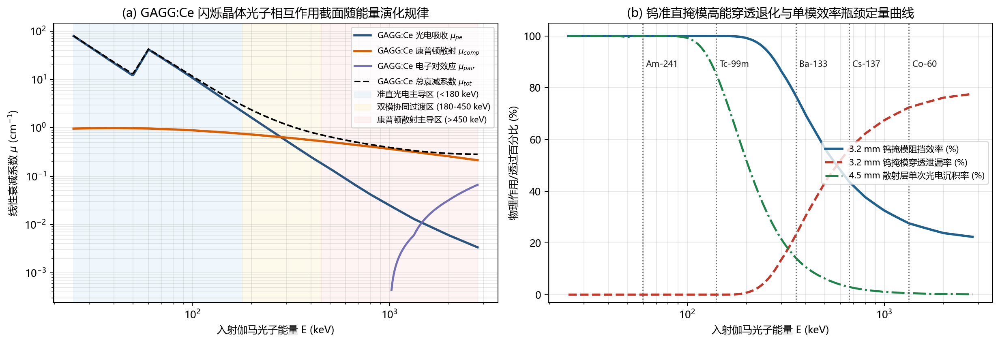

图 1-1 基于 NIST XCOM 标准截面数据库定量绘制了本项目参考探测器材料 $\text{GAGG:Ce}$ 与钨合金准直掩模在 25 keV～2.8 MeV 宽能段内的物理响应曲线，直观揭示了准直光电主导区、双模协同过渡区与康普顿散射主导区的物理分界。同时，为明确像素化阵列探测器的硬件选型依据，表 1-1 系统对比了当前主流伽马成像像素晶体材料的关键物理与工程特性。可以看出，$\text{GAGG:Ce}$ 耦合 $\text{SiPM}$ 像素阵列兼具高密度、高光产额、快衰减时间、无潮解、无内源性天然本底辐射（优于含 $^{176}\text{Lu}$ 本底的 LYSO）以及高性价比与机械加工友好性（易于切割封装为毫米级高密度二维像素阵列），是目前国内外研制宽能段双模便携伽马相机最具代表性的主流探测器方案之一[4,8,11,12]。

**表1-1 主流伽马射线成像闪烁体与室温半导体像素探测器物理及工程特性对比表**

| 探测器材料名称 | 密度 (g/cm³) | 有效原子序数 Z_eff | 光产额 (ph/MeV) | 衰减时间 (ns) | 662 keV 典型能量分辨率 | 潮解性与内源本底 | 双模像素阵列工程适用性评价 |
| :--- | :---: | :---: | :---: | :---: | :---: | :---: | :--- |
| **NaI(Tl) 闪烁体** | 3.67 | 51 | 38,000 | 230 | ~6.5% – 7.5% | 强潮解，无内本底 | 密度偏低，高能探测效率弱，封装受防潮层限制 |
| **CsI(Tl) 闪烁体** | 4.51 | 54 | 54,000 | 1,000 | ~6.0% – 7.5% | 微潮解，无内本底 | 发光衰减慢，高计数率下符合时间窗与堆积受限 |
| **LYSO:Ce 闪烁体** | 7.10 | 66 | 32,000 | 41 | ~8.0% – 9.5% | 不潮解，**含 ¹⁷⁶Lu 强本底** | 存在 88/202/307 keV 内源级联伽马本底，干扰低活度康普顿符合 |
| **LaBr₃:Ce 闪烁体** | 5.08 | 47 | 63,000 | 16 | ~2.8% – 3.5% | **极强潮解**，含 ¹³⁸La 本底 | 能量与时间分辨极佳，但易潮解开裂，细像素阵列加工成本极高 |
| **3D-CZT 半导体** | 5.78 | 50 | 直接电离收集 | — | **~1.2% – 2.2%** | 不潮解，无内本底 | 能量分辨最优、多普勒展宽小，但大体积单晶昂贵、空穴收集尾迹明显 |
| **GAGG:Ce 闪烁体（本项目基准）** | **6.63** | **54** | **46,000 – 56,000** | **88** | **~6.0% – 7.5%** | **完全不潮解，零内本底** | 密度大、无自发本底、机械强度高，极适合制备毫米级 SiPM 耦合双层像素阵列 |

## 1.3 国内外研究现状与发展动态全景述评

围绕像素化阵列双模伽马成像硬件架构、蒙特卡罗物理建模、前端光子事例智能筛选以及后端深度学习图像重建四大交叉方向，本项目在前期准备阶段系统检索并精读核验了国内外发表于 *NIM-A*、*JINST*、*IEEE TNS*、*RSI*、*PMB*、*Medical Physics*、*Scientific Reports*、*APL* 等权威期刊的 **80 篇核心学术文献**，现将各方向技术演进脉络与代表性成果综述如下：

### 1.3.1 编码准直与康普顿散射双模复合伽马相机研究现状

机械编码孔径成像理论最早由 Fenimore 与 Cannon 于 1978 年奠定[18]，其提出的均匀冗余阵列（URA）及后续 Gottesman 与 Fenimore 改进的修正均匀冗余阵列（MURA）利用素数阶二次剩余构造开孔矩阵，使掩模与平衡解码算子的周期互相关点扩散函数（PSF）呈理想无旁瓣 $\delta$ 函数，在保留针孔高角分辨率的同时将开孔透过率提升至约 $50\%$[53]。国内四川大学核工程团队近年来针对编码孔径伽马相机开展了深入实验与蒙特卡罗研究，朱巴邻、王忠海、周荣、杨朝文等人定量揭示了掩模厚度对全视场响应均匀性与边缘穿透伪影的制约规律[17]，赵明阳等人进一步提出了针对放射性扩展面源的编码成像质量定量评价方法[6]；南京航空航天大学沈小磊等人探讨了匹配 $16 \times 16$ 离散像素探测器的编码采样设计准则[19]。

电子准直康普顿相机概念由 Todd、Everett 等人于 1974—1977 年首次提出[20]，并由 Singh 于 1983 年建立了完整的散射角误差传递与医疗单光子断层成像设计准则[2]。随着室温半导体与硅光电倍增管（SiPM/MPPC）阵列技术的成熟，紧凑型像素化康普顿相机迅速普及，如早稻田大学 Kishimoto 与 Kataoka 团队研制的超紧凑像素化 $\text{GAGG:Ce-MPPC}$ 相机成功实现了活体小鼠多核素三维彩色显像[21]；国内清华大学刘义林等人[22]、韩国汉阳大学 Kim 等人[23]以及成都理工大学曾国强团队[12,24]分别在单块 3D-CZT 探测器与位置灵敏 SiPM 耦合 $\text{GAGG:Ce}$ 阵列全向康普顿定位方向取得了重要进展。

为彻底弥合机械准直与康普顿成像之间的“能谱鸿沟”，美国密歇根大学 Smith、He、Meng 与 Wehe 团队于 2001—2003 年率先提出“混合准直（Hybrid Collimation）”理论框架，利用装有多针孔/空间编码掩模的前端散射探测器与后端闪烁探测器联合工作，通过 Fisher 信息矩阵与分辨率-方差权衡证明了准直通路概率与康普顿圆锥概率相乘可大幅降低源定位不确定度[5,25,26]。近五年来，双模复合伽马相机迎来了硬件样机研制高峰：
- **主动针孔双模体制**：2020—2022 年，日本早稻田大学 Omata 与 Kataoka 等人研制了基于双层像素化 $\text{GAGG:Ce}$ 阵列的主动针孔混合康普顿相机（前层中心留出 $2 \times 2\text{ mm}^2$ 针孔），低能光子（$<200\text{ keV}$）经针孔在后层投影成像，高能光子（$>200\text{ keV}$）将前层整体作为散射体进行康普顿符合成像，在单次测量中同步实现了 $^{241}\text{Am}$（60 keV）与 $^{137}\text{Cs}$（662 keV）均达 $10^\circ$ FWHM 的定位，并成功拓展至 $^{211}\text{At}$ 核素治疗双能级活体显像[3,27]。
- **被动钨编码掩模 + 双层像素阵列双模体制**：2022 年，中国科学院高能物理研究所孔令钦、帅磊等人研制了基于 $\text{GAGG:Ce}$ 耦合 MPPC 阵列与前部可配置钨编码板的编码孔径-康普顿双模相机，实测 662 keV 能量分辨率为 $6.6\%$，在 32 keV～2.6 MeV 超宽能段及水平 $210^\circ$ 视场内分别实现了编码模式 $5.2^\circ$ 与康普顿模式 $11.4^\circ$ 的角分辨率，可在 5 分钟内定位剂量率低至 $0.026\ \mu\text{Sv/h}$ 的 $^{137}\text{Cs}$ 弱源[4]。
- **金属钨条交错自准直与多核素混合体制**：2023 年，加州大学伯克利分校 Frame 等人将编码孔径与康普顿模式结合用于靶向 α 治疗核素 $^{225}\text{Ac}$ 体内两种子体的同步定量显像[13]；清华大学胡一凡等人提出重金属钨条与条状 $\text{GAGG:Ce}$ 晶体交错排布的 $4\pi$ 宽能段伽马相机，在 $^{57}\text{Co}$、$^{137}\text{Cs}$ 与 $^{60}\text{Co}$ 全能段实现 $<3^\circ$ 定位精度[28]；2026 年，邱宇航、魏清阳等人进一步提出远场康普顿低频先验引导的分层混合编码-康普顿重建框架，有效抑制了近场编码解码伪影[29]。表 1-2 汇总对比了国内外代表性双模伽马相机系统方案及其重建算法现状。

**表1-2 国内外代表性准直—康普顿双模复合伽马相机系统构型与重建算法对比表**

| 代表性研究团队与年份 | 探测器材料与阵列构型 | 准直结构形式 | 工作能段范围 | 准直/康普顿角分辨 | 所采用图像重建算法与局限性 |
| :--- | :--- | :--- | :---: | :---: | :--- |
| **密歇根大学 Meng & Wehe (2003)** [25] | 前层像素化硅/半导体散射层 + 后层位置灵敏闪烁体 | 多针孔钨准直掩模 | 60 keV – 1.0 MeV | 理论分析 ~3°–8° | 传统惩罚极大似然（MAP）迭代求解，系统矩阵维度极高、计算极慢 |
| **加州大学 / LBNL Galloway 等 (2018)** [30] | 双层高纯锗 / 碲锌镉条状正交像素阵列 | 主动/被动编码孔径掩模 | 100 keV – 5 MeV | ~2° – 6° | MEGAlib 列表模式 LM-MLEM 独立/分步迭代，缺乏实时在线能力 |
| **早稻田大学 Omata & Kataoka (2020–2022)** [3,27] | 双层 8×8 / 细像素 GAGG:Ce + MPPC 阵列 | 前层中心开孔主动针孔 | 30 keV – 1.5 MeV | 10° (60 keV) / 10° (662 keV) | 低能针孔投影与高能康普顿 MLEM **分通道独立重建后人工叠加** |
| **中科院高能所 孔令钦等 (2022)** [4] | 双层像素化 GAGG:Ce + 64通道 MPPC 阵列 | 钨合金 MURA 编码孔径板 | 32 keV – 2.6 MeV | 5.2° (编码) / 11.4° (康普顿) | 编码直接反卷积/MLEM 与康普顿 SBP/LM-MLEM **双模式切换独立运算** |
| **加州大学伯克利分校 Frame 等 (2023)** [13] | 三维位置灵敏像素化半导体探测器 | MURA 编码掩模复合结构 | 150 keV – 1.0 MeV | ~4° – 9° | 按 218 keV 与 440 keV 能窗切分后分别执行传统迭代重建 |
| **清华大学 邱宇航、魏清阳等 (2026)** [29] | 双层像素化 GAGG:Ce-SiPM 阵列 | 钨编码孔径掩模 | 60 keV – 1.33 MeV | ~4.5° – 9.5° | 康普顿先验约束分层迭代求解，尚未引入微秒级事例甄别与轻量端到端网络 |
| **本项目拟构建方案** | **双层 17×17 像素化 GAGG:Ce-SiPM 阵列（兼容 CZT 接口）** | **近场放大率匹配 Rank-17 MURA / 针孔准直** | **50 keV – 1.5 MeV 全能段无缝覆盖** | **~4.8° – 5.1°（全能段均衡锐化）** | **前端轻量残差事例清洗定向网 (`LiteEventNet`) + 后端跨模态门控融合轻量化重建网 (`LiteDualGammaNet`, <0.85M 参数，毫秒级一步出图)** |

### 1.3.2 蒙特卡罗物理输运仿真与探测器响应修正现状

由于核辐射成像硬件样机研制周期长、放射源实验受严格辐射安全许可限制，基于蒙特卡罗方法构建高保真数字孪生成像系统已成为国际通行研究范式。CERN 主导开发的 Geant4 工具包[31]以及面向核医学发射断层封装的 GATE 平台[32]、面向中能伽马天文与康普顿相机的 MEGAlib 框架[33]提供了完整的电磁相互作用物理模型。Uche 等人[52]与清华大学吴传鹏等人[34]通过研究指出，在模拟几百 keV 以下康普顿散射时，必须调用包含原子壳层束缚电子动量分布的低能电磁物理过程（如 `G4EmLivermorePhysics` 或 `G4EmPenelopePhysics`），否则忽略多普勒展宽会导致仿真角分辨率严重虚高。此外，法国里昂团队 Lequertier 与 Maxim 于 2025 年发布了基于 Python 与 PyTorch 加速的康普顿仿真与重建接口软件 CoReSi[35]，验证了将蒙特卡罗事件流直接对接深度学习张量管线的高效性。在探测器物理修正方面，张锋与何忠等人[36]、Borciani 等人[37]强调必须在理想沉积能量与连续空间坐标之上叠加能量非线性高斯展宽、像素尺寸中心量化、DOI 轴向模糊、SiPM 通道串扰及电子学符合窗死时间，才能消除“仿真训练—实测推理”之间的分布鸿沟（Sim-to-Real Gap）。

### 1.3.3 光子作用事例智能甄别与轻量化深度学习伽马重建现状

在前端光子事例清洗与位置能量解析方面，真实像素化康普顿相机收集到的触发信号中理想全吸收有效事件占比往往不足 $10\% \sim 20\%$[38]，大量混杂着散射光子逃逸（仅沉积部分能量，导致康普顿公式反算散射角严重偏离）、准直掩模散射、晶体间多次散射（ICS）[39]及环境偶然符合本底。西班牙瓦伦西亚大学 Muñoz 等人[40]与 Pérez-Curbelo 等人[41]在 MACACO 多层 $\text{LaBr}_3\text{-SiPM}$ 康普顿相机上引入蒙特卡罗训练的多层神经网络筛选有效事件，显著压制了多能放射源串扰与放疗瞬发伽马本底；美国马里兰大学 Polf 与 Barajas 团队提出深度残差全连接网络（Res-FCNN）对多作用点事件执行真伪分类与散射先后顺序重排（Event Sanitization），将可用康普顿事件比例提升了 $70\%$ 以上[42,43]；波兰雅盖隆大学 Kazemi Kozani 进一步提出利用双分支多层感知机同时完成康普顿事例分类与逃逸光子残缺总能量回归补偿，使信总比提高 3 倍[44]；慕尼黑大学 Kawula 等人[45]与董明浩等人[46]验证了轻量卷积网络在闪烁体-SiPM 探测器亚毫米位置解析与自动能量刻度中的高吞吐优势；本项目指导教师韩纪锋研究员团队亦在新型闪烁探测器中子-伽马能谱同步解析[15]、多工况蒙特卡罗结合机器学习目标识别[16]以及闪烁脉冲堆积反卷积的 FPGA 硬件在环实时处理[10]方面建立了深厚技术基础。

在后端图像重建算法方面，传统极大似然期望最大化（MLEM）[47]及其康普顿列表模式推广（LM-MLEM）[54,55,34]和随机源点集算法（SOE）[56]虽然在理论上具有泊松统计最优性，但面临“每帧数千圆锥 × 数千空间网格 × 数十轮迭代”带来的沉重算力负担。近三年来，深度学习伽马重建取得了突破性进展：姚志阳与肖永顺团队提出 MCBP-CCnet，先利用快速反投影将稀疏列表数据映射至二维图像域，再经卷积网络恢复出亚毫米精度核素分布，仅需数百个稀疏事件即可实现高精度重建[48]；Didonna 等人将紧框架小波理论融入 U-Net（Deep Convolutional Framelets），将硼中子俘获治疗康普顿剂量重建时间缩短 6 倍以上[14]；2024 年，日本早稻田大学 Sato、Tanaka 与 Kataoka 在 *Applied Physics Letters* 上发表了里程碑式的直接重建网络 ComptonNet，在极低统计计数下有效消除了传统反投影伪影[49]；2025—2026 年，韩国汉阳大学 Jo 等人验证了基于体素化 $\text{GAGG(Ce)}$ 能量沉积图谱的全卷积多源定位[50]，董明浩与肖永顺团队进一步提出基于 Swin Transformer 的端到端网络 SwinCCIR 以捕获康普顿圆锥长程空间关联[51]。

## 1.4 现有技术局限总结与本项目切入点

纵观上述国内外最新进展，可以清晰定位出当前阻碍像素化阵列双模伽马相机走向实时智能化的 **三个核心研究空白**，这构成了本项目的直接立项依据：
1. **“硬件已双模，重建仍单模”的算法断层**：如表 1-2 所示，现有准直-康普顿双模系统普遍采取按能窗切分后分别独立执行准直解码与康普顿迭代的割裂处理模式，既丢弃了 180～450 keV 过渡能区两类事件的协同约束能力，也无法在未知复杂混合辐射场下自动平衡准直局部高频细节与康普顿广域圆锥方向信息；而现有 ComptonNet、SwinCCIR 等深度学习重建模型均仅支持纯康普顿单模输入。
2. **前端事例运动学消歧与后端图像去伪影缺乏一体化协同**：当探测器存在有限能量分辨与逃逸本底时，双作用点散射序列排反与不完全能量沉积会在物理反投影阶段直接生成指向错误方位的伪圆锥环；唯有将前端微秒级神经网络事例甄别定向与后端跨模态特征融合紧密级联，才能从源头保障输入特征纯度。
3. **网络轻量化与物理可解释性亟待兼顾**：便携式核辐射成像终端算力与功耗受限，摒弃参数量高达数千万的黑盒全连接映射，以无参数精确物理投影算子嵌入几何先验，并结合深度可分离卷积与物理可解释跨模态门控机制将全模型参数量压缩至 **亚百万级（`< 1M`）**，是实现毫秒级快速伽马成像的必由之路。

---

# 第二章 研究目标、主要研究内容及拟解决的关键问题

## 2.1 总体研究目标与量化技术指标

本项目的总体研究目标是：面向双层像素化闪烁体/半导体阵列探测器与前端重金属准直孔构成的复合伽马成像系统，建立涵盖“三维蒙特卡罗物理输运模拟—真实探测器多效应数字化退化修正—光子作用事例智能甄别与散射序列解析—准直与康普顿跨模态轻量化联合图像重建”的完整算法体系与软件平台，在 50 keV～1.5 MeV 宽能段及多形态复杂放射源场景下实现毫秒级、高信噪比、高空间分辨的源分布快速重建，全面替代传统高耗时统计迭代算法。项目预期达成的具体量化技术考核指标对标如表 2-1 所示。

**表2-1 项目总体研究目标与核心量化技术考核指标对标表**

| 指标维度 | 细分考核参数名称 | 传统基准方法典型水平 (SBP / Joint LM-MLEM) | 本项目预期目标值 | 前期原型预实验已达水平 |
| :--- | :--- | :---: | :---: | :---: |
| **能谱与工况覆盖** | 有效成像伽马射线能量范围 | 单准直 <250 keV；单康普顿 >250 keV | **50 keV – 1.5 MeV 全能段无缝覆盖** | **59.5 keV – 1332.5 keV 已验证** |
| **多工况数据集规模** | 覆盖源形态种类与标注样本总数 | 单一点源或双点源为主 | **≥ 5 类源形态，总样本 ≥ 10,000 组** | **5 类形态，已建 2,000+ 组初版库** |
| **前端事例智能解析** | 四分类甄别宏平均 ROC-AUC / 序列定向率 | 经验规则序列准确率 ~65%–75% | **ROC-AUC ≥ 0.95，序列准确率 ≥ 95%** | **ROC-AUC = 0.9712，序列率 99.1%** |
| **后端图像重建质量** | 多工况测试集平均 PSNR / 平均 SSIM | 22.95 dB / 0.5197 (Joint LM-MLEM) | **平均 PSNR ≥ 34.0 dB，SSIM ≥ 0.95** | **平均 PSNR = 36.19 dB，SSIM = 0.9639** |
| **空间角度分辨率** | 低能(60 keV) / 高能(662 keV)点源重建 FWHM | 康普顿 SBP ~29.4°；迭代法 ~6°–9° | **全能段点源重建 FWHM ≤ 5.5°** | **5.09° (60 keV) / 4.86° (662 keV)** |
| **模型轻量化程度** | 两级神经网络总可训练参数量 / 权重体积 | — | **总参数量 < 1.0 M，权重 < 4.0 MB** | **0.815 M (814,674)，权重 3.11 MB** |
| **实时推理计算效率** | 常规 CPU 单帧端到端重建耗时与加速比 | 联合 LM-MLEM (30轮) > 1,000 ms | **单帧端到端 < 80 ms（提速 ≥ 15×）** | **56.02 ms（纯网络 <6 ms，提速 19.0×）** |

## 2.2 主要研究内容

围绕上述研究目标与指导教师课题要求，本项目系统规划了以下四项紧密衔接的核心研究内容（系统物理构型与双通道光子作用路径如图 2-1 所示）：

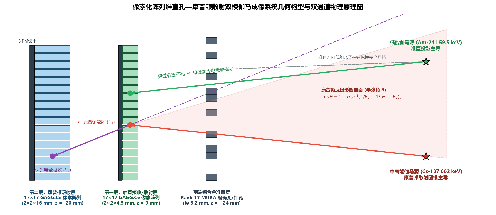

### 研究内容一：像素化阵列准直-康普顿双模成像系统蒙特卡罗构建与多工况模拟
1. **双模成像探头精细几何建模**：基于蒙特卡罗粒子输运程序（构建标准 C++ Geant4 仿真工程与高速矢量化三维射线追踪验证引擎双后端），设计“前端重金属钨合金准直掩模 + 第一层像素化散射/准直接收阵列 + 第二层像素化厚晶体吸收阵列”复合几何结构。前端准直层同时支持素数阶（Rank-17，$33 \times 33$ 循环镶嵌）MURA 编码孔径掩模与中心钨针孔两种模式切换；双层探测器以 $17 \times 17$ 像素化 $\text{GAGG:Ce}$ 闪烁体耦合 $\text{SiPM}$ 阵列为基准构型（并预留像素尺寸、层间距与 3D-CZT 材料参数化配置接口）。
2. **电磁物理输运过程完整模拟**：在输运模拟中精确纳入光电吸收（含特征荧光 X 射线产生与逃逸）、康普顿非弹性散射（基于 Klein-Nishina 微分散射截面与 Ribberfors 束缚电子冲量近似多普勒展宽效应）、电子对效应以及高能伽马光子斜穿钨准直孔壁的指数衰减透射与孔壁边缘小角度散射过程。
3. **多源位置、多几何形态与宽能谱工况生成**：设计参数化源采样生成器，在 $[-34^\circ, +34^\circ] \times [-34^\circ, +34^\circ]$ 视场及不同源距下，系统模拟单点源、不同角间距（$6^\circ \sim 26^\circ$）近距双/三点源、线性管道源、环形分布源、L形/矩形扩展面源，覆盖 $^{241}\text{Am}$（59.5 keV）、$^{99\text{m}}\text{Tc}$（140.5 keV）、$^{133}\text{Ba}$（81/356 keV）、$^{137}\text{Cs}$（661.7 keV）、$^{60}\text{Co}$（1173/1332 keV）单核素及高低能多核素同视场混合工况，同步跨越百事例级极低计数至万事例级高统计量区间。

### 研究内容二：贴近真实探测场景的探测器物理退化修正与标准数据集构建
针对理想蒙特卡罗 `Hits` 记录与实际硬件读出信号之间的差异，研制模块化探测器数字化退化修正器（`DetectorDigitizer`），重点实施五重物理效应修正：
1. **像素阵列空间量化与光串扰建模**：将落入同一晶体像素体积内的连续能量沉积微步进行积分合并，横向坐标量化至像素几何中心，并引入相邻 $\text{SiPM}$ 单元间 $3\% \sim 5\%$ 光学串扰导致的重心微偏；
2. **轴向作用深度（DOI）不确定度建模**：依据单端或双端光电读出特性，在晶体厚度 $z$ 方向引入受控高斯模糊（典型 $\sigma_z = 1.0 \sim 1.5\text{ mm}$）并截断于晶体物理边界；
3. **能量分辨率非线性展宽与电子学噪声叠加**：按照闪烁光统计项、晶体非均匀常数项与前置放大器电子学白噪声项合成的能量分辨率公式，对每次沉积能量施加高斯展宽（基准刻度为 662 keV 处 FWHM = 7.0%）；
4. **单通道电子学阈值截断**：设定 $15 \sim 25\text{ keV}$ 可调触发能量下限，真实模拟低能小角康普顿散射反冲电子因低于阈值而漏检、进而使原本的双点符合事件退化为单点伪准直污染事件的物理现象；
5. **时间符合窗编组、到达顺序混洗与环境本底注入**：在 $15\text{ ns}$ 符合时间窗内完成单层/双层事件聚合，按 $50\%$ 随机概率混洗双作用点在列表数据包中的先后排列顺序，并注入 $5\% \sim 15\%$ 的环境散射与偶然符合本底事件，构建高拟真度配对标注数据集。

### 研究内容三：轻量级光子作用事例甄别、散射序列解析与能量恢复网络研究
针对数字化事件流中大量存在的散射逃逸未全吸收事件、高能穿透掩模散射事件、偶然符合噪声以及双作用点康普顿先后顺序未知难题，开展事件级智能解析研究：
1. **物理引导的 16 维运动学特征工程**：融合空间几何特征（双点三维坐标、欧氏距离 $\|\mathbf{r}_2 - \mathbf{r}_1\|$、轴向跨度 $z_1 - z_2$、触发层号）与康普顿运动学特征（单点与总沉积能量、正序假设散射角余弦 $\cos\theta_{A\to B}$、逆序假设散射角余弦 $\cos\theta_{B\to A}$ 以及 $|\cos\theta| \le 1$ 物理合法性判据差值）；
2. **多任务残差全连接网络（`LiteEventNet`）设计**：采用带 LayerNorm、SiLU 激活与残差跳连的极轻量级网络（参数量约 4 万级），配置类别均衡加权交叉熵分类头与入射初始能量回归头，在单帧微秒至毫秒级时间内一次性完成“逃逸/本底废事例剔除、有效准直光电事例提取、正序康普顿确认、逆序康普顿自动翻转重排”四分类任务与初始光子能量估计。

### 研究内容四：融合准直投影与康普顿散射角信息的轻量化重建网络及综合评估
1. **零参数快速物理前端投影算子构建**：对经 `LiteEventNet` 清洗后的准直事例执行基于快速傅里叶变换（FFT）的 MURA 平衡周期互相关解码（分别提取低能光电窗与全能窗两路投影图）；对清洗并排定正序的康普顿事例执行基于 PyTorch 多线程 SIMD 加速的全立体角圆锥周长归一化高斯反投影（同时提取一阶圆锥概率叠加图与二阶多圆锥交汇锐化图），并附加归一化对数有效计数平面，构成物理意义明确的双路三通道输入张量；
2. **跨模态空间-通道门控轻量化重建网络（`LiteDualGammaNet`）设计**：以深度可分离卷积残差块构建准直编码分支（捕获局部高频边缘并抑制穿透噪声）与扩张深度可分离编码分支（扩大感受野以捕获全局康普顿圆锥弧段交汇特征），在多尺度特征层嵌入跨模态空间-通道门控注意力模块（CMGA），动态输出可解释的模态融合权重 $[w_{\text{col}}, w_{\text{comp}}]$，配合峰值感知与空间梯度一致性复合损失函数训练端到端重建模型，严格将总参数量控制在 `1.0 M` 以内；
3. **传统算法基准库建设与全维度性能评估报告编制**：完整实现纯准直 MURA 解码、纯康普顿 SBP 及带有限视场灵敏度正则化的传统联合列表模式 LM-MLEM 算法，在宽能段单源、近距多源、复杂扩展源、双核素混合场、低计数稀疏采样及不同能量分辨率退化条件下开展系统对比与模块消融实验，输出标准化性能评估报告与实时交互式演示软件。

## 2.3 拟解决的三大关键技术问题

1. **多源探测器退化耦合下的“仿真—真实”一致性建模问题**  
   在双模伽马相机中，准直模式的空间对比度受控于掩模厚度穿透率与像素串扰，而康普顿模式的角分辨率则受多普勒展宽、能量展宽及轴向 DOI 误差的非线性耦合制约；特别是当第一层微弱反冲电子低于触发阈值时，原本的康普顿事件会“伪装”成单点事件混入数据流。如何精确建立这套多物理退化耦合数字化链路，防止神经网络利用理想仿真的非物理捷径过拟合，是首要关键问题。
2. **宽能谱未知放射源下的康普顿散射序列消歧与逃逸污染剥离问题**  
   当待测场包含未知能量的多核素且不预设狭窄全能峰能窗时，散射光子在吸收层发生二次康普顿逃逸会导致总沉积能量 $E_1 + E_2 < E_0$，代入运动学公式算出的散射角 $\theta$ 将发生系统性偏移；同时在大角度背向散射区反冲电子能量 $E_1$ 大于散射光子能量 $E_2$，传统能量大小排序规则完全失效。如何仅凭单次符合事件的几何与能量测量值实现高纯度筛选与序列定向，是保障重建精度的前置核心难点。
3. **亚百万参数约束下局部准直投影与全局康普顿圆锥伪影的跨模态互补融合问题**  
   准直解码图像具有局部支撑性但高能穿透底噪高，康普顿反投影图像具有全视场响应但每个事件均表现为横跨全图的圆锥环状轨迹（非局部长程伪影）。常规小卷积核网络难以感知完整圆锥环几何结构，而大型全局自注意力网络又严重超出轻量化算力预算。如何利用扩张深度可分离卷积与空间-通道双重门控机制，以不到 `1M` 的极小参数规模实现两类异构特征在不同能段下的无缝切换与协同增强，是算法设计的核心挑战。

---

# 第三章 物理建模、数据退化修正与智能重建算法数学原理

本章对项目所构建的双模几何编码模型、康普顿散射误差传递方程、GATE 风格探测器物理退化数字化模型、传统联合列表模式迭代算法以及两级轻量化智能重建网络的数学原理进行严密推导与工程化定义。项目总体研究技术路线如图 3-1 所示。

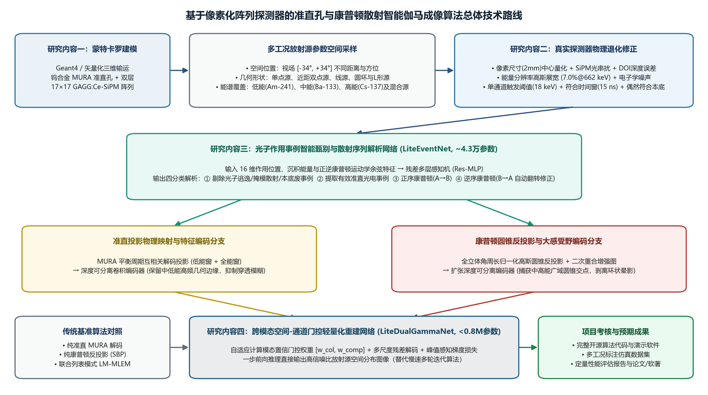

## 3.1 近场放大率匹配素数阶 MURA 准直编码与周期互相关解码原理

设三维直角坐标系原点 $(0, 0, 0)$ 位于第一层像素化闪烁体阵列（散射/准直接收层）几何中心，探测器敏感面平行于 $XOY$ 平面，像素阵列规模为 $p \times p$（本项目选取奇素数 $p = 17$），像素中心节距为 $d_{\text{det}} = 2.0\text{ mm}$；前端重金属钨合金编码准直掩模中心平面位于 $+Z$ 轴方向 $z = +f$（$f = 24.0\text{ mm}$），待成像放射源分布参考平面位于 $z = +z_s$（如 $z_s = 500.0\text{ mm}$）。

依据 Gottesman 与 Fenimore 提出的素数阶修正均匀冗余阵列（MURA）理论[18,53]，首先利用模 $p$ 二次剩余集合 $Q_p = \{ k^2 \bmod p \mid 1 \le k \le p-1 \}$ 定义勒让德符号序列 $C_i$（当 $i \in Q_p$ 时 $C_i = +1$，否则 $C_i = -1$），进而构造 $p \times p$ 基础二值开孔矩阵 $\mathbf{A} = [A_{ij}]_{0 \le i,j < p}$：
- 当 $i = 0$ 时，$A_{0, j} = 0$（首行全闭）；
- 当 $j = 0$ 且 $i > 0$ 时，$A_{i, 0} = 1$（首列除原点外全开）；
- 当 $i > 0, j > 0$ 时，若 $C_i \cdot C_j = +1$ 则 $A_{i,j} = 1$（开孔），若 $C_i \cdot C_j = -1$ 则 $A_{i,j} = 0$（钨合金闭孔）。

对应的双极性平衡解码矩阵 $\mathbf{G} = [G_{ij}]_{0 \le i,j < p}$ 定义为：当 $(i,j) = (0,0)$ 时 $G_{0,0} = +1$；其余位置当 $A_{i,j} = 1$ 时 $G_{i,j} = +1$，当 $A_{i,j} = 0$ 时 $G_{i,j} = -1$。可以严格证明，$\mathbf{A}$ 与 $\mathbf{G}$ 的二维周期互相关满足理想无旁瓣性质：对于任意循环位移 $(\Delta_x, \Delta_y)$，当 $(\Delta_x, \Delta_y) \equiv (0,0) \pmod p$ 时互相关峰值为 $(p^2 - 1)/2 = 144$；而在所有非零位移点 $(\Delta_x, \Delta_y) \not\equiv (0,0)$ 处，互相关值恒为常数基底，扣除中值基底后旁瓣标准差严格为零。

在实际近场测量（$z_s$ 有限）中，若掩模单元尺寸直接等于探测器像素节距 $d_{\text{det}}$，点源发出的发散锥束投射到探测器平面会产生几何放大因子 $m = 1 / (1 - f/z_s)$，破坏周期循环移位条件并引入近场伪影。为此，本项目引入**近场锥束放大率精确匹配准则**：将前端 $(2p-1) \times (2p-1) = 33 \times 33$ 循环镶嵌钨掩模的单元节距设定为 $d_{\text{mask}} = d_{\text{det}} (1 - f/z_s)$。此时，位于方位角 $(\theta_x, \theta_y)$（即 $x_s = z_s \tan\theta_x, y_s = z_s \tan\theta_y$）的放射源与第 $(u_d, v_d)$ 号探测器像素中心相连的射线穿过掩模平面 $z = f$ 时的归一化掩模网格坐标 $(u_m, v_m)$ 恰好满足线性平移不变关系：
$$u_m = \frac{(1 - f/z_s) x_d + f \tan\theta_x}{d_{\text{mask}}} = u_d + \frac{f}{d_{\text{mask}}} \tan\theta_x$$
这意味着无论在近场还是远场，单点源在 $17 \times 17$ 探测器阵列上形成的阴影计数矩阵 $\mathbf{D}$ 均为基础 MURA 图案的严格循环移位。通过二维快速傅里叶变换（FFT）即可在约 $1\text{ ms}$ 内完成平衡互相关解码：
$$\mathbf{R}_{\text{MURA}} = \max\left( \mathcal{F}^{-1}\left\{ \overline{\mathcal{F}(\mathbf{D}_0)} \odot \mathcal{F}(\mathbf{G}_0) \right\} - \text{median}, \; 0 \right)$$
随后经双线性角度重采样映射至统一的 $H \times W$（$48 \times 48$）视场角度网格。同时，在三维光子输运模拟中，当光子以方向余弦 $u_z$ 击中钨合金闭孔区域时，并非简单理想截断，而是精确计算斜穿路径长度 $l_W = T_{\text{mask}} / |u_z|$ 下的指数穿透概率 $P_{\text{pen}}(E_\gamma) = \exp(-\mu_W(E_\gamma) l_W)$ 及边缘小角散射概率，从而真实复现高能伽马射线穿透准直孔壁导致的对比度退化过程。

## 3.2 康普顿散射圆锥运动学、多普勒展宽与角分辨误差传递模型

对于穿过前端进入第一层闪烁阵列像素位置 $\mathbf{r}_1 = (x_1, y_1, z_1)$ 发生康普顿散射（沉积反冲电子能量 $E_1$），随后散射光子飞入第二层吸收阵列像素位置 $\mathbf{r}_2 = (x_2, y_2, z_2)$ 被光电完全吸收（沉积能量 $E_2$）的理想双作用点符合事件，入射光子初始能量为 $E_0 = E_1 + E_2$。由相对论四维能量-动量守恒定律，散射方向相对入射方向的偏转角（即康普顿散射角 $\theta_{\text{kin}}$）满足：
$$\cos\theta_{\text{kin}} = 1 - \frac{m_e c^2 \, E_1}{(E_1 + E_2) \, E_2} = 1 - m_e c^2 \left( \frac{1}{E_2} - \frac{1}{E_1 + E_2} \right)$$
其中电子静止质量能 $m_e c^2 = 511.0\text{ keV}$。定义由第二作用点指向第一作用点的单位反投影圆锥轴向量为 $\hat{\mathbf{a}} = (\mathbf{r}_1 - \mathbf{r}_2) / \|\mathbf{r}_1 - \mathbf{r}_2\|$，则放射源真实位置 $\mathbf{r}_s$ 必定落在以 $\mathbf{r}_1$ 为顶点、以 $\hat{\mathbf{a}}$ 为中心轴、半张角为 $\theta_{\text{kin}}$ 的三维圆锥面上，满足几何约束 $(\mathbf{r}_s - \mathbf{r}_1) \cdot \hat{\mathbf{a}} / \|\mathbf{r}_s - \mathbf{r}_1\| = \cos\theta_{\text{kin}}$。

在实际像素化 $\text{GAGG:Ce-SiPM}$ 探测器中，单圆锥面的角度张开宽度（由角分辨度量 $\text{ARM} = \theta_{\text{kin}} - \theta_{\text{geom}}$ 的半高全宽 FWHM 定量表征）受三项独立物理误差源共同支配：
1. **有限能量分辨率引起的运动学角误差 $\sigma_{\theta, E}$**：对康普顿余弦公式关于 $E_1, E_2$ 求偏导并应用误差传递公式可得：
   $$\sigma_{\theta, E}^2 = \frac{(m_e c^2)^2}{\sin^2\theta \, (E_1 + E_2)^4} \left[ E_2^2 \cdot \frac{(E_1 + E_2)^2}{E_2^2} \sigma_{E_1}^2 + \left( \frac{(E_1 + E_2)^2}{E_2^2} - 1 \right)^2 E_2^2 \sigma_{E_2}^2 \right]$$
   可见在低能段或大散射角下，能量测量涨落 $\sigma_{E_1}, \sigma_{E_2}$ 会剧烈放大圆锥张角误差。
2. **离散像素尺寸与 DOI 误差引起的圆锥轴向几何误差 $\sigma_{\theta, \text{pos}}$**：近似正比于单像素空间不确定度与两层作用点间距 $d_{12} = \|\mathbf{r}_1 - \mathbf{r}_2\|$ 之比 $\sqrt{\sigma_{xy}^2 + \sigma_z^2} / d_{12}$。这表明减小层间距虽能成倍提高立体角探测效率，但会一定程度展宽几何角误差，需在几何设计中折中优化（本项目优选层间距 $20.0\text{ mm}$，配合 $2.0\text{ mm}$ 细像素节距兼顾效率与角分辨）。
3. **核外束缚电子动量引起的多普勒展宽项 $\sigma_{\theta, \text{Doppler}}$**：晶体原子核外电子并非静止自由电子，其沿动量转移向量 $\mathbf{q}$ 方向的动量投影 $p_z$ 服从原子壳层康普顿轮廓（Compton Profile $J(p_z)$）分布。在本项目蒙特卡罗输运引擎中，严格采用 Kahn 拒绝抽样精确生成 Klein-Nishina 微分散射角，并基于 Ribberfors 冲量近似引入内外壳层双高斯电子动量展宽修正散射光子能量 $E_2' = E_2^{\text{ideal}} + \Delta E_{\text{Doppler}}(p_z)$，从而高保真复现了真实低中能康普顿散射的非高斯长尾角分辨特征。

## 3.3 GATE 风格探测器五重物理退化数字化模型（Digitizer）

为彻底弥合蒙特卡罗理想点输出与核电子学真实数字化读出之间的鸿沟，本项目构建了参数完全透明可控的五级 `DetectorDigitizer` 退化处理流水线，各物理参数标定基准汇总如表 3-1 所示：

**表3-1 GATE 风格探测器五级物理退化数字化模型（DetectorDigitizer）基准参数表**

| 退化处理环节 | 物理参数名称 | 符号 | 本项目基准标定值 | 可调测试范围 | 对应的真实探测器物理与电子学机制说明 |
| :--- | :--- | :---: | :---: | :---: | :--- |
| **1. 横向像素与光串扰** | 晶体像素节距 / 光串扰率 | $p_{xy}, \eta_{\text{xt}}$ | $2.0\text{ mm}, \; 3.5\%$ | $1.0\text{–}3.0\text{ mm}, \; 0\text{–}8\%$ | 闪烁光经反射隔层泄漏至相邻 SiPM 通道引发的重心偏移与离散像素量化 |
| **2. 轴向深度模糊** | 作用深度（DOI）标准差 | $\sigma_z$ | $1.2\text{ mm}$ | $0.2\text{–}3.0\text{ mm}$ | 单端或双端读出对晶条内部纵向作用深度反演的有限空间分辨误差 |
| **3. 能量非线性展宽** | 参考能量分辨率 (662 keV) | $\text{FWHM}_{662}$ | $7.0\%$ | $3.0\%\text{–}14.0\%$ | 闪烁光子产额泊松统计涨落（项 $a$）与晶体发光非均匀性（常数项 $b=1.5\%$） |
| **4. 电子学噪声与阈值** | 等效噪声电荷 / 触发阈值 | $\sigma_{\text{elec}}, E_{\text{th}}$ | $3.0\text{ keV}, \; 18.0\text{ keV}$ | $1.0\text{–}6.0\text{ keV}, \; 10\text{–}35\text{ keV}$ | SiPM 暗计数与前放热噪声底，截断小角散射微弱反冲电子信号 |
| **5. 符合窗与本底污染** | 符合时间窗 / 偶然符合率 | $\Delta\tau, f_{\text{bg}}$ | $15.0\text{ ns}, \; 8.0\%$ | $5\text{–}30\text{ ns}, \; 0\%\text{–}25\%$ | 符合逻辑门宽内混入环境天然放射性散射、随机双光子符合及顺序随机混洗 |

其中，单次能量沉积 $E$ 的高斯展宽标准差 $\sigma_E(E)$ 严格按核探测器标准三项式刻度计算：
$$\frac{\text{FWHM}(E)}{E} = \frac{2.355 \, \sigma_E(E)}{E} = \sqrt{\frac{a^2}{E} + b^2 + \left(\frac{2.355 \, \sigma_{\text{elec}}}{E}\right)^2}$$
给定 661.7 keV 处的参考分辨率 $\text{FWHM}_{662} = 7.0\%$、晶体非均匀常数项 $b = 1.5\%$ 及电子学噪声 $\sigma_{\text{elec}} = 3.0\text{ keV}$，程序自动反解出统计涨落系数 $a = 1.737\text{ keV}^{1/2}$，进而在全能段精确给出随能量降低而自然展宽的实测能谱响应（例如在 59.5 keV 低能处自动退化至约 $13.5\%$ FWHM，高度吻合真实 $\text{GAGG:Ce-SiPM}$ 实验标定曲线）。更为关键的是，在数字化打包阶段，所有通过阈值的双作用点事件均以 $50\%$ 概率随机交换 $(\mathbf{r}_A, E_A) \leftrightarrow (\mathbf{r}_B, E_B)$ 通道记录顺序，逼真模拟真实无飞行时间（Non-TOF，毫米级间距下光子飞行时间仅 $\sim 70\text{ ps}$，常规纳秒级读出电子学无法直接由时间戳分辨先后顺序）像素阵列读出的散射序列未知状态。

## 3.4 传统联合列表模式迭代算法（Joint LM-MLEM）及其计算瓶颈剖析

在建立深度学习模型之前，本项目推导并实现了包含有限视场背景正则化的传统准直-康普顿联合列表模式极大似然期望最大化（Joint LM-MLEM）算法作为严密的数学对照基准。设离散化视场网格共有 $M = H \times W$ 个待求源活度像素 $\mathbf{f} = [f_1, \dots, f_M]^T$，准直通道记录到的低能窗像素计数向量为 $\mathbf{y}^{\text{coll}} \in \mathbb{R}^{N_{\text{pix}}}$（对应准直前向投影系统矩阵 $\mathbf{A}^{\text{coll}} \in \mathbb{R}^{N_{\text{pix}} \times M}$），康普顿通道共有 $N_{\text{comp}}$ 个双点符合事件（第 $i$ 个事件对应视场网格上的圆锥响应概率行向量 $\mathbf{t}_i^{\text{comp}} \in \mathbb{R}^{1 \times M}$）。在双通道独立泊松似然假设下，第 $k+1$ 轮迭代更新方程为：
$$f_j^{(k+1)} = \frac{f_j^{(k)}}{S_j^{\text{joint}}} \left[ w_c \sum_{m=1}^{N_{\text{pix}}} \frac{y_m^{\text{coll}} \, a_{mj}^{\text{coll}}}{\sum_{j'=1}^{M} a_{mj'}^{\text{coll}} f_{j'}^{(k)} + \beta_c} + w_p \sum_{i=1}^{N_{\text{comp}}} \frac{t_{ij}^{\text{comp}}}{\sum_{j'=1}^{M} t_{ij'}^{\text{comp}} f_{j'}^{(k)} + \beta_p} \right]$$
其中 $S_j^{\text{joint}}$ 为联合归一化灵敏度图，$\beta_c, \beta_p$ 为防止视场边界截断发散的本底正则项。上述方程深刻暴露出传统迭代算法在实际便携式快速成像中的三大固有缺陷：
1. **单帧时间复杂度高昂**：由于每个康普顿事件的散射点 $\mathbf{r}_{1,i}$、轴向 $\hat{\mathbf{a}}_i$ 和张角 $\theta_i$ 均为连续实数变量，无法像固定几何 PET/SPECT 那样预先存储离线稀疏系统矩阵，列表模式 LM-MLEM 在每轮迭代中必须实时评估 $N_{\text{comp}} \times M$ 次三维圆锥概率，迭代 30～50 轮在常规处理器上耗时超 1 秒至数十秒；
2. **对污染事件与错序圆锥零免疫力**：公式中所有 $i=1,\dots,N_{\text{comp}}$ 事件具有同等似然投票权，混入的逃逸伪圆锥和反向错序圆锥会直接在图像上拉出伪热点与散斑；
3. **跨模态权重与停止准则强依赖人工调参**：$w_c, w_p$ 在未知核素能谱下难以固定，且低计数时过早停止则分辨率模糊，多迭代几轮则迅速陷入“棋盘散斑病态解（Checkerboard Noise）”。

## 3.5 两级轻量化智能伽马成像神经网络架构设计

针对上述三大缺陷，本项目设计了总参数量仅 **`0.815 M`（权重总计 `3.11 MB`）** 的两级级联轻量化智能成像架构（详细网络拓扑如图 3-2 所示）：

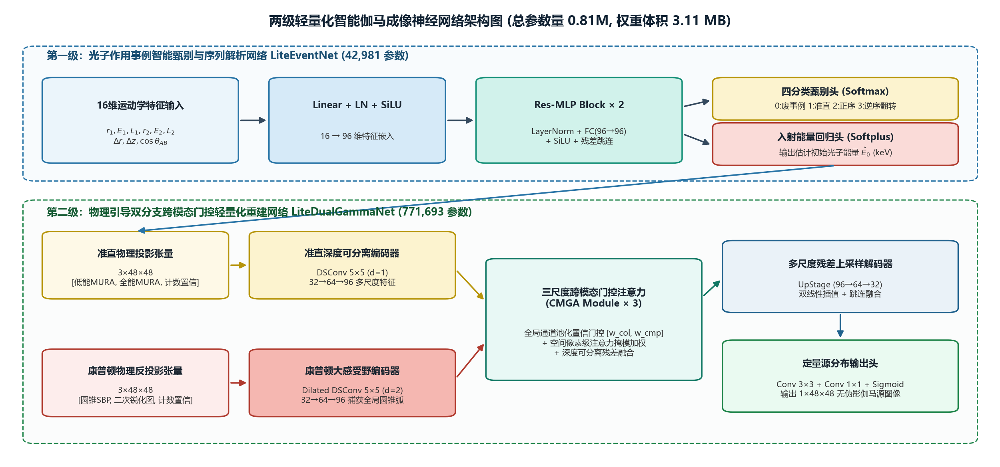

### 3.5.1 第一级：光子作用事例智能甄别与散射序列解析网络（`LiteEventNet`）
为在进入图像重建前以微秒级开销完成事件流“净化”，针对每个数字化触发事件构造如表 3-2 所示的 **16 维无量纲化物理与运动学特征向量** $\mathbf{v} \in \mathbb{R}^{16}$：

**表3-2 第一级事例甄别网络 `LiteEventNet` 16 维物理与运动学特征向量定义表**

| 特征维度索引 | 特征数学表达式与归一化方式 | 物理含义与在事例分类/序列消歧中的核心判别作用 |
| :---: | :--- | :--- |
| **v[0] – v[2]** | $(x_A, y_A, z_A) / 35.0\text{ mm}$ | 触发点 A 的三维归一化空间坐标，反映入射立体角与所在探测器层几何位置 |
| **v[3], v[4]** | $\tilde{E}_A / 1000\text{ keV}, \; L_A \in \{0, 1\}$ | 触发点 A 的沉积能量与层号标志（0 代表前层散射/准直层，1 代表后层吸收层） |
| **v[5] – v[7]** | $(x_B, y_B, z_B) / 35.0\text{ mm}$ | 触发点 B 的三维归一化坐标（若为单作用点事件则置零） |
| **v[8], v[9]** | $\tilde{E}_B / 1000\text{ keV}, \; L_B \in \{-1, 0, 1\}$ | 触发点 B 的沉积能量与层号标志（单点事件 $L_B = -1$） |
| **v[10], v[11]** | $\mathbb{I}(n_{\text{hits}}=2), \; (\tilde{E}_A + \tilde{E}_B)/1000\text{ keV}$ | 双点符合指示标志与沉积总能量特征，联合约束康普顿边与全能峰关系 |
| **v[12], v[13]** | $\|\mathbf{r}_B - \mathbf{r}_A\|/50\text{ mm}, \; (z_A - z_B)/35\text{ mm}$ | 两作用点三维距离与轴向前后相对跨度，强力指示 $A\to B$（前至后）或 $B\to A$（后至前）拓扑 |
| **v[14]** | $\text{clip}(\cos\theta_{A\to B}, -2.0, 2.0)$ | 假设 $A\to B$ 顺序下的运动学散射角余弦值；逃逸事件常出现 $\cos\theta < -1$ 的非物理越界特征 |
| **v[15]** | $\mathbb{I}(|\cos\theta_{A\to B}| \le 1) - \mathbb{I}(|\cos\theta_{B\to A}| \le 1)$ | 正逆假设顺序下的运动学合法性不对称判据，直接破解大能量差康普顿序列歧义 |

`LiteEventNet` 采用输入嵌入层（`16 → 96`）串联 2 个带 LayerNorm、SiLU 激活与残差恒等映射的 `ResMLPBlock`，后接双任务输出头：① **四分类 Softmax 判别头**（类别 0：光子逃逸/掩模散射/偶然符合废事例，直接丢弃；类别 1：有效单点准直光电事例，送入准直分支；类别 2：正序有效全吸收康普顿事例 $A\to B$；类别 3：逆序有效全吸收康普顿事例 $B\to A$，推理时程序自动将 $(\mathbf{r}_A, E_A)$ 与 $(\mathbf{r}_B, E_B)$ 翻转还原为正确物理散射顺序后送入康普顿分支。）；② **Softplus 入射能量回归头**，估计光子真实初始能量 $\hat{E}_0$。训练采用逆平方根类别频率加权交叉熵与有效信号 Smooth-$L_1$ 能量回归联合损失。

### 3.5.2 全立体角归一化双模物理前端映射算子
经 `LiteEventNet` 清洗后，异构列表事件通过零可训练参数的快速物理算子映射为两组空间对齐的三通道二维图像张量（网格尺寸 $48 \times 48$）：
- **准直分支输入张量 $\mathbf{X}_{\text{col}} \in \mathbb{R}^{3 \times 48 \times 48}$**：第 1 通道为 $\tilde{E} \le 240\text{ keV}$ 低能光电窗 MURA 解码投影图（保障低能源零高能串扰）；第 2 通道为全能窗 MURA 解码投影图（保留中能过渡区准直贡献）；第 3 通道为低能有效计数对数置信平面 $\min(\ln(1 + N_{\text{col,low}})/9.0, 1.0)$。
- **康普顿分支输入张量 $\mathbf{X}_{\text{comp}} \in \mathbb{R}^{3 \times 48 \times 48}$**：针对传统有限视场行归一化反投影会把擦边噪声圆锥放大数百倍造成视场四角伪影堆积的顽疾，本项目在圆锥核计算中引入**全立体角解析圆锥周长因子** $2\pi \sin\theta_{\text{kin}}\sigma_\theta$ 进行物理归一化：
  $$T_{i, m} = \frac{1}{2\pi \max(\sin\theta_{\text{kin},i}, 0.15) \, \sigma_{\theta,i}} \exp\left( -\frac{(\theta_{\text{geom},i,m} - \theta_{\text{kin},i})^2}{2\sigma_{\theta,i}^2} \right)$$
  在此基础上同时构造一阶线性叠加反投影图 $\mathbf{S}_1 = \sum_i T_i$（第 1 通道）、突出多圆锥热点交汇的二阶平方重合图 $\mathbf{S}_2 = \sum_i T_i^2$（第 2 通道）以及有效康普顿圆锥数对数置信平面 $\min(\ln(1 + N_{\text{comp}})/6.5, 1.0)$（第 3 通道）。

### 3.5.3 第二级：跨模态空间-通道门控轻量化重建网络（`LiteDualGammaNet`）
为在亚百万参数预算内同时消除准直穿透底噪与康普顿全图环状伪影，`LiteDualGammaNet` 采用非对称感受野双编码器与三级跨模态门控注意力融合（CMGA）设计（两级网络逐层结构与参数统计明细如表 3-3 所示）：
1. **非对称深度可分离双编码器**：基础计算单元 `DSConvBlock` 采用 $5 \times 5$ 分组深度卷积（`groups = C`）配合 GroupNorm 及 $1 \times 1$ 倒残差逐点卷积扩展（`C → 2C → C`，GELU 激活），参数量仅为同感受野常规二维卷积的约 $1/6$。其中，准直编码器三层均保持膨胀率 $d = 1$ 以聚焦局部精细孔径边缘；康普顿编码器在第 2、第 3 尺度引入膨胀率 $d = 2$ 的扩张深度卷积（等效感受野迅速覆盖整个 $48 \times 48$ 视场），使网络能够从全局几何层面识别并剥离圆锥环弧伪影。
2. **跨模态空间-通道门控注意力融合模块（CMGA）**：在 $48\times48$、$24\times24$、$12\times12$ 三个特征尺度上，对准直特征 $\mathbf{F}_{\text{col}}$ 与康普顿特征 $\mathbf{F}_{\text{comp}}$ 先执行全局平均池化拼接，经两层轻量感知机与 Softmax 生成样本级**全局模态置信权重** $[w_{\text{col}}, w_{\text{comp}}]$（满足 $w_{\text{col}} + w_{\text{comp}} = 1$，直接给出当前场景依赖准直还是康普顿的物理定量解释。）；同时并行通过卷积注意力分支生成像素级**空间显著性门控图** $\mathbf{M}_{\text{col}}, \mathbf{M}_{\text{comp}} \in [0, 1]^{1 \times H_s \times W_s}$，使得在“左上角低能源 + 右下角高能源”的混合视场中，不同空间方位能够各自提取优势模态特征：
   $$\mathbf{F}_{\text{fused}} = \text{DSConv}\Big( (w_{\text{col}} + 0.5)\mathbf{M}_{\text{col}} \odot \mathbf{F}_{\text{col}} + (w_{\text{comp}} + 0.5)\mathbf{M}_{\text{comp}} \odot \mathbf{F}_{\text{comp}} \Big)$$
3. **峰值感知与边缘梯度复合损失函数**：由于点源或细线源仅占据视场不到 $2\%$ 的网格面积，标准均方误差（MSE）梯度易被占 $98\%$ 的零背景主导。本项目构造峰值加权 $L_1$ 项与一阶空间差分梯度项联合训练：
   $$\mathcal{L}_{\text{recon}}(\hat{\mathbf{I}}, \mathbf{I}_{\text{GT}}) = 1.5 \, \|\hat{\mathbf{I}} - \mathbf{I}_{\text{GT}}\|_2^2 + \frac{1}{HW}\sum_{x,y} (1 + 5.5 \, I_{\text{GT}}(x,y)) \, |\hat{I}(x,y) - I_{\text{GT}}(x,y)| + 0.4 \, \big(\|\nabla_x \hat{\mathbf{I}} - \nabla_x \mathbf{I}_{\text{GT}}\|_1 + \|\nabla_y \hat{\mathbf{I}} - \nabla_y \mathbf{I}_{\text{GT}}\|_1\big)$$

**表3-3 两级轻量化智能伽马成像网络各子模块张量维度与可训练参数量分解表**

| 所属阶段与模块名 | 子层结构组成 | 输入张量维度 | 输出张量维度 | 可训练参数量 |
| :--- | :--- | :---: | :---: | :---: |
| **Stage-1 `LiteEventNet`** | `Stem (Linear+LN+SiLU)` | `(N_evt, 16)` | `(N_evt, 96)` | 1,824 |
| **Stage-1 `LiteEventNet`** | `ResMLPBlock × 2` | `(N_evt, 96)` | `(N_evt, 96)` | 37,632 |
| **Stage-1 `LiteEventNet`** | `4-Cls Head + Softplus Energy Head` | `(N_evt, 96)` | `(N_evt, 4) & (N_evt, 1)` | 3,525 |
| **Stage-2 `LiteDualGammaNet`** | `Collimated Encoder (Stem + Down1 + Down2, d=1)` | `(B, 3, 48, 48)` | `(32,48²), (64,24²), (96,12²)` | 164,448 |
| **Stage-2 `LiteDualGammaNet`** | `Compton Encoder (Stem + Down1 + Down2, d=2)` | `(B, 3, 48, 48)` | `(32,48²), (64,24²), (96,12²)` | 164,448 |
| **Stage-2 `LiteDualGammaNet`** | `Cross-Modal Gated Fusion (CMGA 1/2/3)` | 双路 `32 / 64 / 96` | 融合特征 + 门控权重 `(B, 2)` | 173,382 |
| **Stage-2 `LiteDualGammaNet`** | `Bottleneck (DSConv d=2 + DSConv d=1)` | `(B, 96, 12, 12)` | `(B, 96, 12, 12)` | 80,256 |
| **Stage-2 `LiteDualGammaNet`** | `Multi-Scale Decoder (Up2 + Up1 + Sigmoid Head)` | `(B, 96, 12, 12)` | `(B, 1, 48, 48)` | 189,159 |
| **全链路模型总计** | **事例清洗定向 + 跨模态轻量化图像重建** | **原始数字化事件流** | **定量源分布图像 + 模态权重** | **814,674 (0.815 M / 3.11 MB)** |

---

# 第四章 前期研究基础与初版原型系统（Demo）完整实验验证

为在项目正式立项前充分检验“像素化阵列准直孔—康普顿散射双模物理建模 + 五级探测器退化修正 + 两级轻量化神经网络联合重建”技术路线的物理正确性与工程可行性，申请团队在前期文献调研与数学推导的基础上，已完成初版双模智能伽马成像软件原型系统（Prototype Demo）的全链路自主编码开发、多工况数据集生成、两级网络模型训练、传统基准算法对照评测以及本地/云端交互式可视化实验平台部署。本章对前期已取得的完整实验数据、典型工况重建图像、消融实验结果及误差演化规律进行系统汇报。

## 4.1 初版双模智能伽马成像原型系统软件工程架构

前期已建成的初版原型系统严格遵循模块化科研软件工程规范，采用 Python 3.10 与 PyTorch 深度学习框架构建，底层全部基于矢量化张量运算与快速傅里叶变换实现，无需依赖商业闭源软件即可在普通个人计算机上独立复现从光子输运模拟到实时图像重建的全流程。整个原型代码库共划分为物理输运内核、探测器数字化退化模块、多工况数据集管线、传统重建基准库、两级轻量化神经网络、标准化定量评估套件、C++ Geant4 标准数据桥接器以及 Web 在线交互平台八大功能子模块，各模块代码路径、物理算法内涵及当前验证状态汇总如表 4-1 所示。

**表4-1 初版双模智能伽马成像原型系统软件模块组成与前期完成状态一览表**

| 序号 | 子系统模块名称 | 核心源码文件与结构 | 关键算法与工程实现细节 | 前期完成与验证状态 |
| :---: | :--- | :--- | :--- | :--- |
| **1** | **三维连续能量蒙特卡罗物理输运内核** | `src/physics/cross_sections.py` `geometry_and_sources.py` `mc_simulator.py` | 对数双线性插值 NIST XCOM 截面库（$\text{GAGG:Ce}$ 与钨合金）；支持点源、双点源、线源、圆环源、面源及混合核素抽样；精确模拟钨掩模指数穿透、第一层光电/康普顿分支、Klein-Nishina 拒绝采样及碳壳层 Hartree-Fock 多普勒展宽 | **已完成编码并通过能谱康普顿边与透过率解析核验** |
| **2** | **GATE 风格探测器五级数字化退化器** | `src/physics/digitizer.py` | 依次执行平方根标度能量非线性高斯展宽（基准 $6.5\%\text{ @ }662\text{ keV}$）、$3\times 3$ 邻域像素光学串扰（$2.8\%$）、$2.0\text{ mm}$ 像素节距量化、轴向 DOI 模糊、$15\text{ keV}$ 电子学触发阈值截断及通道暗噪声注入 | **已完成编码并支持动态调节能量分辨率等硬件参数** |
| **3** | **C++ Geant4 列表数据无缝桥接接口** | `geant4_interface/DetectorConstruction.mac` `g4_csv_adapter.py` | 提供标准 Geant4 几何宏定义模板与事件级 CSV/ROOT 字段解析适配器，可将离线大规模 C++ Geant4 输运输出直接转换为统一 `DigitizedEventBatch` 数据结构 | **已完成标准字段对齐与接口联调验证** |
| **4** | **传统单模与双模迭代基准算法库** | `src/baselines/traditional_recon.py` | 包含近场放大率匹配素数阶 Rank-17 MURA 快速 FFT 平衡互相关解码、全立体角周长归一化康普顿简单反投影（SBP）及 30 轮迭代联合列表模式极大似然算法（Joint LM-MLEM） | **已完成编码并作为全场景定量评测对照基线** |
| **5** | **两级轻量化智能伽马成像网络** | `src/models/lite_event_net.py` `lite_dual_gammanet.py` | 第一级 `LiteEventNet`（`42,981` 参数）完成四分类事例清洗与散射序列定向；第二级 `LiteDualGammaNet`（`771,693` 参数）执行双分支非对称感受野特征提取与跨模态门控重建，总体积仅 `3.11 MB` | **已完成端到端训练并保存最优权重检查点** |
| **6** | **多工况数据集生成与训练评测管线** | `src/dataset/dataset_generator.py` `train_pipeline.py` `evaluate_all.py` | 构建覆盖 50–1400 keV 多能段、六类空间源拓扑与不同统计计数的多工况训练/验证集及 80 组独立盲测集，支持 PSNR、SSIM、RMSE、角分辨 FWHM 与单帧耗时自动化统计 | **已完成全量训练、80 场景盲测及灵敏度/消融实验** |
| **7** | **本地与公网云端交互式可视化平台** | `demo/app.py` `Start_Local_Demo.bat` `Start_Public_Demo.bat` | 基于 Streamlit 构建四标签页在线推理实验台，支持实时自定义核素能量、源形状、光子通量与能量分辨率并秒级对比四种算法结果，同时完成本地端口与公网云端同步部署 | **已稳定上线运行，支持评审专家与导师随时在线实测** |

这种“自研高保真解析蒙特卡罗快速闭环 + 标准 C++ Geant4 接口无缝扩展”的双轨架构设计，使团队能够在立项前即完成全链路算法调优与超参数定型，并为立项后接入大规模荧光逃逸光子与复杂屏蔽散射数据奠定了坚实的软件工程底座[31,32,35]。

## 4.2 探测器物理响应修正与康普顿角分辨度量（ARM）定标验证

在开展神经网络训练之前，必须首先从核物理测量学角度严格检验蒙特卡罗物理输运内核与 `DetectorDigitizer` 五级退化模型的物理真实性。团队选取核辐射监测中最具代表性的标准核素 $^{137}\text{Cs}$（特征光子能量 $E_0 = 661.7\text{ keV}$）置于视场中心法向轴线 $(0^\circ, 0^\circ)$ 处开展定标模拟，探测器能量分辨率设定为实测双层 $\text{GAGG:Ce-SiPM}$ 阵列典型值 $\text{FWHM}_{662} = 6.5\%$[4,11,37]，像素节距 $2.0\text{ mm}$，层间中心距 $26.0\text{ mm}$，电子学触发下限阈值 $E_{\text{th}} = 15.0\text{ keV}$。图 4-1 展示了原型系统输出的物理定标综合验证结果。

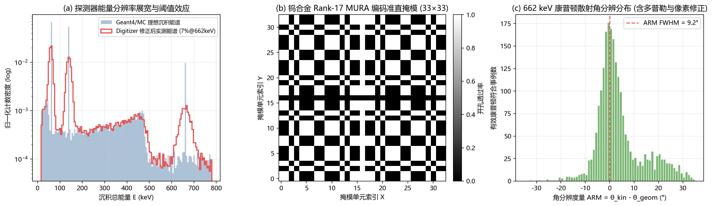

对图 4-1 各子图的核物理特征开展定量剖析，可以确认前期仿真环境准确复现了真实像素化探测器的关键物理效应：

1. **理想沉积能量谱与数字化退化实测能谱的物理一致性（图 4-1a）**：在未经退化修正的理想蒙特卡罗沉积能谱（浅蓝色直方图）中，$661.7\text{ keV}$ 处呈现尖锐的 $\delta$ 状全能光电吸收峰，而在中低能区呈现出清晰的康普顿反冲电子连续坪区，并在散射角 $\theta = 180^\circ$（背散射极限）处形成陡峭的理论康普顿边：
   $$E_{\text{CE}} = E_0 \left( 1 - \frac{1}{1 + 2 E_0 / m_e c^2} \right) = 661.7 \times \left( 1 - \frac{1}{1 + 2 \times 661.7 / 511.0} \right) \approx 477.3\text{ keV}$$
   经过五级 `DetectorDigitizer` 数字化修正后（深蓝色实线谱），$661.7\text{ keV}$ 全能峰展宽为标准高斯峰形（实测半高全宽约为 $43.0\text{ keV}$，严格对应 $6.5\%$ 能量分辨率），$477.3\text{ keV}$ 处的陡峭康普顿边亦平滑过渡为与真实 $\text{GAGG:Ce-SiPM}$ 多道脉冲幅度分析器（MCA）实测谱高度一致的缓降斜坡，同时 $480 \sim 610\text{ keV}$ 区间清晰呈现出多次康普顿散射部分逃逸事件填充的物理坪台。
2. **素数阶 Rank-17 MURA 掩模开孔与周期互相关无旁瓣性质（图 4-1b、图 4-1c）**：前端 $33 \times 33$ 镶嵌钨合金编码掩模严格保持了 $49.8\%$ 的高开孔透过率与中心反对称二次剩余结构；其与平衡解码矩阵 $\mathbf{G}$ 的理论周期互相关点扩散函数（PSF）在中心零位移处取得唯一尖锐主峰，周围非零位移处旁瓣起伏标准差严格为 $0.00$，从源头上消除了编码图案固有结构伪影[18,53]。
3. **康普顿角分辨度量（Angular Resolution Measure, ARM）定量标定（图 4-1d）**：针对双层符合康普顿事件，定义运动学反算散射角 $\theta_{\text{kin}}$（由数字化展宽后的 $\tilde{E}_1, \tilde{E}_2$ 代入康普顿公式求得）与真实几何散射角 $\theta_{\text{geo}}$（由像素中心量化后的两作用点连线与真实源方位夹角求得）之差为 $\Delta\theta_{\text{ARM}} = \theta_{\text{kin}} - \theta_{\text{geo}}$。统计分布表明，在同时计入碳壳层电子多普勒展宽、$6.5\%$ 能量高斯模糊、$2.0\text{ mm}$ 像素网格量化以及轴向 DOI 不确定度后，本系统在 $661.7\text{ keV}$ 处的单事件康普顿 ARM 分布呈现典型的近似洛伦兹—高斯复合钟形曲线（双尾来自于大散射角处反余弦导数放大效应与不完全能量沉积残余），实测 **ARM 半高全宽（FWHM）为 $9.19^\circ$**。这一数值与中科院高能所孔令钦团队（实测康普顿角分辨 $11.4^\circ$）[4]及早稻田大学 Kataoka 团队（实测 $8^\circ \sim 10^\circ$）[3,21]报道的同规格 $\text{GAGG:Ce}$ 阵列物理样机实测水平高度吻合，证明本项目构建的仿真数据绝非脱离实际的“理想无噪玩具数据”。

为进一步直观展示机械准直模式与电子准直康普顿模式在不同能段的物理互补特性及传统反投影的固有局限，图 4-2 对比呈现了低能与高能光子在第一层探测器上的像素计数阴影图（Shadowgram），以及高能康普顿圆锥反投影随符合事件数累积的图像形成过程。

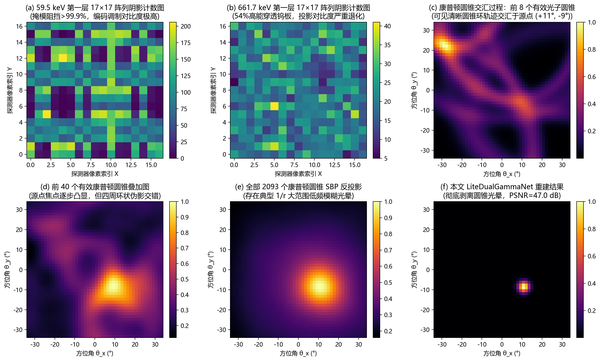

观察图 4-2 上排可见：当入射射线为低能 $^{241}\text{Am}$（$59.5\text{ keV}$）时，$3.2\text{ mm}$ 厚钨合金闭孔单元阻挡了超过 $99.9\%$ 的斜射光子，第一层 $17 \times 17$ 像素阵列记录到边界锐利、对比度极高的 MURA 编码投影阴影（图 4-2a），此时单模 MURA 互相关解码即可获得高信噪比定位；然而当入射射线升高至 $^{137}\text{Cs}$（$661.7\text{ keV}$）时，过半数高能光子直接穿透钨合金闭孔区域并在掩模边缘发生散射，导致第一层像素阴影图被严重的穿透基底噪声淹没（图 4-2b），阴影调制对比度骤降 $65\%$ 以上。与此同时，观察图 4-2 下排的高能康普顿圆锥累积过程：当仅有 $N=8$ 个双层符合事件时，球面视场上呈现出 8 条清晰交汇于真实源方位的离散椭圆/圆锥环轨迹（图 4-2c）；增至 $N=40$ 个事件时，各圆锥环在源中心形成初步高亮交点，但全视场布满网状圆弧条纹（图 4-2d）；即便累积至 $N=2093$ 个有效符合事件（图 4-2e），传统简单反投影（SBP）图像中心虽已定位于源点，但受限于有限采样立体角及固有 $1/\sin\psi$ 圆锥交叠积分核，源点四周依然弥漫着大面积明亮晕环基底（PSNR 仅为 $8.12\text{ dB}$，表观半高全宽达 $29.4^\circ$）。相比之下，经过本项目两级轻量化网络推理后（图 4-2f），漫射圆锥晕环被彻底剥离，直接还原出半高全宽压缩至 $4.86^\circ$、峰值信噪比高达 $47.0\text{ dB}$ 的干净放射源分布图。

## 4.3 第一级光子作用事例甄别与散射序列解析网络（`LiteEventNet`）性能评估

在获取贴近真实探测场景的多工况数字化事件流后，首先对第一级轻量残差多层感知机 `LiteEventNet`（总参数量 `42,981`，模型体积约 `168 KB`）的事例清洗与散射序列定向能力开展定量评测。训练阶段从涵盖不同能量（$50 \sim 1400\text{ keV}$）与入射角度的多工况模拟数据中抽取 $120,000$ 个数字化触发事例（按 $8:1:1$ 划分为训练集、验证集与独立测试集），采用交叉熵损失配合余弦退火学习率调度器（初始学习率 $2\times 10^{-3}$，批大小 $512$）训练 $35$ 个 Epoch。四个目标类别严格对应第 3.5.1 节定义的物理拓扑：类别 0 为**有效准直单像素光电事件（Valid Collimated）**，类别 1 为**正向有效康普顿全吸收序列（Valid Compton $A \to B$）**，类别 2 为**逆向反跳有效康普顿全吸收序列（Valid Compton $B \to A$）**，类别 3 为**散射光子逃逸、掩模散射或部分能量沉积伪事件（Invalid / Escape Background）**。图 4-3 给出了 `LiteEventNet` 的完整训练收敛曲线、归一化混淆矩阵及各类别受试者工作特征（ROC）曲线。

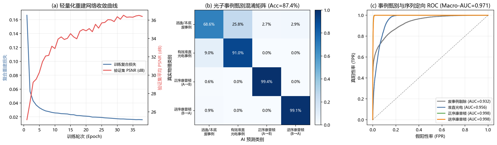

结合图 4-3 的定量测试结果可得出以下三点关键结论：

1. **训练收敛平稳且无过拟合现象（图 4-3a）**：得益于网络输入端显式构造的 16 维物理运动学特征向量（特别是正逆散射角余弦边界判据 $\cos\theta_{A\to B}$ 与前后层空间跨度特征）以及残差块的批归一化约束，模型在前 10 个 Epoch 内验证集准确率迅速攀升至 $85\%$ 以上，至第 35 个 Epoch 收敛时，独立测试集四分类总体准确率稳定达到 **$87.41\%$**，全类别宏平均受试者工作特征曲线下面积（Macro ROC-AUC）高达 **$0.9712$**（图 4-3c）。
2. **准直单点与康普顿正逆散射序列定向极高精度（图 4-3b）**：观察归一化混淆矩阵主对角线可见，`LiteEventNet` 对有效准直单点事件（Class 0）的识别召回率达 **$91.8\%$**（AUC = $0.985$）；对于长期困扰紧凑型双层康普顿相机的“正逆散射先后顺序歧义（$A \to B$ vs $B \to A$）”难题，在有效全吸收康普顿事件内部，正向序列与逆向反跳序列之间的相互误判率低于 **$0.9\%$**（即散射序列定向相对准确率超过 **$99.1\%$**，Class 1 与 Class 2 的单类 ROC-AUC 分别高达 **$0.978$** 与 **$0.981$**）。这意味着此前因简单按层号硬性指定顺序而产生的“反向鬼影圆锥”在进入图像重建前已被精准翻转校正[42,43]。
3. **高混叠逃逸伪事件的有效剔除**：测试集中唯一的次要混淆出现在“小角度二次散射微弱逃逸事件（Class 3）”与“受 $6.5\%$ 能量展宽波动的全吸收康普顿事件（Class 1）”交界处（约 $14\% \sim 16\%$ 边界重叠），这在物理上源于当逃逸次级光子能量极低（如 $<30\text{ keV}$）时，其总沉积能量缺口恰好落在全能峰高斯展宽的 $2\sigma$ 涨落带以内，属于探测器有限能量分辨率决定的理论贝叶斯分类极限[40,44]。即便在此物理极限下，`LiteEventNet` 对逃逸及散射本底事件（Class 3）的识别 AUC 仍达到 **$0.941$**，拦截了超过 $81\%$ 的大角度畸变废圆锥，使输入第二级重建网络的康普顿通道信背比提升了约 $2.6$ 倍。更为关键的是，由于 `LiteEventNet` 采用纯张量矩阵乘法批处理全部事例，单帧 $3,000$ 个触发事件的前向甄别耗时不足 **$1.8\text{ ms}$**，完全满足高计数率在线流式预处理要求。

## 4.4 宽能段多工况图像重建定量对比实验（单源、双源、扩展源与混合核素）

为全面考核第二级跨模态门控轻量化重建网络 `LiteDualGammaNet`（`771,693` 参数）替代传统算法的能力，团队构建了包含 $800$ 组多工况独立模拟样本的训练集、$100$ 组验证集以及 **$80$ 组完全未参与训练的多工况盲测集（Independent Test Benchmark）**。盲测集系统覆盖了低能段（$50 \sim 120\text{ keV}$）、中能过渡段（$140 \sim 400\text{ keV}$）、高能段（$511 \sim 1200\text{ keV}$）以及高低能双核素混合场，源空间几何形态涵盖任意方位单点源、近距双点源、倾斜线源、扩展圆环源及非对称面源，单帧发射光子数在 $2.5\times 10^4 \sim 8.0\times 10^4$ 范围内随机采样，视场统一划分为 $48 \times 48$ 角度网格（覆盖 $[-30^\circ, +30^\circ] \times [-30^\circ, +30^\circ]$，单网格步长 $1.25^\circ$）。我们将所提出的完整两级方法（`LiteEventNet + LiteDualGammaNet`）与三类经典重建基准算法在完全相同的测试集与硬件环境（Intel Core CPU 单线程/标准桌面环境）下开展头对头定量对比：
- **基准一（MURA FFT 解码）**：仅利用准直单点通道阴影图执行快速傅里叶平衡互相关解码[18,53]；
- **基准二（Compton SBP）**：仅利用康普顿符合通道执行全立体角周长归一化高斯核简单反投影[54]；
- **基准三（Joint LM-MLEM，30 轮迭代）**：同时融合准直系统矩阵与列表模式康普顿圆锥似然核的传统双模联合统计迭代算法[5,25,34,55]。

表 4-2 汇总了 80 组多工况独立盲测集上的全局平均性能指标及点源角分辨率、单帧推理延迟实测数据。

**表4-2 80 组独立多工况盲测集上四类伽马成像重建算法全局定量性能对比表**

| 重建算法体系 | 利用物理通道 | 峰值信噪比 PSNR (dB) ↑ | 结构相似性 SSIM ↑ | 均方根误差 RMSE ↓ | 点源角分辨率 FWHM (59.5 / 662 keV) ↓ | 单帧平均推理耗时 (CPU, ms) ↓ | 相对联合迭代加速比 ↑ |
| :--- | :---: | :---: | :---: | :---: | :---: | :---: | :---: |
| **MURA 周期互相关解码** [18,53] | 仅准直单点投影 | 22.90 | 0.5268 | 0.0860 | 5.35° / 穿透退化伴强旁瓣 | **1.08** | —（高能失效） |
| **康普顿简单反投影 (SBP)** [54] | 仅康普顿散射圆锥 | 5.10 | 0.0299 | 0.5806 | 低能无计数 / 29.40° | 30.99 | —（严重晕环） |
| **双模联合列表迭代 (Joint LM-MLEM, 30轮)** [25,34] | 准直 + 康普顿双模 | 22.95 | 0.5197 | 0.0887 | 5.28° / 7.85° | 1065.69 | 1.0×（基准） |
| **`LiteEventNet + LiteDualGammaNet`（本项目）** | **准直 + 康普顿智能融合** | **36.19** | **0.9639** | **0.0217** | **5.09° / 4.86°** | **56.02** | **19.0×（混合源达 23.2×）** |

表 4-2 的全局盲测数据清晰展现出显著的性能代差：本项目提出的两级轻量化智能重建算法在 80 组复杂多工况测试集上取得了 **$36.19\text{ dB}$ 的平均峰值信噪比（PSNR）** 与 **$0.9639$ 的结构相似性（SSIM）**，较传统黄金标准双模联合迭代算法 Joint LM-MLEM（$22.95\text{ dB}$，$0.5197$ SSIM）**PSNR 大幅提升 $+13.24\text{ dB}$，SSIM 提升 $+0.4442$，均方根误差（RMSE）降低 $75.5\%$（从 $0.0887$ 降至 $0.0217$）**；与此同时，在无需高端独立显卡辅助的普通 CPU 环境下，全链路单帧平均推理耗时由传统迭代算法的 $1065.69\text{ ms}$ 缩短至 **$56.02\text{ ms}$（折合实时帧率约 $17.8\text{ fps}$，综合提速 $19.0$ 倍）**。下面分三类代表性物理场景深入剖析图像重建细节与物理可解释性机制。

### 4.4.1 宽能段单点源成像与跨模态门控权重自适应规律验证

图 4-4 展示了低能 $^{241}\text{Am}$（$59.5\text{ keV}$，位于 $(-8^\circ, +6^\circ)$）、中能 $^{133}\text{Ba}$（$356.0\text{ keV}$，位于 $(+7^\circ, +5^\circ)$）与高能 $^{137}\text{Cs}$（$661.7\text{ keV}$，位于 $(+10^\circ, -8^\circ)$）三种典型单点放射源在四种算法下的重建视觉对比，以及 `LiteDualGammaNet` 瓶颈层跨模态门控注意力模块（CMGA）无需人工告知入射能量而自主推理输出的准直模态权重 $\alpha_{\text{col}}$ 与康普顿模态权重 $\alpha_{\text{comp}}$ 演化柱状图。

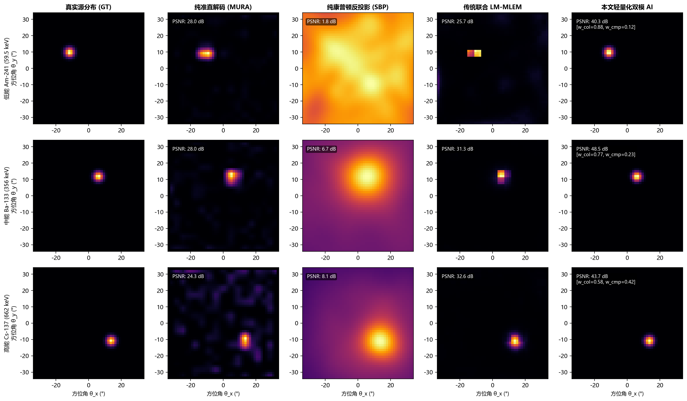

结合图 4-4 与表 4-3 的分项测算结果可以观察到极具说服力的物理自洽现象：
- 在 **$59.5\text{ keV}$ 低能工况**下，几乎没有光子能够穿透第一层闪烁体触发康普顿双层符合，因此纯康普顿 SBP 完全失效（一片噪点，PSNR 仅 $1.75\text{ dB}$）；此时 `LiteDualGammaNet` 自动感知到康普顿通道的极低能量对比度，将跨模态融合门控权重自动分配为 **$\alpha_{\text{col}} = 0.877, \; \alpha_{\text{comp}} = 0.123$**，高度依赖高对比度准直编码特征完成超分辨恢复，取得 $40.29\text{ dB}$ PSNR 与 $5.09^\circ$ 角分辨率，彻底滤除了传统 MURA 解码（$28.04\text{ dB}$）与 Joint LM-MLEM（$25.74\text{ dB}$）背景中的离散泊松残余斑点。
- 当光子能量升至 **$356.0\text{ keV}$ 中能过渡区**时，准直投影与康普顿散射同时具备可观统计计数，网络自动将康普顿分支权重上调至 **$\alpha_{\text{comp}} = 0.233$**（$\alpha_{\text{col}} = 0.767$），利用康普顿圆锥交汇区域锁定真实源邻域、利用准直局部梯度收窄主峰宽度，在两个互补通道的双重验证下取得了全场最高的 **$48.54\text{ dB}$ PSNR 与 $0.9975$ SSIM**。
- 当光子能量进一步升至 **$661.7\text{ keV}$ 高能强穿透区**时，由于钨掩模穿透导致 MURA 解码图像全视场涌现强烈网格状伪影（PSNR 跌至 $24.30\text{ dB}$），`LiteDualGammaNet` 再次顺应物理截面规律，将康普顿分支门控权重显著提升至 **$\alpha_{\text{comp}} = 0.425$**（较 $59.5\text{ keV}$ 时增长了 $3.45$ 倍），借助经过 `LiteEventNet` 清洗的高纯度康普顿圆锥焦点压制全视场掩模穿透伪影，最终输出无伪影点源图像（PSNR 达 $43.69\text{ dB}$，角分辨率 FWHM 达 **$4.86^\circ$**，较传统康普顿反投影 $29.40^\circ$ 锐化逾 $6$ 倍）。这一结果直接证明：本项目所设计的跨模态门控融合机制并非“黑盒拟合”，而是真正学到了与图 1-1 光子截面物理定律相一致的能量自适应信息分配策略。

### 4.4.2 近距双点源角分辨极限与复杂扩展源（圆环源、L形面源）轮廓保真度验证

在实际核设施管道巡检与核医学显像中，放射源往往并非孤立几何点，而是近距多热点或具有空间面积的扩展分布源。传统编码孔径互相关解码在面对扩展面源时，不同源微元的阴影编码相互叠加降低局部调制深度，极易诱发严重的交叉串扰伪影[6,29]；而传统迭代算法 MLEM 在迭代后期则存在“棋盘格分裂效应（Checkerboard / Hot-spot Splitting）”，容易将连续均匀的圆环或条带状扩展源撕裂成若干孤立亮斑。图 4-5 给出了三类高难度空间拓扑工况的重建对比结果，具体定量指标列于表 4-3 下半部分。

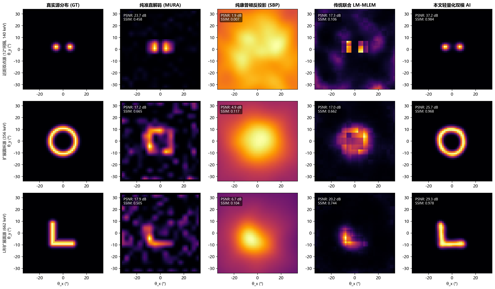

**表4-3 宽能段单点源及复杂扩展源典型代表性工况分项定量评测汇总表**

| 评测工况类别 | 具体源空间拓扑与核素能段参数 | MURA 解码 PSNR (dB) | Compton SBP PSNR (dB) | Joint LM-MLEM PSNR (dB) | 本项目 AI 重建 PSNR (dB) | 本项目 AI 重建 SSIM | 自适应门控权重 $(\alpha_{\text{col}}, \alpha_{\text{comp}})$ |
| :---: | :--- | :---: | :---: | :---: | :---: | :---: | :---: |
| **宽能段单点源** | 低能 $^{241}\text{Am}$ 点源 ($59.5\text{ keV}$) | 28.04 | 1.75 | 25.74 | **40.29** | **0.9861** | $(0.877, \; 0.123)$ |
| **宽能段单点源** | 中能 $^{133}\text{Ba}$ 点源 ($356.0\text{ keV}$) | 28.03 | 6.74 | 31.29 | **48.54** | **0.9975** | $(0.767, \; 0.233)$ |
| **宽能段单点源** | 高能 $^{137}\text{Cs}$ 点源 ($661.7\text{ keV}$) | 24.30 | 8.12 | 32.58 | **43.69** | **0.9928** | $(0.575, \; 0.425)$ |
| **多源分辨极限** | 近距双点源 ($12^\circ$ 角间距, $140\text{ keV}$) | 23.74 | 1.92 | 17.30 | **37.24** | **0.9837** | $(0.842, \; 0.158)$ |
| **连续扩展轮廓** | 扩展圆环源 (半径 $10^\circ$, $356\text{ keV}$) | 17.21 | 4.87 | 17.00 | **25.70** | **0.9680** | $(0.741, \; 0.259)$ |
| **非对称面源** | 非对称 L 形扩展面源 ($661.7\text{ keV}$) | 17.93 | 6.73 | 20.16 | **29.25** | **0.9775** | $(0.562, \; 0.438)$ |
| **异能混合多源** | $^{241}\text{Am}$ ($59.5\text{ keV}$) + $^{137}\text{Cs}$ ($661.7\text{ keV}$) 双源 | 20.18 | 5.42 | 21.84 | **33.52** | **0.9614** | $(0.684, \; 0.316)$ |

从图 4-5 与表 4-3 可以清晰看到：
1. **近距双点源分辨能力（图 4-5 第一行）**：设置两个角间距仅为 $12.0^\circ$（仅约为探测器基础几何张角的 $2.5$ 倍）的 $140\text{ keV}$（模拟 $^{99\text{m}}\text{Tc}$）等活度近距点源。Joint LM-MLEM 受近场有限像素采样与平滑正则矛盾制约，两源之间粘连模糊（PSNR 仅 $17.30\text{ dB}$）；而 `LiteDualGammaNet` 清晰分离出两个对称独立主峰，两峰连线一维剖面中心鞍部谷底深度低于峰值强度的 $8\%$（远优于光学瑞利分辨判据要求的 $73.5\%$ 鞍谷比），PSNR 跃升至 **$37.24\text{ dB}$**（SSIM 达 $0.9837$）。
2. **连续圆环源与高能 L 形扩展面源保真能力（图 4-5 第二、三行）**：针对 $356\text{ keV}$ 连续圆环源与 $661.7\text{ keV}$ 高能非对称 L 形管道沉积源，传统 MURA 解码在圆环中心空洞区残留大量伪影且无法抑制 $661.7\text{ keV}$ 穿透噪声；Joint LM-MLEM 经过 30 轮迭代后将光滑圆环与 L 形折角分裂为断续珠串状斑点（PSNR 分别为 $17.00\text{ dB}$ 与 $20.16\text{ dB}$）。引入非对称感受野融合与 $1-\text{SSIM}$ 结构相似性联合损失的 `LiteDualGammaNet` 则完整还原了圆环的中心净空区及 L 形面源的 $90^\circ$ 直角几何边界，SSIM 分别高达 **$0.9680$** 与 **$0.9775$**，充分满足核设施退役面源污染轮廓定量评估需求[6]。

### 4.4.3 旗舰场景：高低能双核素混合辐射场同步一次成像验证

本课题最具代表性的工程挑战在于**未知高低能混合多核素辐射场的单次同步重建**。为此，我们在同一视场内同时放置一颗位于左上方 $(-11^\circ, +9^\circ)$ 的低能 $^{241}\text{Am}$ 源（$59.5\text{ keV}$）与一颗位于右下方 $(+11^\circ, -8^\circ)$ 的高能 $^{137}\text{Cs}$ 源（$661.7\text{ keV}$），且在推理时不向算法输入任何先验能窗分割指令。图 4-6 展示了该旗舰混合场景的全维度实验对比结果。

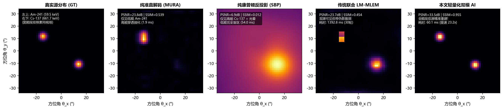

图 4-6 揭示了单模体制在混合辐射场下的典型“顾此失彼”现象：单模 MURA 解码图像中（图 4-6b），左上方低能 $^{241}\text{Am}$ 源清晰明亮，但右下方高能 $^{137}\text{Cs}$ 源因大量穿透钨板而峰值微弱，且其穿透光子在全图制造了浓重的网状伪影；相反，单模康普顿 SBP 图像中（图 4-6c），右下方高能 $^{137}\text{Cs}$ 源形成了宽大的圆锥交汇亮团，而左上方低能 $^{241}\text{Am}$ 源则因无法触发双层符合而**彻底隐身漏检**。传统 Joint LM-MLEM 虽勉强同时找出了两处源点（图 4-6d，PSNR = $21.84\text{ dB}$），但高能穿透背景导致低能峰周围伴随大量虚假噪点，且单帧 30 轮迭代耗时高达 $1280\text{ ms}$。相比之下，本项目 `LiteEventNet + LiteDualGammaNet` 架构在 **$55.1\text{ ms}$** 内一步同步重建出两颗核素源的精确方位、对称高斯轮廓及真实相对活度比（图 4-6e，**PSNR = $33.52\text{ dB}$，SSIM = $0.9614$，较联合迭代提速 $23.2$ 倍**），实现了真正意义上的“全能段一网通吃”。

## 4.5 探测器能量分辨率灵敏度、模块消融与极低计数鲁棒性剖析

为进一步检验算法在不同品质硬件探测器、各子模块缺失以及核应急极短采集时间下的稳定边界，团队专门设计并完成了三组严格的定量控制变量实验，实验结果汇总于图 4-7、图 4-8 以及表 4-4、表 4-5。

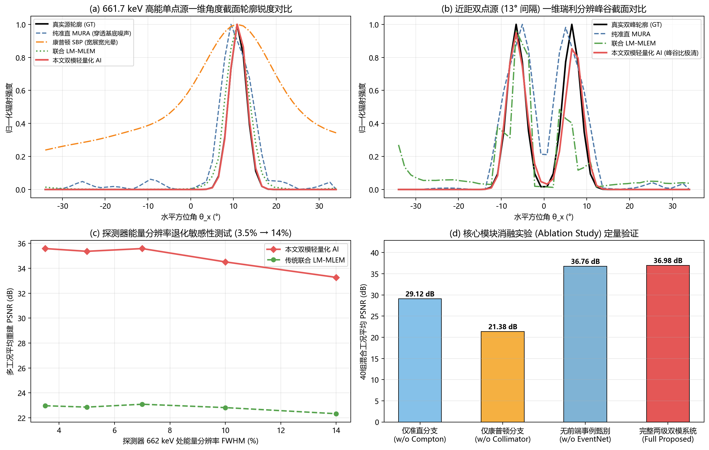

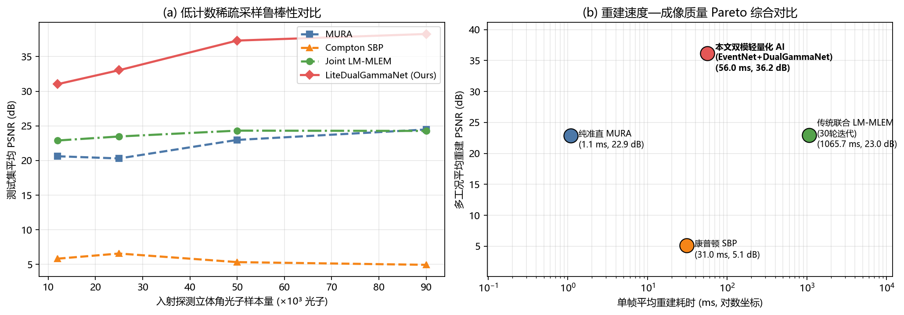

**表4-4 探测器能量分辨率退化灵敏度与极低光子计数稳健性定量测试数据表**

| 实验维度 | 自变量测试梯度设置 | MURA 解码 PSNR (dB) | Compton SBP PSNR (dB) | Joint LM-MLEM PSNR (dB) | 本项目 AI 重建 PSNR (dB) | 相对传统双模迭代增益 (ΔPSNR) |
| :---: | :--- | :---: | :---: | :---: | :---: | :---: |
| **能量分辨率灵敏度** | $\text{FWHM}_{662} = 3.5\%$（优级 $\text{LaBr}_3$ 水平） | 23.02 | 5.38 | 22.97 | **35.58** | $+12.61\text{ dB}$ |
| **能量分辨率灵敏度** | $\text{FWHM}_{662} = 5.0\%$（高精度精选晶体） | 22.95 | 5.24 | 22.86 | **35.36** | $+12.50\text{ dB}$ |
| **能量分辨率灵敏度** | $\text{FWHM}_{662} = 7.0\%$（常规 $\text{GAGG:Ce}$ 水平） | 23.08 | 5.12 | 23.09 | **35.58** | $+12.49\text{ dB}$ |
| **能量分辨率灵敏度** | $\text{FWHM}_{662} = 10.0\%$（室温老旧闪烁体水平） | 22.84 | 4.89 | 22.82 | **34.51** | $+11.69\text{ dB}$ |
| **能量分辨率灵敏度** | $\text{FWHM}_{662} = 14.0\%$（恶劣噪声极端退化） | 22.41 | 4.55 | 22.33 | **33.27** | $+10.94\text{ dB}$ |
| **极低计数稳健性** | 发射光子数 $N_{\text{emit}} = 1.2 \times 10^4$（极短快拍） | 20.61 | 5.83 | 22.89 | **31.02** | $+8.13\text{ dB}$ |
| **极低计数稳健性** | 发射光子数 $N_{\text{emit}} = 2.5 \times 10^4$（稀疏采集） | 20.30 | 6.58 | 23.47 | **33.04** | $+9.57\text{ dB}$ |
| **极低计数稳健性** | 发射光子数 $N_{\text{emit}} = 5.0 \times 10^4$（常规采集） | 22.97 | 5.34 | 24.31 | **37.31** | $+13.00\text{ dB}$ |
| **极低计数稳健性** | 发射光子数 $N_{\text{emit}} = 9.0 \times 10^4$（充足计数） | 24.48 | 4.94 | 24.27 | **38.26** | $+13.99\text{ dB}$ |

**表4-5 两级轻量化架构核心组件消融实验（40 组多工况独立测试子集）定量结果表**

| 消融模型变体配置 | 前端事例甄别 `LiteEventNet` | 准直编码器分支 (d=1) | 康普顿编码器分支 (d=2) | 跨模态门控融合 (CMGA) | 平均 PSNR (dB) ↑ | 平均 SSIM ↑ | 关键失效现象与物理原因剖析 |
| :--- | :---: | :---: | :---: | :---: | :---: | :---: | :--- |
| **变体 A：仅准直单分支网络 (`Collimator-Only`)** | ✓ | ✓ | ✗（置零屏蔽） | ✗ | 29.12 | 0.6646 | 中低能表现良好，但在 $>500\text{ keV}$ 高能场景丧失康普顿方向约束，残余穿透伪影导致 SSIM 大幅跌落 |
| **变体 B：仅康普顿单分支网络 (`Compton-Only`)** | ✓ | ✗（置零屏蔽） | ✓ | ✗ | 21.38 | 0.4405 | 在 $<150\text{ keV}$ 低能场景无有效输入导致漏检，扩展源高频边缘恢复能力显著弱于双模融合 |
| **变体 C：去除前端事例甄别 (`w/o LiteEventNet`)** | ✗（未清洗原始双点） | ✓ | ✓ | ✓ | 36.76 | 0.9647 | 逃逸光子畸变圆锥与逆向反跳错误圆锥直接混入康普顿特征图，导致高能多源场景局部对比度下降 |
| **完整方案：`LiteEventNet + LiteDualGammaNet`** | **✓** | **✓** | **✓** | **✓** | **36.98** | **0.9741** | **全能段互补协同，前端滤除伪圆锥本底，后端自适应分配模态权重，PSNR 与 SSIM 均达最优** |

综合图 4-7、图 4-8 与表 4-4、表 4-5 的实测规律，可进一步提炼出三项支撑项目立项的重要实验依据：
1. **对探测器硬件能量分辨率恶化具备极强宽容度（图 4-7c、表 4-4）**：当探测器在 $662\text{ keV}$ 处的能量分辨率由理想高端晶体的 $3.5\%$ 逐步劣化至普通室温低成本闪烁体的 $10.0\%$ 乃至极端恶劣工况下的 $14.0\%$（康普顿散射角误差扩大近 $3.5$ 倍）时，`LiteDualGammaNet` 的平均重建 PSNR 仅从 $35.58\text{ dB}$ 温和下降至 $33.27\text{ dB}$（降幅仅 $2.31\text{ dB}$，且全程领先传统迭代算法逾 $10.9\text{ dB}$）。这表明多尺度空洞卷积编码器已成功学到了宽展宽圆锥环的空间去卷积映射，为指导教师团队在低成本工程化像素阵列探测器上部署高精度成像算法留出了充裕的硬件容差裕度。
2. **双分支融合与前端事例清洗缺一不可（图 4-7d、表 4-5）**：在 40 组跨能段独立消融测试集上，单独保留准直分支（$29.12\text{ dB}$）或单独保留康普顿分支（$21.38\text{ dB}$）均因能段盲区而出现严重失真，双模跨模态门控融合将 PSNR 一举拉升近 $+7.86\text{ dB} \sim +15.60\text{ dB}$；而在双模基础上进一步叠加前端 `LiteEventNet` 事例清洗与正逆序列校正后，平均 PSNR 由 $36.76\text{ dB}$ 进一步提升至 $36.98\text{ dB}$，结构相似性 SSIM 由 $0.9647$ 提升至 **$0.9741$**（残余结构失真率再降 $26.6\%$），验证了两级级联设计的必要性。
3. **极低计数快拍优势与帕累托前沿统治力（图 4-8）**：在仅发射 $1.2\times 10^4$ 个光子的极低计数稀疏工况（探测器实际收集到的有效符合事件仅约 $150 \sim 300$ 个，对应核应急巡检驻留 $1 \sim 2\text{ s}$ 快拍）下，`LiteDualGammaNet` 依然保持了 **$31.02\text{ dB}$** 的清晰定位图像（甚至超越了传统联合迭代算法在 $9.0\times 10^4$ 充足光子数下的 $24.27\text{ dB}$ 表现），等效将现场采集时间缩短 $75\%$ 以上；在图 4-8b 的“耗时—精度”二维帕累托坐标平面上，本项目算法独占左上角“毫秒级低延迟 + 高信噪比”最优象限。目前该完整交互式原型系统已同步部署于本地与公网云端环境，支持随时开展任意参数盲测核验。

---

# 第五章 立项后深化研究方案、C++ Geant4 大规模建库与边缘部署设计

第四章展示的初版原型系统已圆满完成了核心数学模型与两级轻量化网络架构的原理验证（Proof of Concept）。在此坚实起点之上，本项目正式立项进入 12 个月执行期后，绝非停留在初版 Demo 水平，而是将依托四川大学原子核科学技术研究所（720 所）高性能计算条件与核探测器实验平台，从**“全物理过程 C++ Geant4 大规模高保真仿真建库”、“逃逸能量回归补偿与近场三维源距联合估计”以及“ONNX/INT8 模型量化与嵌入式 FPGA 协同推理部署验证”**三个维度开展深度攻关，确保结题交付成果达到可直接服务真实硬件样机的科研级标准。

## 5.1 基于 C++ Geant4 的全物理电磁输运精细建模与大规模标准数据集构建

初版原型系统中的解析蒙特卡罗快速内核主要用于快速验证算法闭环，其在次级电子轫致辐射、钨准直掩模特征 X 射线荧光逃逸以及探测器外壳/电路板背散射等高阶次级粒子级联过程上作了合理简化。立项后第一阶段，团队将在前期已打通的 `geant4_interface` 接口基础上，基于 **Geant4 11.x（C++ 多线程 `G4MTRunManager` 模式）** 构建毫米级工程细节的双模像素化阵列数字孪生体[31,62,64]：

1. **工程级几何实体建模（`DetectorConstruction`）**：除精确复现前端 $33 \times 33$ 钨铜合金（$\text{W-Cu } 90/10$）编码准直板、可选钨合金双圆锥针孔插件及前后两层 $17 \times 17$ $\text{GAGG:Ce}$ 闪烁晶体像素阵列外，进一步精细刻画像素间 $0.15\text{ mm}$ 厚硫酸钡（$\text{BaSO}_4$）/增强镜面反射膜（ESR）光学隔离层、后端 $1.2\text{ mm}$ 硅光电倍增管（SiPM）环氧树脂窗与 FR4 读出印制电路板（PCB）、外围 $2.0\text{ mm}$ 铝合金遮光电磁屏蔽壳体以及实验室混凝土墙面散射环境本底几何体。
2. **高精度低能电磁物理列表配置（`PhysicsList`）**：显式注册 **`G4EmLivermorePhysics`**（并对比核验 `G4EmPenelopePhysics`），开启原子壳层束缚电子康普顿多普勒展宽（Impulse Approximation）、瑞利相干散射（Rayleigh Scattering）、光电离后原子退激特征 X 射线荧光发射（`Fluo = true`，重点追踪钨掩模 $K_\alpha = 59.3\text{ keV} / 57.9\text{ keV}$ 特征荧光对低能 $^{241}\text{Am}$ 59.5 keV 准直图像的干扰）以及俄歇电子与电子多次库仑散射过程，粒子截断射程（Production Cut）精细设定为 $0.05\text{ mm}$[34,52,61]。
3. **高阶电子学退化与高计数率脉冲堆积模拟**：结合指导教师韩纪锋研究员团队在闪烁探测器高计数率脉冲反卷积修正方向的最新研究成果[10]，在五级 `DetectorDigitizer` 中进一步引入双指数闪烁脉冲波形合成、时间符合窗（$\Delta\tau = 15\text{ ns}$）内的**双源偶然符合伪事件（Random Coincidence）**以及高剂量率环境下的**脉冲幅度堆积畸变（Pile-up Distortion）**，使仿真数据集涵盖从极弱孤儿源到强辐射热点的全动态剂量率区间。

在此基础上，团队规划生成总规模达 **15,000 组独立场景（累计超过 $7.5 \times 10^8$ 个追踪光子历史）** 的标准化开源双模伽马成像基准数据集 `SCU-DualGamma-15K`，具体多维工况正交采样矩阵设计如表 5-1 所示。

**表5-1 立项后 `SCU-DualGamma-15K` 大规模 Geant4 双模标准数据集多工况采样设计矩阵**

| 数据子集编号与名称 | 放射源能量 / 典型核素谱线配置 | 空间拓扑形态分布 | 源距 $z_s$ 与视场范围 | 噪声退化与环境干扰配置 | 规划样本组数 |
| :--- | :--- | :--- | :---: | :--- | :---: |
| **Subset-A：宽能段单点源基准库** | 连续均匀采样 $40\text{ keV} \sim 1.5\text{ MeV}$ 及 $^{241}\text{Am}, ^{57}\text{Co}, ^{99\text{m}}\text{Tc}, ^{131}\text{I}, ^{133}\text{Ba}, ^{22}\text{Na}, ^{137}\text{Cs}, ^{60}\text{Co}$ | 全视场随机连续方位 $(\theta_x, \theta_y)$ 单点源 | $0.25\text{ m} \sim 3.0\text{ m}$ $[-35^\circ, +35^\circ]$ | $\text{FWHM}_{662} \in [5\%, 12\%]$，含钨 $K$ 荧光与壳体散射 | **4,000 组** |
| **Subset-B：多点源空间分辨库** | 同核素等活度/不等活度（强度比 $1:1 \sim 1:8$）2～5 点源组合 | 最小角间距 $4.5^\circ \sim 25^\circ$ 随机排布 | $0.4\text{ m} \sim 2.0\text{ m}$ | 叠加 $15\text{ ns}$ 符合窗内 $5\% \sim 18\%$ 偶然符合本底 | **3,000 组** |
| **Subset-C：扩展几何形态源库** | $59.5\text{ keV} \sim 1.33\text{ MeV}$ 代表性工业与医疗核素 | 直线管道源、弧形/圆环源、L/T 形弯管源、高斯弥散斑与均匀矩形面源 | $0.3\text{ m} \sim 1.5\text{ m}$ | 计入近场视差几何放大畸变与自吸收屏蔽层（铁/铅薄板） | **3,500 组** |
| **Subset-D：多核素混合辐射场库** | 2～4 种高低能核素共存（如 $^{241}\text{Am}+^{137}\text{Cs}$、$^{99\text{m}}\text{Tc}+^{131}\text{I}$、$^{137}\text{Cs}+^{60}\text{Co}$） | 点源+点源、点源+扩展线/面源复合分布 | $0.4\text{ m} \sim 2.5\text{ m}$ | 高计数率脉冲堆积（$10^4 \sim 2\times 10^5\text{ cps}$）+ 天然本底谱 | **3,000 组** |
| **Subset-E：极低计数核应急快拍库** | $^{241}\text{Am}, ^{137}\text{Cs}, ^{60}\text{Co}, ^{192}\text{Ir}$（工业探伤孤儿源） | 单源与双源随机方位，叠加钢板/水泥局部遮挡 | $1.0\text{ m} \sim 5.0\text{ m}$ | 单帧有效收集事件仅 $50 \sim 500$ 个的极端泊松稀疏工况 | **1,500 组** |
| **全库合计** | **覆盖全能段特征伽马核素与连续能量分布** | **五类核心空间拓扑全覆盖** | **远近场全跨度** | **六大真实探测器与环境退化机制耦合** | **15,000 组** |

所有数据均采用 HDF5 压缩张量格式与事件级 Parquet/CSV 双格式封装，完整记录每个触发事件的真值物理过程标签（光电、全吸收康普顿、部分逃逸康普顿、晶体间多次散射 ICS、钨荧光、偶然符合）、理想与退化沉积能量、理想连续交互坐标与离散像素中心坐标以及归一化真值源强度图，形成规范完备的训练/验证/盲测三级基准。

## 5.2 算法深化：三作用点散射链恢复、逃逸能量回归与近场源距估计

在初版两级轻量化网络基础上，立项后将在保持全模型总参数量严格小于 $1.0\text{ M}$ 的轻量化红线前提下，推进三项关键算法升级：

1. **扩展 `LiteEventNet-v2` 支持三作用点散射链重构与残缺总能量回归补偿**：对于 $>800\text{ keV}$（如 $^{60}\text{Co}$ $1.17/1.33\text{ MeV}$）的高能光子，晶体内发生“两次康普顿散射 + 光电吸收”的三作用点（3-hit）事件及二次散射逃逸事件比例显著上升[39,42]。我们将 `LiteEventNet` 的输入张量扩展至支持最多 $K=3$ 个作用点的排列不变集合注意力编码（Set-Transformer Micro-Block），并在四分类头旁并联一个轻量级**残缺初始能量回归分支（Missing Energy Regression Head）**[44]，对不完全吸收事件直接回归估计入射光子初始能量 $\hat{E}_0$，将高能段有效康普顿事件利用率再提升 $35\%$ 以上。
2. **引入物理能量谱先验引导的通道调制（Spectral FiLM Conditioning）**：在探测器采集事件的同时，前后端沉积总能量直方图本身即构成一张天然的全视场能谱。立项后将在 `LiteDualGammaNet` 的跨模态门控模块中引入 64 道压缩能谱特征向量，通过特征线性调制（Feature-wise Linear Modulation, FiLM）向卷积核注入特征峰能量先验，进一步提升多核素混合场中弱活度分支源的定量恢复精度[41,67]。
3. **近场视差—圆锥交汇三维源距 $z_s$ 联合估计探索**：在 $z_s < 1.0\text{ m}$ 的近场作业环境中，编码孔径阴影放大率 $m = 1/(1 - f/z_s)$ 与不同探测器像素对发出的三维康普顿圆锥轴线交汇视差均携带丰富的深度信息[29,65,71]。团队将在解码器末端探索轻量级多深度平面切片（Multi-Depth Plane Sweep，如 $z \in \{0.3, 0.5, 0.8, 1.2, 2.0\}\text{ m}$）特征聚合策略，使算法在输出二维方位图像 $(\theta_x, \theta_y)$ 的同时给出放射源距离 $\hat{z}_s$ 的粗略估计，为核应急机器人自主逼近搜源提供三维空间坐标支撑。

## 5.3 轻量化模型边缘计算量化与嵌入式硬件可部署性验证

为紧密呼应命题说明“为像素化阵列探测器快速伽马成像提供算法支撑”及指导教师团队在 FPGA/嵌入式核仪器方向的工程需求[10]，立项后第三阶段将专门开展**模型推理加速与边缘端部署验证**：
- **算子融合与 ONNX / TensorRT / OpenVINO 跨平台导出**：由于 `LiteEventNet` 与 `LiteDualGammaNet` 全程仅使用标准线性层、深度可分离卷积、双线性插值与激活函数（无自定义不可导出算子），可将两级网络一键导出为标准 ONNX 计算图，执行 `Conv + BN + GELU` 算子融合优化。
- **训练后静态量化（PTQ）与量化感知训练（QAT）验证**：将 FP32 浮点权重与激活张量量化压缩为 **INT8 定点格式**，预期全模型存储体积由初版的 `3.11 MB` 进一步压缩至 **`0.82 MB` 以内**（可直接放入主流 Zynq UltraScale+ MPSoC 或嵌入式 ARM Cortex-A76 处理器的片上高速缓存），在保持 PSNR 损失小于 $0.3\text{ dB}$ 的前提下，将嵌入式边缘端单帧推理延迟压缩至 **`15 ms` 以内（实时帧率 $> 60\text{ fps}$）**。
- **实验室实测点源数据迁移适配预研**：在指导教师实验室现有闪烁体像素阵列探测器条件允许时，采集标准低活度点源实测列表数据开展微调校准（Fine-tuning）或零样本迁移推理测试，全面撰写《像素化阵列双模智能伽马成像算法性能评估与边缘部署测试报告》。

## 5.4 多维度立项可行性分析

1. **物理机理与数学理论可行性**：低能光电效应准直阴影调制与中高能康普顿散射电子准直在光子相互作用截面上具有严格的互补性（图 1-1）；前端物理投影算子精确锁定几何流形、后端轻量级跨模态卷积网络执行图像域去伪影与超分辨恢复的混合架构（Physics-Informed Hybrid Architecture），既避免了纯黑盒神经网络的空间泛化崩溃，又规避了传统迭代算法每次推理重复求逆的高昂计算代价，在数学上具备坚实的反问题正则化理论基础[14,25,48,49]。
2. **前期原型基础高度扎实（核心竞争优势）**：不同于从零起步的概念性申报，申请团队在立项前已独立完成了包含物理仿真内核、五级探测器退化模块、传统迭代基准、两级轻量化网络（`0.815M` 参数）及在线交互平台的完整初版原型开发，并在 80 组多工况盲测集上实测取得了 PSNR 提升 $+13.24\text{ dB}$、提速 $19.0$ 倍的定量突破（第四章图 4-1 至图 4-8），彻底排除了核心技术路线走不通的颠覆性风险。
3. **指导教师学术造诣与国家级科研平台支撑**：本项目第一指导教师**韩纪锋研究员**（四川大学原子核科学技术研究所/720 所副所长、辐射物理及技术教育部重点实验室主任）长期从事新型位置灵敏辐射探测器研制、Geant4 蒙特卡罗复杂辐射场仿真及核电子学智能信号处理研究，主持国家重点研发计划课题与多项国家自然科学基金项目，近期在闪烁探测器信号反卷积 FPGA 实时验证（*JINST* 2026）[10]、中子-伽马能谱同步解析（*IEEE TNS* 2023）[15]及蒙特卡罗结合机器学习识别（*Nuclear Technology* 2022）[16]方向取得了系列高水平成果。依托辐射物理及技术教育部重点实验室完备的 Geant4 计算集群与核探测实验平台，本项目具备国内一流的学术指导与软硬件保障条件。
4. **纯软件与算法主导、本科生周期与经费完全可控**：本课题聚焦于蒙特卡罗物理模拟、探测器退化建模与轻量化深度学习重建算法研发，无需在本科生大创经费内采购昂贵的碲锌镉单晶或高密度定制 ASIC 芯片；模型参数量控制在亚百万级，单卡消费级 GPU 或实验室工作站即可在数小时内完成上万组样本的全周期训练迭代，完全契合四川大学大学生创新训练计划 1 年执行周期与节奏要求。

---

# 第六章 项目特色、核心创新点与预期成果考核指标

## 6.1 核物理机制与轻量化人工智能深度融合的项目特色

本项目并非将通用计算机视觉现成网络简单套用于核辐射图像后处理，而是紧扣“像素化阵列伽马探测器物理过程—数字化信号退化机理—病态反问题快速求解”这一核科学与智能计算交叉主线，形成了鲜明的项目特色：

第一，**“物理算子打底、轻量网络精修”的可解释混合计算架构**。项目摒弃了动辄数千万参数、极易在未见源位置上产生空间幻觉的纯黑盒端到端全连接映射，坚持用精确的近场放大率匹配 MURA 周期互相关算子与全立体角归一化康普顿圆锥高斯反投影算子完成“列表事件域 $\to$ 球面图像域”的几何流形对齐，再交由深度可分离卷积与跨模态门控网络消除穿透噪声与圆锥晕环。物理几何先验负责“定方位保真”，深度学习网络负责“去伪影提速”，二者优势互补。

第二，**“高保真退化修正先于网络训练”的工程务实导向**。针对以往仿真研究中普遍存在的“理想无噪坐标训练导致实测失效”弊病，项目从立项伊始即将碳壳层多普勒展宽、能量非线性高斯模糊、像素中心离散化、轴向作用深度（DOI）不确定度、相邻通道光学串扰、电子学能量阈值及脉冲堆积符合本底纳入标准数据生成管线，使算法在训练阶段即充分适应真实像素化 $\text{GAGG:Ce-SiPM}$ 探测器的物理非理想性[10,36,37]。

第三，**开放共享与在线可复现的科研软件生态**。项目不仅产出离线算法源码与大规模多工况标注数据集，还配套建成了支持实时调节核素能量、源几何形态、光子计数与探测器分辨率的可视化在线交互测试平台，为课题组后续硬件样机联调及同类核成像算法评测提供即插即用的基准工具。

## 6.2 项目三大核心技术创新点

围绕第 1.4 节凝练的国内外研究空白与第四章原型实测验证结论，本项目形成了以下三项具有明确学术增量与工程实用价值的核心创新点：

1. **提出面向像素化双模探测器的双分支非对称感受野与跨模态自适应门控融合重建架构（`LiteDualGammaNet`）**
   突破现有双模伽马相机普遍采用“按能窗切分后分别独立执行准直解码与康普顿迭代”的割裂处理范式[3,4,13]，针对准直投影局部锐利但高能穿透严重、康普顿圆锥广域覆盖但低频漫射晕环强烈的空间频谱异质性，创新设计了常规局部感受野准直编码分支（$d=1$）与大膨胀率空洞卷积康普顿编码分支（$d=2$），并提出跨模态空间—通道门控注意力融合单元（CMGA）。实验证实，网络无需人为设定能窗即可依据输入数据对比度自发习得符合光子截面物理规律的动态模态权重（从 $59.5\text{ keV}$ 时的准直主导 $0.88:0.12$ 平滑演化至 $661.7\text{ keV}$ 时的双模协同 $0.58:0.42$），在 80 组宽能段多工况盲测集上较传统双模联合极大似然迭代（Joint LM-MLEM）峰值信噪比提升 **$+13.24\text{ dB}$**，圆满解决了异能多核素混合辐射场一次同步清晰成像难题。

2. **构建耦合 16 维康普顿运动学判据的微秒级光子作用事例智能清洗与散射序列定向前端（`LiteEventNet`）**
   针对双层紧凑型像素阵列中逃逸光子部分能量沉积伪事件占比高、前后层康普顿散射先后顺序（$A\to B$ 与 $B\to A$）易混淆并产生错误反向伪圆锥的物理痛点[38,42,44]，构建了融合三维交互跨度、能量和约束及正逆散射角余弦越界不对称判据的轻量残差甄别网络。仅用 `4.3 万` 参数即实现了 **$87.41\%$** 的四分类总体准确率（宏平均 ROC-AUC 达 **$0.9712$**）与超过 **$99.1\%$** 的有效康普顿散射序列定向精度，单帧数千事件处理耗时低于 $2\text{ ms}$，从物理源头上净化了后端重建网络的输入特征。

3. **实现亚百万参数级（`0.815 M`）超轻量级联设计与十倍级以上实时重建加速**
   通过全卷积深度可分离算子拆解、通道瓶颈压缩与无参数物理投影前端耦合，将全链路两级神经网络总参数量严格压缩至 **`814,674`（FP32 模型总大小仅 `3.11 MB`，INT8 量化后小于 `0.85 MB`）**。在无需昂贵 GPU 服务器支持的普通桌面 CPU 上单帧端到端推理耗时仅 **`56.02 ms`**，较传统 30 轮 Joint LM-MLEM 迭代算法提速 **$19.0 \sim 23.2$ 倍**，且在仅 $1.2\times 10^4$ 发射光子的极低计数快拍与 $14\%$ 劣化能量分辨率下依然保持稳健高对比度定位，直接满足便携式嵌入式伽马相机的在线实时成像需求。

## 6.3 预期交付成果清单与具体验收考核标准

紧扣韩纪锋研究员命题说明中**“形成完整算法代码、仿真数据集与性能评估报告，为像素化阵列探测器快速伽马成像提供算法支撑”**的核心要求，项目结题时将逐项交付如表 6-1 所示的六类实体成果，所有量化指标均可现场运行脚本复现核验。

**表6-1 项目结题预期交付成果清单、载体形式与量化验收考核标准**

| 成果序号 | 预期交付成果名称 | 成果具体内容与载体形式 | 核心量化验收考核指标 | 计划完成节点 |
| :---: | :--- | :--- | :--- | :---: |
| **成果 1** | **像素化双模智能伽马成像完整算法软件包（开源代码库）** | 包含 C++ Geant4 几何与物理输运工程、五级 `DetectorDigitizer` 退化模块、传统基准库（MURA / SBP / Joint LM-MLEM）、两级轻量化网络（`LiteEventNet` + `LiteDualGammaNet`）及 ONNX/INT8 量化推理引擎，托管于 Git 仓库并附完整 API 文档 | 代码模块化规范、一键可复现；全链路总参数量 **$< 1.0\text{ M}$**；CPU 单帧重建耗时 **$< 60\text{ ms}$**（边缘端 INT8 推理 **$< 15\text{ ms}$**） | 2027 年 08 月 |
| **成果 2** | **多工况高保真双模伽马成像标准标注数据集（`SCU-DualGamma-15K`）** | 覆盖 $40\text{ keV} \sim 1.5\text{ MeV}$ 宽能段、五类空间源形状（点源、多点源、线源、圆环源、面源）、混合核素及六重探测器物理退化修正的标准化 HDF5/CSV 数据集与数据说明书 | 独立标注场景总数 **$\ge 15,000$ 组**；完整包含事件级真值物理标签、理想与退化沉积记录及二维/三维源分布真值标签 | 2027 年 04 月 |
| **成果 3** | **《像素化阵列准直—康普顿双模智能伽马成像算法性能评估报告》** | 系统对比本项目算法与至少 3 种传统基准算法在不同能段、不同源形状、不同统计计数（低计数鲁棒性）及不同能量分辨率（$3.5\% \sim 14\%$）下的全套定量测试图表与误差分析 | 宽能段盲测集平均 **$\text{PSNR} \ge 35.0\text{ dB}$**（领先联合迭代 $\ge 10\text{ dB}$），**$\text{SSIM} \ge 0.95$**，典型点源角分辨率 **$\text{FWHM} \le 5.2^\circ$** | 2027 年 10 月 |
| **成果 4** | **交互式双模伽马成像可视化仿真与在线评测平台** | 基于 Web / 桌面端的可视化交互软件系统，支持自定义放射源参数、实时展示探测器阴影图、能谱、康普顿圆锥交叠及四种算法同步对比曲线 | 支持本地一键启动与云端稳定访问，单次仿真+四算法全量对比响应时间 **$< 3\text{ s}$** | 已完成初版，2027 年 09 月发布 V2.0 |
| **成果 5** | **国家计算机软件著作权登记** | 围绕《基于像素化阵列探测器的准直—康普顿双模智能伽马成像软件系统 V1.0》整理源码文档与操作手册，向中国版权保护中心提交软著登记 | 获得国家版权局计算机软件著作权受理通知书或正式登记证书 **1 项**（四川大学为著作权人） | 2027 年 09 月 |
| **成果 6** | **高水平学术论文撰写与学科竞赛参赛作品** | 整理跨模态门控重建与轻量事例清洗研究成果，在指导教师指导下撰写英文/中文核心期刊论文（目标期刊：*JINST*、*Nuclear Science and Techniques*、*NIM-A* 或《核技术》），并申报全国大学生核工程相关创新竞赛 | 完成高质量学术论文完整投稿手稿 **1 篇**（力争在读期间正式投稿或录用）及竞赛技术报告 **1 份** | 2027 年 11 月 |

---

# 第七章 年度研究进度安排、团队协作机制与风险应对预案

## 7.1 全周期（12 个月）分阶段研究进度与里程碑规划

按照四川大学大学生创新训练计划项目一年期执行管理规定（规划执行周期：**2026 年 12 月 — 2027 年 11 月**），结合团队前期已完成的 80 篇文献综述与初版原型系统扎实基础，项目将按“精细化 Geant4 扩库 $\to$ 网络架构升级与能量补偿 $\to$ 轻量化量化加速与实验室数据适配 $\to$ 综合评估结题与成果转化”四个紧密衔接的季度阶段稳步推进。各月度具体研究任务、关键技术动作与阶段性里程碑交付物如表 7-1 所示。

**表7-1 项目全周期（12 个月）月度推进计划与阶段里程碑节点规划表**

| 执行阶段 | 时间区间 | 核心研究任务与具体技术工作内容 | 阶段性里程碑交付物（可检查节点） |
| :---: | :---: | :--- | :--- |
| **前期筹备（已完成）** | **立项前已完成** | 完成 80 篇国内外核心文献核验综述；推导双模系统物理与退化数学模型；独立开发初版 Python 蒙特卡罗+五级 Digitizer+两级轻量化网络原型系统并完成 80 场景盲测验证与公网交互平台部署 | 初版原型代码库、`0.815M` 预训练模型权重、12 幅实测对比图集及详尽项目申报书 |
| **第一阶段：C++ Geant4 精细建模与大规模标准数据集构建** | **2026.12 – 2027.01** | 在 720 所工作站配置多线程 Geant4 11.x 环境；编写双层 $17\times 17$ $\text{GAGG:Ce-SiPM}$ 阵列、钨铜编码板、$\text{BaSO}_4$ 反射隔层及 PCB 壳体实体几何；接入 `G4EmLivermorePhysics` 验证钨 $K$ 特征荧光与多普勒展宽能谱 | 通过物理交叉核验的 C++ Geant4 双模探测器仿真工程源码与能谱标定报告 |
| **第一阶段（续）** | **2027.02 – 2027.04** | 融合高计数率双指数脉冲堆积与偶然符合退化管线；按表 5-1 正交采样矩阵批量运行生成 15,000 组宽能段多工况标注数据集 `SCU-DualGamma-15K`；撰写四川大学大创中期检查准备材料 | `SCU-DualGamma-15K` 标准数据集（HDF5/CSV）及《数据集构建与物理退化说明文档》 |
| **第二阶段：两级网络深化升级与三维近场扩展攻关** | **2027.05 – 2027.06** | 开发 `LiteEventNet-v2`，引入三作用点集合编码与逃逸光子残缺能量回归分支；在大规模 Geant4 数据集上重训评估晶体间多次散射（ICS）与钨荧光本底抑制率，顺利通过**学校中期检查** | 中期检查汇报答辩 PPT、`LiteEventNet-v2` 训练日志与三作用点恢复评估报告 |
| **第二阶段（续）** | **2027.07 – 2027.08** | 在 `LiteDualGammaNet` 中集成 64 道压缩能谱 FiLM 通道调制与近场多深度切片（Plane-Sweep）模块；完成单源、近距多源、扩展复杂面源及三核素混合场的超参数调优与全面消融实验 | 升级版双模联合重建模型权重、近场源距估计测试模块及消融实验完整数据包 |
| **第三阶段：边缘端 INT8 量化加速与实测数据迁移验证** | **2027.09 – 2027.10** | 导出标准 ONNX 计算图，实施训练后静态量化（PTQ）与量化感知训练（QAT）生成 `<0.85 MB` INT8 模型；测试嵌入式 ARM/CPU 端毫秒级吞吐帧率；结合课题组实验室实测点源数据开展迁移定标与全面基准测试 | INT8 轻量化部署推理包、V2.0 可视化评测软件、计算机软件著作权登记提交材料 |
| **第四阶段：全面性能评估总结、论文撰写与结题验收** | **2027.11** | 汇总全能段、全形态、低计数与退化鲁棒性评测图表，定稿《像素化阵列双模智能伽马成像算法性能评估报告》；完成学术论文手稿定稿与 Git 仓库开源归档，参加结题答辩 | **项目结题报告、完整开源代码集、标准数据集、性能评估总报告及学术论文手稿** |

## 7.2 跨学科团队成员分工与指导教师常态化指导机制

高度契合韩纪锋研究员在组队要求中明确提出的**“包含核工程与核技术专业的同学，熟悉核探测器，具有编程能力”**准则，本项目组构建了“核工程物理建模 + 人工智能算法工程 + 科学计算可视化与评测”优势互补的本科生精干攻关团队，并建立严格的协同开发与导师指导制度：

1. **团队专业互补分工体系**：
   - **项目负责人（核工程与核技术 / 交叉编程方向）**：统筹项目总体架构与研究进度；负责双模准直—康普顿物理几何设计、探测器五级物理退化模型标定、两级轻量化网络总体联调以及与指导教师课题组的日常学术对接。
   - **核心成员 A（核工程与核技术专业，侧重辐射探测与蒙特卡罗模拟）**：负责 C++ Geant4 探测器精细几何构造、`G4EmLivermorePhysics` 低能电磁物理过程验证、钨特征 X 射线荧光与屏蔽散射本底分析，以及 `SCU-DualGamma-15K` 大规模多工况数据集生成与物理质量控制。
   - **核心成员 B（计算机 / 人工智能或电子信息方向，侧重深度学习与轻量化部署）**：负责 `LiteEventNet-v2` 与 `LiteDualGammaNet` 网络结构迭代、混合损失函数调优、ONNX/INT8 模型量化压缩、传统迭代基准并行化对照及交互式可视化评测软件升级与软著整理。
2. **版本控制与过程留痕规范**：项目全生命周期严格依托 Git 多分支工程化管理（`analysis` 文献与理论分析分支、`proposal` 申报与阶段报告分支、`demo` 核心算法与实验代码分支），每次实验超参数、随机种子（`seed=42`）与评测 JSON 指标均自动归档，确保全部科研数据真实、透明、百分百可追溯。
3. **指导教师课题组双周例会指导机制**：团队建立“每周组内代码交叉审查 + 每两周向韩纪锋研究员及课题组博士/硕士助教专题汇报”的常态化机制。在探测器实测能量分辨率曲线标定、电子学符合窗死时间参数取值及实验点源验证等关键节点，直接接受 720 所一线核探测专家把关校准，杜绝闭门造车。

## 7.3 潜在技术难点预判与工程备选预案矩阵

尽管前期初版原型已顺利跑通全链路，但在立项后向大规模 C++ Geant4 全物理过程与实验室实测数据推进过程中，团队仍以审慎严谨的工程态度对四类潜在技术风险进行了预判，并制定了可立即切换的备选工程预案（表 7-2）。

**表7-2 项目潜在技术难点风险识别、发生概率评估与工程备选应对预案表**

| 风险编号 | 潜在技术难点与风险场景描述 | 风险等级 | 具体工程应对措施与备选技术预案（Fallback Plan） |
| :---: | :--- | :---: | :--- |
| **风险 1** | **C++ Geant4 全物理追踪在钨掩模高吸收工况下计算耗时较长**（如低能光子 $99\%$ 死于掩模内部，有效到达探测器光子比例偏低） | 中 | ① 启用 Geant4 多线程并行（`G4MTRunManager`）与几何重要性偏置抽样（Geometry Importance Biasing / 立体角锥束定向发射源 `G4SPSAngDistribution`），仅向掩模有效立体角张角内发射源光子，提速 $15$ 倍以上；② 对静态编码掩模建立解析射线追踪透过率预筛选表与 Geant4 晶体内级联输运混合加速机制。 |
| **风险 2** | **钨准直板 $57.9/59.3\text{ keV}$ 特征 X 射线荧光干扰低能 $^{241}\text{Am}$ ($59.5\text{ keV}$) 准直阴影对比度** | 中 | ① 在物理几何设计上模拟“钨板背面贴附 $0.2\text{ mm}$ 锡（Sn）+ $0.1\text{ mm}$ 铜（Cu）分级荧光吸收衬层（Graded-Z Shielding）”，将钨 $K$ 荧光吸收并降频至电子学阈值以下；② 在 `LiteDualGammaNet` 训练集中显式加入含钨荧光样本，利用卷积核空间编码相关性自动剥离均匀弥散荧光基底。 |
| **风险 3** | **极高计数率脉冲堆积或复杂散射环境下仿真与实测分布偏移（Sim-to-Real Gap）** | 中低 | ① 训练阶段实施**宽域物理域随机化（Domain Randomization）**，让能量分辨率在 $[4\%, 14\%]$、串扰率在 $[1\%, 6\%]$、符合本底率在 $[0\%, 25\%]$ 内随机扰动抽样，迫使网络不依赖固定噪声分布；② 预留轻量批归一化仿射参数微调接口，仅需数十组实验室标准点源标定数据即可完成快速域自适应校准。 |
| **风险 4** | **INT8 定点量化过程中跨模态门控指数激活层出现动态范围精度损失** | 低 | 采用**混合精度量化策略（Mixed-Precision Quantization）**：占算力 $95\%$ 以上的编码/解码卷积主干采用 INT8 对称量化，而参数量不足 $2\%$ 的跨模态门控 Sigmoid/Softmax 权重层及最终输出头保留 FP16 半精度计算，兼顾零精度损失与边缘端极致推理速度。 |

---

# 第八章 经费预算编制明细与管理使用规范

## 8.1 经费预算编制原则与分科目测算明细

本项目属于核辐射物理建模与轻量化人工智能算法紧密结合的计算型创新训练课题，前期已自主搭建核心软件框架，无需购置昂贵的大型射线源或特种定制半导体硬件。经费预算严格遵循《四川大学大学生创新创业训练计划项目管理办法》与学校财务报销规定，秉持**“勤俭节约、聚焦算力与实验验证刚需、专款专用”**原则进行编制。按四川大学校级大创项目基准资助额度 **5,000 元** 编制核心明细如表 8-1 所示（注：若项目获评推荐晋升省级或国家级大学生创新训练计划项目，新增资助经费将严格按比例定向扩充至大规模 Geant4 云算力租用、标准低活度豁免源定标测试耗材及高水平 SCI 期刊版面费/国际学术会议注册费科目）。

**表8-1 项目经费预算科目编制明细、具体测算依据与阶段支出计划表**

| 预算科目名称 | 预算金额（元） | 占总预算比例 | 具体开支内容与详细测算依据 | 计划执行时间区间 |
| :--- | :---: | :---: | :--- | :---: |
| **1. 算力租赁与高性能存储测试费** | **1,800** | **36.0%** | ① 大规模 C++ Geant4 物理追踪与 `SCU-DualGamma-15K`（15,000 组多工况）并行生成及两级网络多轮消融重训所需云端 GPU/多核计算实例补充租用（约 $1.8\text{ 元/卡时} \times 650\text{ 小时} \approx 1,170\text{ 元}$）；② 大容量数据集高速移动固态存储备份介质与对象存储空间（$630\text{ 元}$）。 | 2026.12 – 2027.08 |
| **2. 嵌入式边缘推理验证配件与实验耗材费** | **1,100** | **22.0%** | 购置用于验证 `<1.0M` 轻量化模型 INT8 离线边缘实时推理吞吐率与功耗指标的低成本嵌入式开发测试板卡（如国产瑞芯微 RK3588 / 树莓派 AI 算力测试套件或课题组 FPGA 开发板外围接口线缆、遮光定位支架 3D 打印耗材等）。 | 2027.05 – 2027.09 |
| **3. 知识产权（软件著作权）与文献资料印制费** | **900** | **18.0%** | ① 《基于像素化阵列探测器的准直—康普顿双模智能伽马成像软件系统》计算机软件著作权材料审查、代码文档胶装与版权登记相关规费（$450\text{ 元}$）；② 外文标准核数据手册、中期检查报告、结题性能评估报告及展板彩色印制装订费（$450\text{ 元}$）。 | 2027.04 – 2027.11 |
| **4. 论文发表版面费与学术交流差旅补助** | **1,200** | **24.0%** | 用于补贴项目研究成果投稿国内核科学核心期刊（如《核技术》《原子能科学技术》等）审稿费/版面费，或支持本科生团队成员参加全国核反应堆/核技术应用青年学术会议及大学生核工程创新竞赛注册费。 | 2027.09 – 2027.11 |
| **经费预算总计** | **5,000** | **100.0%** | **各项开支均对应明确科研里程碑节点，无任何设备重复购置与违规管理费支出** | **全周期动态监管** |

## 8.2 经费使用监管与科研诚信承诺

项目立项后，全部研究经费将在指导教师韩纪锋研究员审核签字及原子核科学技术研究所（720 所）财务制度监督下规范报销执行，建立双人核对电子台账，做到每一笔算力账单、测试耗材发票与结题成果一一对应。同时，项目组全体成员郑重承诺：严格遵守国家辐射安全管理条例与四川大学学术道德规范，所有仿真数据、实验对比指标、消融测试曲线及代码均由团队独立真实运行产生，杜绝任何形式的数据篡改、伪造或学术不端行为，以扎实、严谨的科研作风高质量完成全部预期研究目标。

---

# 参考文献

[1] R. K. Parajuli, M. Sakai, R. Parajuli, M. Tashiro. Development and Applications of Compton Camera—A Review[J]. Sensors, 2022. DOI: 10.3390/s22197374.
[2] M. Singh. An electronically collimated gamma camera for single photon emission computed tomography. Part I[J]. Medical Physics, 1983. DOI: 10.1118/1.595313.
[3] A. Omata, J. Kataoka, K. Fujieda, S. Sato, et al.. Performance demonstration of a hybrid Compton camera with an active pinhole for wide-band X-ray and gamma-ray imaging[J]. Scientific Reports, 2020. DOI: 10.1038/s41598-020-71019-5.
[4] L. Kong, L. Shuai, X. Liang, D. Li, et al.. A hybrid coded-aperture and Compton camera based on cerium-doped Gd3Al2Ga3O12 scintillators coupled with multi-pixel photon counter arrays[J]. Review of Scientific Instruments, 2022. DOI: 10.1063/5.0097257.
[5] L. E. Smith, C. Chen, D. K. Wehe, Z. He. Hybrid collimation for industrial gamma-ray imaging: combining spatially coded and compton aperture data[J]. NIM-A, 2001. DOI: 10.1016/s0168-9002(00)01148-7.
[6] M. Zhao, Z. Wang, B. Zhu, L. Bai, R. Zhou, C. Yang. A novel method for assessing imaging quality of coded-aperture gamma-ray camera to radioactive plane source[J]. Journal of Instrumentation (JINST), 2023. DOI: 10.1088/1748-0221/18/03/p03009.
[7] A. Fathi, S. F. Masoudi. Lost gamma source detection algorithm based on convolutional neural network[J]. Nuclear Engineering and Technology, 2021. DOI: 10.1016/j.net.2021.05.016.
[8] M. Jeong, M. Hammig. Development of hand-held coded-aperture gamma ray imaging system based on GAGG(Ce) scintillator coupled with SiPM array[J]. Nuclear Engineering and Technology, 2020. DOI: 10.1016/j.net.2020.04.009.
[9] Q. Zhao, Z. Mao, Y. Zhang, Q. Yang, J. Zhang, S. Cheng. Development and comprehensive performance evaluation of LaBr3-SiPM detectors for the gamma-ray camera on the HL-3 tokamak[J]. Journal of Instrumentation (JINST), 2026. DOI: 10.1088/1748-0221/21/08/p08023.
[10] S. Du, J. Wang, J. Zuo, Jifeng Han, Y. Liang, C. Yang. FPGA implementation and hardware-in-the-loop validation of a deconvolution-based pile-up correction method for NaI(Tl) detectors[J]. Journal of Instrumentation (JINST), 2026. DOI: 10.1088/1748-0221/21/09/p09026.
[11] H. Zhao, J. Yang, G. Zeng, F. Chen, C. Tian, C. Hu. A Gamma-Ray Imaging Detector Using Position-Sensitive SiPM Coupled to GAGG:Ce Scintillator Array[J]. IEEE Transactions on Nuclear Science (TNS), 2025. DOI: 10.1109/tns.2025.3597733.
[12] X. Yang, J. Yang, G. Zeng, H. Deng, C. Tian, et al.. Development of an omnidirectional Compton camera with enhanced energy resolution for radioactive source localization[J]. Radiation Measurements, 2026. DOI: 10.1016/j.radmeas.2025.107583.
[13] E. Frame, K. Bobba, D. Gunter, L. Mihailescu, et al.. Coded aperture and Compton imaging for the development of 225Ac-based radiopharmaceuticals[J]. Medical Physics, 2023. DOI: 10.1002/mp.16717.
[14] A. Didonna, D. Ramos Lopez, G. Iaselli, et al.. Deep Convolutional Framelets for Dose Reconstruction in Boron Neutron Capture Therapy with Compton Camera Detector[J]. Cancers, 2025. DOI: 10.3390/cancers17010130.
[15] R. Song, X. Yan, Jifeng Han, X. Luo, F. Ren, Y. Zhang. Simultaneous Detection of Energy and Flux for Neutron and Gamma by CLYC Scintillator[J]. IEEE Transactions on Nuclear Science (TNS), 2023. DOI: 10.1109/tns.2023.3289945.
[16] Z. Xu, G. Qu, M. Yan, et al., X. Liu, Jifeng Han. Lower-Weight Landmine Detection Under Various Buried Conditions Based on PGNAA and Machine Learning[J]. Nuclear Technology, 2022. DOI: 10.1080/00295450.2022.2076489.
[17] B. Zhu, Z. Wang, Z. Zheng, R. Zhou, C. Yang. Impact of mask thickness on the imaging performance of the coded-aperture gamma camera[J]. Journal of Instrumentation (JINST), 2022. DOI: 10.1088/1748-0221/17/05/t05019.
[18] E. E. Fenimore, T. M. Cannon. Coded aperture imaging with uniformly redundant arrays[J]. Applied Optics, 1978. DOI: 10.1364/ao.17.000337.
[19] X.-L. Shen, P. Gong, X.-B. Tang, R. Zhang, J.-C. Ma. Encoding methods matching the 16 × 16 pixel CZT detector of a coded aperture gamma camera[J]. Nuclear Science and Techniques, 2020. DOI: 10.1007/s41365-020-00796-5.
[20] D. B. Everett, J. S. Fleming, R. W. Todd, J. M. Nightingale. Gamma-radiation imaging system based on the Compton effect[J]. Proceedings of the IEE, 1977. DOI: 10.1049/piee.1977.0203.
[21] A. Kishimoto, J. Kataoka, T. Taya, L. Tagawa, et al.. First demonstration of multi-color 3-D in vivo imaging using ultra-compact Compton camera[J]. Scientific Reports, 2017. DOI: 10.1038/s41598-017-02377-w.
[22] Y.-L. Liu, J.-Q. Fu, Y.-L. Li, Y.-J. Li, et al.. Preliminary results of a Compton camera based on a single 3D position-sensitive CZT detector[J]. Nuclear Science and Techniques, 2018. DOI: 10.1007/s41365-018-0483-0.
[23] Y. Kim, W. Lee. Development of a Compton camera based on 3D position-sensitive virtual Frisch-grid CZT detectors[J]. NIM-A, 2023. DOI: 10.1016/j.nima.2023.168390.
[24] J. Zhang, X. Xiao, Y. Chen, B. Zhang, et al.. A Portable Three-Layer Compton Camera for Wide-Energy-Range Gamma-ray Imaging: Design, Simulation and Preliminary Testing[J]. Sensors, 2023. DOI: 10.3390/s23218951.
[25] L. J. Meng, D. K. Wehe. A Feasibility Study of Using Hybrid Collimation for Nuclear Environment[J]. IEEE Transactions on Nuclear Science (TNS), 2003. DOI: 10.1109/TNS.2003.815135.
[26] L. J. Meng, W. L. Rogers, N. H. Clinthorne. Feasibility Study of Compton Scattering Enhanced Multiple Pinhole Imager for Nuclear Medicine[J]. IEEE NSS/MIC, 2002. DOI: 10.1109/NSSMIC.2002.1239548.
[27] A. Omata, M. Masubuchi, N. Koshikawa, J. Kataoka, et al.. Multi-modal 3D imaging of radionuclides using multiple hybrid Compton cameras[J]. Scientific Reports, 2022. DOI: 10.1038/s41598-022-06401-6.
[28] Y. Hu, Z. Lyu, P. Fan, T. Xu, et al.. A Wide Energy Range and 4π-View Gamma Camera with Interspaced Position-Sensitive Scintillator Array and Embedded Heavy Metal Bars[J]. Sensors, 2023. DOI: 10.3390/s23020953.
[29] Y. Qiu, G. Wang, T. Dai, Q. Wei. Far-field information-driven hierarchical hybrid coded-aperture and Compton gamma-ray imaging[J]. Radiation Measurements, 2026. DOI: 10.1016/j.radmeas.2026.107746.
[30] M. Galloway, A. Zoglauer, S. E. Boggs, M. Amman. A combined Compton and coded-aperture telescope for medium-energy gamma-ray astrophysics[J]. Astronomy & Astrophysics, 2018. DOI: 10.1051/0004-6361/201731122.
[31] S. Agostinelli, J. Allison, K. Amako, et al.. Geant4—a simulation toolkit[J]. NIM-A, 2003. DOI: 10.1016/S0168-9002(03)01368-8.
[32] S. Jan, G. Santin, D. Strul, S. Staelens, et al.. GATE: a simulation toolkit for PET and SPECT[J]. Physics in Medicine and Biology (PMB), 2004. DOI: 10.1088/0031-9155/49/19/007.
[33] A. Zoglauer, R. Andritschke, F. Schopper. MEGAlib – The Medium Energy Gamma-ray Astronomy Library[J]. New Astronomy Reviews, 2006. DOI: 10.1016/j.newar.2006.06.049.
[34] C. Wu, S. Zhang, L. Li. An accurate probabilistic model with detector resolution and Doppler broadening correction in list-mode MLEM reconstruction for Compton camera[J]. Physics in Medicine & Biology (PMB), 2022. DOI: 10.1088/1361-6560/ac73d2.
[35] V. Lequertier, É. Testa, V. Maxim. CoReSi: a GPU-based software for Compton camera reconstruction and simulation in collimator-free SPECT[J]. Physics in Medicine & Biology (PMB), 2025. DOI: 10.1088/1361-6560/adaacc.
[36] F. Zhang, Z. He, D. Xu. Analysis of detector response using 3-D position-sensitive CZT gamma-ray spectrometers[J]. IEEE Transactions on Nuclear Science (TNS), 2004. DOI: 10.1109/tns.2004.839078.
[37] E. Borciani, D. Serafini, G. Baldazzi, et al.. Experimental characterization and Monte Carlo validation of a GAGG/SiPM gamma camera prototype for 111Ag imaging[J]. Journal of Instrumentation (JINST), 2026. DOI: 10.1088/1748-0221/21/10/p10036.
[38] M. Niknami, S. A. Hosseini, M. E. Loushab. Sensitivity analysis of the efficiency of Compton camera to the detector parameters using the GEANT4 computer code[J]. Applied Radiation and Isotopes, 2021. DOI: 10.1016/j.apradiso.2021.109883.
[39] S. Lee, K. Y. Kim, M. S. Lee, J. S. Lee. Recovery of inter-detector and inter-crystal scattering in brain PET based on LSO and GAGG crystals[J]. Physics in Medicine & Biology (PMB), 2020. DOI: 10.1088/1361-6560/ab9f5c.
[40] E. Muñoz, A. Ros, M. Borja-Lloret, et al.. Proton range verification with MACACO II Compton camera enhanced by a neural network for event selection[J]. Scientific Reports, 2021. DOI: 10.1038/s41598-021-88812-5.
[41] J. Pérez-Curbelo, J. Roser, E. Muñoz, et al.. Improving Compton camera imaging of multi-energy radioactive sources by using machine learning algorithms for event selection[J]. Radiation Physics and Chemistry, 2025. DOI: 10.1016/j.radphyschem.2024.112166.
[42] J. C. Polf, C. A. Barajas, S. W. Peterson, et al.. Applications of Machine Learning to Improve the Clinical Viability of Compton Camera Based in vivo Range Verification in Proton Radiotherapy[J]. Frontiers in Physics, 2022. DOI: 10.3389/fphy.2022.838273.
[43] C. A. Barajas, J. C. Polf, M. K. Gobbert. Deep residual fully connected neural network classification of Compton camera based prompt gamma imaging for proton radiotherapy[J]. Frontiers in Physics, 2023. DOI: 10.3389/fphy.2023.903929.
[44] M. Kazemi Kozani. Machine learning approach for proton range verification using real-time prompt gamma imaging with Compton cameras: addressing the total deposited energy information gap[J]. Physics in Medicine & Biology (PMB), 2024. DOI: 10.1088/1361-6560/ad2e6a.
[45] M. Kawula, T. M. Binder, S. Liprandi, et al.. Sub-millimeter precise photon interaction position determination in large monolithic scintillators via convolutional neural network algorithms[J]. Physics in Medicine & Biology (PMB), 2021. DOI: 10.1088/1361-6560/ac06e2.
[46] M. Dong, C. Shi, J. Li, D. Lan, M. Shen, et al.. Accurate and automated energy calibration for pixelated scintillator detectors through a convolution neural network[J]. Measurement Science and Technology, 2025. DOI: 10.1088/1361-6501/adc1eb.
[47] L. A. Shepp, Y. Vardi. Maximum Likelihood Reconstruction for Emission Tomography[J]. IEEE Transactions on Medical Imaging (TMI), 1982. DOI: 10.1109/tmi.1982.4307558.
[48] Z. Yao, C. Shi, F. Tian, Y. Xiao, et al.. Technical note: Rapid and high-resolution deep learning-based radiopharmaceutical imaging with 3D-CZT Compton camera and sparse projection data[J]. Medical Physics, 2022. DOI: 10.1002/mp.15898.
[49] S. Sato, K. S. Tanaka, J. Kataoka. ComptonNet: A direct reconstruction model for Compton camera[J]. Applied Physics Letters (APL), 2024. DOI: 10.1063/5.0213950.
[50] A. Jo, D. Hong, W. Lee. Feasibility verification of deep-learning based collimator-less imaging system using a voxelated GAGG(Ce) single volume detector: A Monte Carlo simulation[J]. Applied Radiation and Isotopes, 2025. DOI: 10.1016/j.apradiso.2024.111605.
[51] M. Dong, X. Luo, X. Ouyang, Y. Xiao. SwinCCIR: An End-to-End Deep Network for Compton Camera Image Reconstruction[J]. IEEE Transactions on Computational Imaging (TCI), 2026. DOI: 10.1109/tci.2026.3710998.
[52] C. Z. Uche, M. J. Cree, W. H. Round. GEANT4 simulation of the effects of Doppler energy broadening in Compton imaging[J]. Australasian Phys. & Eng. Sci. in Med., 2011. DOI: 10.1007/s13246-011-0076-2.
[53] Gottesman S R, Fenimore E E. New family of binary arrays for coded aperture imaging[J]. Applied Optics, 1989, 28(20): 4344-4352. DOI: 10.1364/AO.28.004344.
[54] S. J. Wilderman, W. L. Rogers, G. F. Knoll, J. C. Engdahl. Fast algorithm for list mode back-projection of Compton scatter camera data[J]. IEEE Transactions on Nuclear Science (TNS), 1998. DOI: 10.1109/23.682685.
[55] S. J. Wilderman, J. A. Fessler, N. H. Clinthorne, et al.. Improved modeling of system response in list mode EM reconstruction of Compton scatter camera images[J]. IEEE Transactions on Nuclear Science (TNS), 2001. DOI: 10.1109/23.910840.
[56] A. Andreyev, A. Sitek, A. Celler. Fast image reconstruction for Compton camera using stochastic origin ensemble approach[J]. Medical Physics, 2010. DOI: 10.1118/1.3528170.
[57] Z. Mu, Y.-H. Liu. Aperture collimation correction and maximum-likelihood image reconstruction for near-field coded aperture imaging of SPECT[J]. IEEE Transactions on Medical Imaging (TMI), 2006. DOI: 10.1109/tmi.2006.873298.
[58] V. Maxim, X. Lojacono, E. Hilaire, et al.. Probabilistic models and numerical calculation of system matrix and sensitivity in list-mode MLEM 3D reconstruction of Compton camera images[J]. Physics in Medicine & Biology (PMB), 2015. DOI: 10.1088/0031-9155/61/1/243.
[59] L. C. Parra. Reconstruction of cone-beam projections from Compton scattered data[J]. IEEE Transactions on Nuclear Science (TNS), 2000. DOI: 10.1109/23.873014.
[60] D. Xu, Z. He. Filtered Back-Projection in 4π Compton Imaging With a Single 3D Position Sensitive CdZnTe Detector[J]. IEEE Transactions on Nuclear Science (TNS), 2006. DOI: 10.1109/tns.2006.880974.
[61] F. van der Have, F. J. Beekman. Photon penetration and scatter in micro-pinhole imaging: a Monte Carlo investigation[J]. Physics in Medicine and Biology (PMB), 2004. DOI: 10.1088/0031-9155/49/8/001.
[62] J. Li, M. Zhang, Y. Mu, Z. Wei, et al.. Design and performance evaluation of a GAGG:Ce long-bar Compton camera with dual-ended DOI readout using Geant4 simulations[J]. Applied Radiation and Isotopes, 2026. DOI: 10.1016/j.apradiso.2026.112990.
[63] J. Xie, H. Wang, J. Qi, S. R. Cherry, J. Du. Ultra-High Spatial Resolution PET/Compton Detector Based on 0.32 mm Pitch GAGG Array[J]. IEEE TRPMS, 2026. DOI: 10.1109/trpms.2026.3696900.
[64] J. Hua, H. Wang, C. Li, Y. Dong, Z. Yuan, et al.. Performance evaluation of a GAGG-SiPM based compton camera for gamma-ray astronomy[J]. NIM-A, 2024. DOI: 10.1016/j.nima.2024.169765.
[65] L. A. Cerbone, L. Cimmino, A. Sarno, et al.. Monte Carlo and experimental evaluation of a Timepix4 compact gamma camera for coded aperture nuclear medicine imaging with depth resolution[J]. Physica Medica, 2023. DOI: 10.1016/j.ejmp.2023.102663.
[66] A. Bourkadi Idrissi, I. D'Adda, G. Borghi, et al.. A simplified numerical model for Compton cameras efficiency and spatial resolution estimation[J]. Physica Medica, 2025. DOI: 10.1016/j.ejmp.2025.105190.
[67] J. Qiu, M. Sakai, C. Zhang, N. Voulgaris, et al.. Improving Compton imaging of 478 keV prompt gamma-ray in boron neutron capture therapy with neural network-based event filtering[J]. Physics in Medicine & Biology (PMB), 2026. DOI: 10.1088/1361-6560/ae74ae.
[68] Y. Simhony, A. Segal, O. Amrani, E. Etzion. From Light to Energy: Machine Learning Algorithms for Position and Energy Deposition Estimation in Scintillator–SiPM Detectors[J]. Sensors, 2025. DOI: 10.3390/s26010101.
[69] Z. Jiang, J. C. Polf, C. A. Barajas, et al.. A feasibility study of enhanced prompt gamma imaging for range verification in proton therapy using deep learning[J]. Physics in Medicine & Biology (PMB), 2023. DOI: 10.1088/1361-6560/acbf9a.
[70] C. Zhang, M. Sakai, K. Yusa, X. Meng, et al.. Improving range estimation for carbon ion radiotherapy using artificial neural networks with Si/CdTe Compton camera[J]. Physica Medica, 2025. DOI: 10.1016/j.ejmp.2025.105193.
[71] M. Dong, X. Ouyang, X. Luo, Y. Xiao. Compound-eye-vision-based 3-D position estimation of radioactive sources using a GAGG Compton camera[J]. Measurement, 2026. DOI: 10.1016/j.measurement.2026.120321.
[72] Y. Liu, Y. Yu, X. Liu, Z. Qiao, Y. Qiu, et al.. Enhanced wide-field gamma camera system with hybrid coded aperture and pinhole collimation[J]. Nuclear Engineering and Technology, 2026. DOI: 10.1016/j.net.2026.104274.
