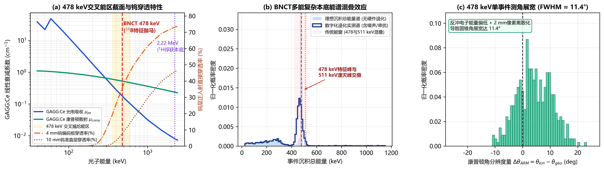
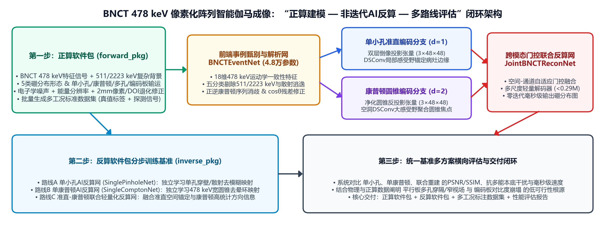
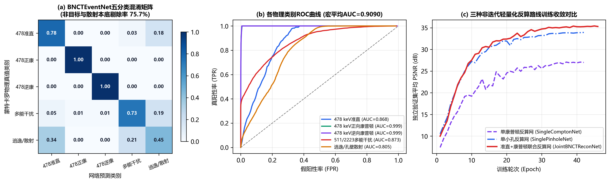
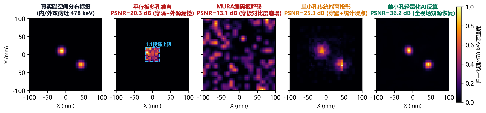
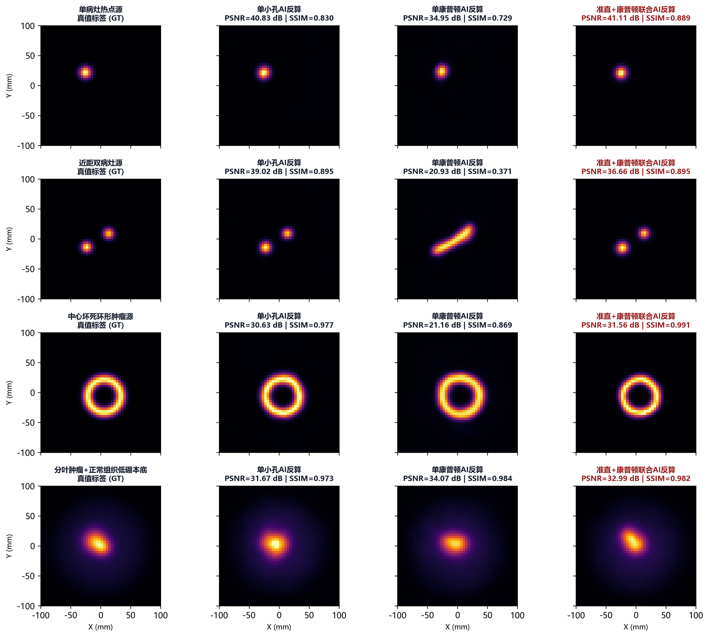
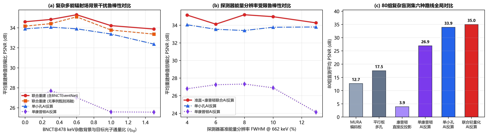

# 四川大学大学生创新训练计划 · 创新类项目申报书

- **项目名称**：智能伽马成像算法研究（课题编号：`12475312`，2027 批次）
- **项目属性**：高水平课题子计划（依托国家自然科学基金项目：基于中子伽马多模成像的BNCT硼浓度和剂量分布监测研究）
- **申请类别**：工程技术类 | **一级学科代码**：0822 核工程类 | **重点支持领域**：E.人工智能
- **指导教师**：韩纪锋 研究员（四川大学原子核科学技术研究所 / 720所，辐射物理及技术教育部重点实验室主任）
- **项目起止年月**：2026年11月至2027年10月 | **申请经费**：5000 元

---

## 项目摘要（195 字 / 限 200 字以内）

硼中子俘获治疗（BNCT）可通过对478 keV特征伽马成像间接监测体内硼分布。该能量处于准直易穿壁散射、康普顿测角误差偏大的交叉区，且伴随多能量本底与探测噪声干扰。本项目假定：引入神经网络开展事例甄别并融合单小孔空间投影与康普顿散射角信息，可克服单一模式瓶颈。拟构建贴近真实响应的正算软件包，研发非迭代轻量化AI反算软件包并对比单小孔、单康普顿与联合重建，支撑BNCT硼分布快速准确反演。

## 简表特色创新点（96 字 / 限 100 字以内）

1.建立含多能本底与噪声分辨率修正的BNCT 478 keV正算工具链；2.设计耦合事例甄别与散射角解析的非迭代轻量化反算网络；3.融合单小孔投影与康普顿信息，克服478 keV交叉能区局限。

---

## 报告正文：立项依据与研究内容（建议 8000 字以内，不含文献）

### 1．项目的立项依据

**（1）研究背景与实际应用需求**
硼中子俘获治疗（BNCT）是一种针对恶性脑胶质瘤、复发性头颈部肿瘤等难治性肿瘤的二元靶向放射治疗技术。治疗过程中，富集于肿瘤细胞内的 ^{10}B 原子核俘获热中子或超热中子发生 ^{10}B(n,α)^{7}Li* 核反应，释放高线性能量传递（LET）的 α 粒子与 ^{7}Li 反冲核杀伤肿瘤细胞；其中约 93.7% 的反应分支处于激发态，会在极短时间内退激并发射一颗能量为 477.6 keV（通常统称 478 keV）的瞬发特征伽马射线[1,2]。由于 α 与 ^{7}Li 射程仅约一个细胞直径（5～9 μm），无法穿透人体用于体外直接探测，因此在照射过程中对穿透力较强的 478 keV 特征伽马射线开展体外空间成像，是实时反映靶区与周围正常组织硼空间分布、支撑在线剂量监测的核心物理手段。
然而，围绕 478 keV 特征伽马射线开展高精度、快响应空间成像面临突出的物理矛盾。一方面，478 keV 正好落入传统伽马成像体制的“交叉尴尬能区”：对于机械准直成像而言，478 keV 光子在钨合金中的平均自由程接近 4 mm，相比核医学常规低能核素（如 ^{99m}Tc 的 140 keV）穿透能力显著增强，准直孔边缘极易发生穿壁效应与孔壁小角康普顿散射，导致投影图像对比度下降与边缘弥散[3,4]；而对于电子准直康普顿散射成像而言，478 keV 的入射光子能量又偏低，在散射层探测器内发生中等角度散射时传递给反冲电子的沉积能量往往仅有几十至一百余 keV，极易受闪烁体光统计涨落、电子学读出噪声、束缚电子多普勒展宽以及毫米级像素尺寸离散化的共同制约，导致散射角反算误差偏大、反投影圆锥面显著变宽[5,6]。另一方面，BNCT 实际治疗室辐射场并非纯净的单一 478 keV 伽马源，人体软组织和水模中大量氢核发生 ^{1}H(n,γ)^{2}H 反应会产生高通量的 2.223 MeV 强穿透伽马射线，结构材料与屏蔽体中还会伴生大量 511 keV 正电子湮灭光子及宽能谱连续散射本底[1]。在常规闪烁体像素探测器（478 keV 处能量分辨率约 8%～9%）上，511 keV 湮灭峰与 478 keV 特征峰发生部分交叠，2.223 MeV 光子在探测器及准直器上的多次散射康普顿坪区亦直接覆盖 478 keV 能窗。若缺乏针对性的物理建模、事例筛选与多信息融合机制，硼空间分布反演的可靠性将大幅降低。

**（2）国内外研究现状与发展动态分析**
针对机械准直与康普顿散射各自的能段局限，国内外学者近年来围绕像素化阵列探测器（如 GAGG:Ce 闪烁体耦合 SiPM 阵列或室温 CZT 半导体阵列）开展了深入探索。在硬件体制与准直方式选择上，早稻田大学 Omata 与 Kataoka 等人探讨了利用双层像素化 GAGG:Ce 阵列构建主动针孔与康普顿复合相机的方案[7]；中国科学院高能物理研究所孔令钦等人研制了基于 GAGG:Ce-MPPC 阵列的双模探测系统[8]；清华大学邱宇航等人近期进一步探讨了远场康普顿信息引导的混合伽马重建思路[9]。但需要指出的是，上述研究大多面向核安保宽能段单点放射源搜寻（如 60 keV 与 662 keV 分段独立处理），针对 BNCT 478 keV 这一特定交叉能区下“单小孔准直、单康普顿散射与准直-康普顿联合重建”在统一像素化探测器基准上的定量优劣边界，以及为何平行板多孔准直器与编码孔径板在该复杂辐射场下效果不佳乃至不可行，目前仍缺乏系统的正反算对比研究。例如四川大学核工程团队朱巴邻等人的研究表明，编码掩模厚度增加虽能减少穿透，但会引发严重的孔壁自遮挡视场暗角，而减薄掩模在数百 keV 能区又会因遮挡对比度崩塌导致周期互相关解码出现大面积伪影[4]。
在探测响应建模与图像反演算法方面，传统研究普遍依赖 Geant4 或 GATE 开展蒙特卡罗模拟[10,11]，后端图像重建则长期采用极大似然期望最大化（LM-MLEM）等统计迭代算法。传统迭代算法不仅单帧计算需要遍历海量事件与空间体素迭代数十轮、耗时达秒级至分钟级，而且在 BNCT 高本底低信噪比条件下容易放大泊松统计噪声。近年来，深度学习方法逐步引入辐射探测信号解析与直接图像重建领域：指导教师韩纪锋研究员课题组前期已在闪烁探测器退化脉冲实时修正[12]及中子-伽马混合辐射场粒子能量同步解析[13]方面积累了扎实基础；马里兰大学 Barajas 等人[14]与东京大学/群马大学 Qiu 等人[1]证实了利用轻量神经网络在重建前开展瞬发伽马事例甄别与散射序列恢复可大幅抑制杂散本底；Sato 等人提出的 ComptonNet[15]与 Didonna 等人的卷积紧框架网络[2]则验证了摒弃传统迭代、由神经网络直接学习“探测信号→源空间分布”逆映射的可行性。
**（3）本研究的科学意义与切入点**
综上所述，现有非迭代神经网络伽马重建工作多局限于单一康普顿模式或理想纯净单能放射源假设，尚未充分结合 BNCT 实际多能量本底、真实像素阵列噪声/分辨率退化以及准直投影与康普顿散射角信息的互补融合。本项目依托指导教师承担的国家自然科学基金 BNCT 多模成像课题，立足像素化阵列探测器，构建贴近真实探测场景的蒙特卡罗**正算软件包**，并完全舍弃传统慢速迭代算法，设计融合光子事例甄别、能量/位置解析与双通道特征联合反演的轻量化神经网络**反算软件包**，在统一基准下系统阐明单小孔、单康普顿、联合重建以及平行板多孔、编码板的物理与算法边界，为 BNCT 硼浓度分布快速监测提供可靠的算法工具支撑。

#### 主要参考文献（15 篇）

[1] Qiu J, Sakai M, Zhang C, et al. Improving Compton imaging of 478 keV prompt gamma-ray in boron neutron capture therapy with neural network-based event filtering[J]. Physics in Medicine & Biology, 2026. DOI: 10.1088/1361-6560/ae74ae.
[2] Didonna A, Ramos Lopez D, Iaselli G, et al. Deep Convolutional Framelets for Dose Reconstruction in Boron Neutron Capture Therapy with Compton Camera Detector[J]. Cancers, 2025, 17(1): 130. DOI: 10.3390/cancers17010130.
[3] van der Have F, Beekman F J. Photon penetration and scatter in micro-pinhole imaging: a Monte Carlo investigation[J]. Physics in Medicine and Biology, 2004, 49(8): 1369-1386. DOI: 10.1088/0031-9155/49/8/001.
[4] Zhu B, Wang Z, Zheng Z, Zhou R, Yang C. Impact of mask thickness on the imaging performance of the coded-aperture gamma camera[J]. Journal of Instrumentation, 2022, 17(05): T05019. DOI: 10.1088/1748-0221/17/05/t05019.
[5] Singh M. An electronically collimated gamma camera for single photon emission computed tomography. Part I[J]. Medical Physics, 1983, 10(4): 421-427. DOI: 10.1118/1.595313.
[6] Uche C Z, Cree M J, Round W H. GEANT4 simulation of the effects of Doppler energy broadening in Compton imaging[J]. Australasian Physical & Engineering Sciences in Medicine, 2011, 34(2): 235-242. DOI: 10.1007/s13246-011-0076-2.
[7] Omata A, Kataoka J, Fujieda K, et al. Performance demonstration of a hybrid Compton camera with an active pinhole for wide-band X-ray and gamma-ray imaging[J]. Scientific Reports, 2020, 10: 14064. DOI: 10.1038/s41598-020-71019-5.
[8] Kong L, Shuai L, Liang X, et al. A hybrid coded-aperture and Compton camera based on cerium-doped Gd3Al2Ga3O12 scintillators coupled with multi-pixel photon counter arrays[J]. Review of Scientific Instruments, 2022, 93(9): 093102. DOI: 10.1063/5.0097257.
[9] Qiu Y, Wang G, Dai T, Wei Q. Far-field information-driven hierarchical hybrid coded-aperture and Compton gamma-ray imaging[J]. Radiation Measurements, 2026: 107746. DOI: 10.1016/j.radmeas.2026.107746.
[10] Agostinelli S, Allison J, Amako K, et al. Geant4—a simulation toolkit[J]. Nuclear Instruments and Methods in Physics Research Section A, 2003, 506(3): 250-303. DOI: 10.1016/S0168-9002(03)01368-8.
[11] Jan S, Santin G, Strul D, et al. GATE: a simulation toolkit for PET and SPECT[J]. Physics in Medicine and Biology, 2004, 49(19): 4543-4561. DOI: 10.1088/0031-9155/49/19/007.
[12] Du S, Wang J, Zuo J, Han J, Liang Y, Yang C. FPGA implementation and hardware-in-the-loop validation of a deconvolution-based pile-up correction method for NaI(Tl) detectors[J]. Journal of Instrumentation, 2026, 21(09): P09026. DOI: 10.1088/1748-0221/21/09/p09026.
[13] Song R, Yan X, Han J, et al. Simultaneous Detection of Energy and Flux for Neutron and Gamma by CLYC Scintillator[J]. IEEE Transactions on Nuclear Science, 2023, 70(8): 2138-2145. DOI: 10.1109/tns.2023.3289945.
[14] Barajas C A, Polf J C, Gobbert M K. Deep residual fully connected neural network classification of Compton camera based prompt gamma imaging for proton radiotherapy[J]. Frontiers in Physics, 2023, 11: 903929. DOI: 10.3389/fphy.2023.903929.
[15] Sato S, Tanaka K S, Kataoka J. ComptonNet: A direct reconstruction model for Compton camera[J]. Applied Physics Letters, 2024, 125(2): 023505. DOI: 10.1063/5.0213950.

### 2．项目拟解决的关键科学问题，研究内容、总体框架、重点难点、主要目标

**（1）拟解决的关键科学问题**
1）**478 keV 交叉能区及多能干扰场下像素化探测器真实退化响应的正算表征问题**：如何定量刻画钨准直结构刀口穿壁、孔壁小角散射、束缚电子多普勒展宽与 2.223 MeV / 511 keV 非目标射线本底，并将电子学噪声、能量分辨率展宽、毫米级像素离散化及晶体厚度方向作用深度（DOI）模糊准确耦合至正算数据生成过程，缩小仿真训练集与实际探测信号之间的偏差。
2）**非纯净能谱与有限分辨率条件下光子作用事例甄别及运动学信息解析机制**：当 478 keV 全能峰与 511 keV 湮灭峰部分重叠、且混有大量逃逸和散射伪事例时，单纯依靠传统固定能量窗截取会引入严重本底。如何利用多维作用位置跨度与康普顿运动学自洽关系，通过轻量级网络准确分离有效 478 keV 准直事例与正逆序康普顿事例，并抑制散射角计算偏差。
3）**非迭代轻量化神经网络中准直投影空间锚定与康普顿散射角圆锥信息的融合泛化机制**：在完全摒弃传统统计迭代后，如何针对局部锐利但统计计数偏低的单小孔投影特征，以及计数充足但圆锥面较宽的康普顿散射特征，设计感受野匹配且参数紧凑的双分支融合网络，保证不同源位置、不同硼分布形状下的跨工况泛化精度。
**（2）主要研究内容与总体框架**
本项目严格遵循“**物理建模生成数据（正算打底）→ AI 学习逆向映射（反算攻坚）→ 多路线横向对比验证（探索闭环）**”的总体研究框架（见图 2），具体包含三方面研究内容：
第一，**BNCT 复杂辐射场与像素化阵列成像正算工具链构建**。基于蒙特卡罗程序构建双层像素化 GAGG:Ce 闪烁体阵列与前端钨准直结构模型，模拟 478 keV 特征信号及 2.223 MeV 氢俘获伽马、511 keV 湮灭光子等复杂背景输运；加入电子学基线噪声、平方根能量分辨率展宽、光学串扰及像素中心离散化修正；改变硼分布位置与几何形状（单热点、近距双病灶、管状源、环形肿瘤源及含正常组织低硼底色的分叶源），批量生成覆盖单小孔、单康普顿、联合模式以及平行板多孔、编码板对照模式的多工况标注数据集（或正算快速代理模块），封装为独立可用的**正算软件包**。
第二，**摒弃传统迭代的分步与联合轻量化 AI 反算网络设计**。不采用传统慢速迭代算法，先在统一基准下分别构建并训练**单小孔反算网络（SinglePinholeNet）**与**单康普顿反算网络（SingleComptonNet）**，打通“探测信号→源空间分布”的基础非迭代映射；进而引入前端光子事例甄别与运动学解析网络（BNCTEventNet），清洗非目标能量干扰并恢复散射先后顺序，结合非对称感受野双分支编码与跨模态门控模块训练**准直-康普顿联合轻量化重建网络（JointBNCTReconNet）**，封装为可直接输入探测数据并毫秒级输出硼空间分布的**反算软件包**。
第三，**多成像方案横向对比评估与多孔/编码板局限性机理阐释**。在独立多工况盲测集及指导教师提供的实验参考基准上，定量对比单小孔、单康普顿与联合重建在含强本底干扰、低计数和受限能量分辨率下的成像精度与速度；同时结合物理推导与正算模拟数据，客观阐明平行板多孔准直器因穿隔透射和 1:1 视场截断而效果欠佳、编码孔径板因穿板遮挡对比度不足与厚孔斜射暗角而可行性过低的内在原因。

**（3）重点与难点剖析**
本项目的重点在于高质量多工况正算数据集构建以及准直与康普顿双通道信息的有效融合；主要研究难点集中在四个方面：① **478 keV 交叉能区固有物理瓶颈**，准直穿壁散射与康普顿低能反冲电子测角模糊并存，单一探测体制难以兼顾空间分辨与统计效率；② **BNCT 非单一能量杂散射线干扰强**，511 keV 与 2.223 MeV 散射坪区直接污染目标能窗，对前端事例甄别纯度要求高；③ **真实探测器数字化退化耦合复杂**，噪声、能量模糊与像素网格量化共同导致康普顿圆锥失真；④ **非迭代神经网络的轻量化与跨形态泛化平衡**，需在亚百万参数规模下同时准确恢复孤立小病灶与连续扩展肿瘤轮廓，避免过拟合。
**（4）主要研究目标与交付成果**
项目最终目标是交付结构规范的**正算软件包**、**反算软件包**、覆盖多源形状与复杂本底的**多工况仿真标注数据集**以及系统的**《智能伽马成像多路线对比性能评估报告》**（表 1），实现总参数量小于 0.5 M、桌面 CPU 单帧重建耗时小于 30 ms、复杂本底下联合重建精度显著优于单小孔与单康普顿基准。

### 3．拟采取的研究方案及可行性分析

**（1）具体研究方法与技术路线**
1）**蒙特卡罗正算建模与五级探测响应数字化修正方案**：以双层 20×20 像素化 GAGG:Ce 闪烁体阵列（像素节距 2.0 mm，前层厚 5.0 mm，后层厚 14.0 mm，层间距 24.0 mm）为基准探测器，前端距散射层 36 mm 处配置厚 12.0 mm、中心孔径 2.6 mm 的钨合金双圆锥刀口单小孔准直器（联合模式下结合外围双层符合散射环同步采集康普顿符合事件）。调用低能电磁物理过程模拟光电效应、含束缚电子多普勒展宽的康普顿散射及孔壁小角散射；随后在理想交互记录上依次施加光学串扰（~2.8%）、能量高斯展宽（基准 7.0% @ 662 keV，对应 478 keV 处约 8.3%）叠加电子学噪声（σ≈4.5 keV）、2.0 mm 像素中心坐标离散化与层厚中心 DOI 量化，以及 20 keV 电子学触发阈值截断，形成标准事件流与投影网格数据。
2）**前端光子事例甄别与信息解析方案（BNCTEventNet）**：针对每个触发事件提取 18 维物理与运动学特征，包括三维离散坐标、单双点沉积能量、总能量相对 478 keV 与 511 keV 偏离度、正逆散射顺序假设下的康普顿余弦值 cosθ_{A→B} / cosθ_{B→A} 以及固定 478 keV 先验能量自洽残差。采用包含两层残差块的轻量级多层感知机（参数量约 4.8 万）输出五分类概率（有效 478 keV 准直、正向 478 keV 康普顿、逆向反跳 478 keV 康普顿、511/2223 keV 多能干扰、逃逸/孔壁散射本底），并并联余弦残差微调分支修正低能反冲电子测角偏差。
3）**分步与跨模态联合轻量化反算网络设计方案**：在进入卷积网络前，先利用无参数针孔几何倒像算子与多线程矢量化圆锥投影算子将离散事件流映射至统一的 48×48 目标平面网格，嵌入精确几何先验。单小孔反算网（SinglePinholeNet）采用常规局部感受野（膨胀率 d=1）深度可分离卷积残差 U-Net 消除穿壁晕边；单康普顿反算网（SingleComptonNet）采用空洞深度可分离卷积（d=2）扩大感受野以剥离宽圆锥重叠伪影；联合重建网（JointBNCTReconNet，参数量约 23.9 万）并行配置上述非对称双编码器，在三个尺度上通过空间-通道自适应门控模块动态融合准直高频边缘锚定信息与康普顿高统计方向约束，采用靶区加权 L1、均方误差与空间梯度联合损失函数配合四方向旋转等变增强完成端到端训练。
**（2）前期预实验验证结果与准直方案机理分析**
为提前检验上述正反算技术路线的有效性，申请团队在立项准备阶段已编写完成初版 Python 正算软件包（forward_pkg）与 PyTorch 反算软件包（inverse_pkg），生成了 420 组训练样本、60 组验证样本及 **80 组独立复杂工况盲测样本**（混合 2.223 MeV、511 keV 及散射本底，非目标光子比 η_{bg}=0.45～0.90），完成了全流程预实验跑通验证。

预实验定量结果（图 1、图 4、图 5 及表 2）清晰印证了前期物理判断：① **平行板多孔与编码板局限性得到定量证实**（图 4）：在 80 组盲测集上，MURA 编码板解码平均 PSNR 仅为 12.67 dB（SSIM 近乎为 0），原因在于 478 keV 与 2.223 MeV 光子大量穿透钨闭孔导致阴影对比度严重不足，叠加厚孔斜射暗角后互相关解码将背景涨落放大为全图伪影；平行板多孔准直平均 PSNR 仅为 17.51 dB，不仅 0.65 mm 薄钨隔片穿隔模糊严重，而且 1:1 投影使有效视场被截断在 40×40 mm 探测器范围内，直接漏检外侧病灶。② **前端事例甄别显著净化输入信号**：BNCTEventNet 宏平均 ROC-AUC 达 0.9090，正逆康普顿散射序列分辨准确率接近 100%，有效滤除了绝大部分非 478 keV 杂散干扰。③ **联合轻量化反算全面优于单一模式**（图 5、表 2）：全链路总参数量仅 **28.7 万（1.10 MB）**，桌面 CPU 单帧反算仅需 **21.70 ms**；80 组盲测集平均 PSNR 达 **35.00 dB**（SSIM 达 **0.9489**），较单康普顿 AI 反算（26.94 dB）大幅提升 **+8.06 dB**（在近距双病灶子集上提升达 +13.68 dB），较单小孔 AI 反算（33.93 dB）进一步提升 **+1.07 dB**（RMSE 降低 11.4%，双病灶子集提升 +2.86 dB），且在 η_{bg}=1.5 强背景干扰与 13% 劣化能量分辨率下依然稳定维持在 33.8 dB 以上。
**（3）可行性分析与年度实施计划（2026年11月—2027年10月）**
1）**理论与前期基础可行**：单小孔空间位置锚定与康普顿高几何效率在 478 keV 能区物理互补性强；团队已完成初版正反算双软件包闭环预实验，排除了核心算法路线风险。2）**平台与导师指导可行**：项目直接依托指导教师主持的国家自然科学基金 BNCT 多模成像课题及辐射物理及技术教育部重点实验室的高性能计算与闪烁体探测实验条件，可获得实验参考数据对照验证。3）**进度安排清晰可控**：① **2026.11–2027.02**：结合 C++ Geant4 深化正算物理细节（补充钨特征荧光与水模散射），扩充多工况标准数据集并完善正算软件包；② **2027.03–2027.06**：优化 BNCTEventNet 与三套轻量化反算网络架构及跨距离/跨活度泛化训练，完成中期检查；③ **2027.07–2027.09**：结合课题组实验对照数据开展系统横向测试与模型轻量化导出，定稿反算软件包；④ **2027.10**：完成《性能评估报告》、代码数据集开源归档及论文/软著整理，参加结题验收。

### 4．本项目的特色与创新点

**1. 面向 BNCT 478 keV 交叉能区与非纯净辐射场的高保真正算—反算双软件包闭环设计**：紧扣临床 BNCT 实际存在的 2.223 MeV 氢俘获伽马、511 keV 湮灭光子干扰及像素化探测器电子学噪声、能量与位置分辨率退化效应，构建参数透明可调的正算软件包，并结合统一模拟数据从物理与解码机制上定量阐明平行板多孔与编码板在该能区受限的原因，使算法研发建立在真实可靠的物理基准之上。
**2. 耦合 478 keV 运动学自洽判据的微秒级事例甄别与散射角信息解析机制**：针对 478 keV 与 511 keV 能峰交叠及孔壁散射、逃逸本底混杂难题，提出基于 18 维位置-能量-余弦自洽特征的轻量级残差甄别与角度修正前端网络（BNCTEventNet，仅 4.8 万参数），在替代传统固定能窗抑制多能干扰的同时完成正逆康普顿散射序列恢复与散射角余弦微调。
**3. 完全摒弃传统统计迭代的准直投影—康普顿散射非对称感受野轻量化联合反算架构**：通过无参数物理投影算子嵌入几何先验，利用常规局部感受野分支提取单小孔锐利边界、利用空洞卷积大感受野分支聚合康普顿散射圆锥交点，经跨模态空间-通道门控实现互补融合，在仅 28.7 万总参数（1.10 MB）规模下实现约 22 ms 单帧快速高精度硼分布重建。

---

## 研究基础与工作条件

### 1．项目负责人研究基础（279 字 / 限 300 字以内）
项目负责人及核心成员具备扎实的核辐射探测物理基础、蒙特卡罗仿真经验与Python/PyTorch深度学习编程能力。前期围绕本项目开展了充分准备：系统梳理了BNCT 478 keV瞬发伽马成像与双模探测相关文献；独立搭建了包含GAGG:Ce截面输运、多能复杂背景抽样及噪声/能量/位置分辨率修正的初版正算软件包（forward_pkg），以及涵盖事例甄别网、单小孔反算网、单康普顿反算网与联合重建网的初版反算软件包（inverse_pkg），在80组盲测集上跑通了五种路线定量对比预实验并搭建了交互可视化测试界面，为项目按期高质量完成奠定了直接代码与实验基础。

### 2．指导教师研究基础（273 字 / 限 300 字以内）
指导教师韩纪锋为四川大学原子核科学技术研究所（720所）研究员、副所长，辐射物理及技术教育部重点实验室主任，长期从事新型位置灵敏辐射探测器研制、Geant4复杂辐射场蒙特卡罗模拟及核电子学智能信号处理研究。主持国家自然科学基金项目“基于中子伽马多模成像的BNCT硼浓度和剂量分布监测研究”（本项目直接依托课题）及国家重点研发计划课题等多项国家级项目，近期在闪烁探测器退化脉冲反卷积FPGA实时验证（JINST, 2026）与混合场中子-伽马能谱同步解析（IEEE TNS, 2023）等方向取得系列成果，可为本项目提供深入物理指导与实验对照参考。

### 3．工作条件（179 字 / 限 200 字以内）
本项目依托辐射物理及技术教育部重点实验室与四川大学原子核科学技术研究所（720所）开展。实验室具备完善的多核高性能计算工作站、Geant4/ROOT蒙特卡罗仿真软件环境及深度学习训练算力，可充分支撑多工况大规模正算模拟与神经网络训练；同时拥有像素化闪烁体/SiPM阵列探测器、多道电子学读出系统及标准伽马放射源实验测试平台，完全具备项目所需的软硬件研究条件。
